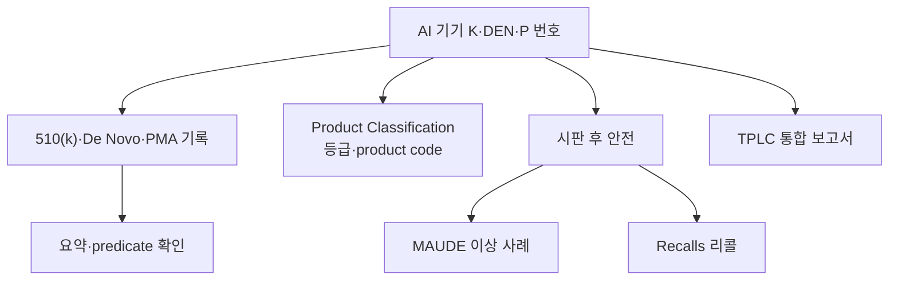

# FDA 기기 데이터베이스

> FDA가 공개하는 의료기기 조회 시스템 모음. 510(k)·De Novo·PMA 허가 기록뿐 아니라 분류, 이상 사례(MAUDE), 리콜, 등록·목록, UDI까지 찾아볼 수 있어 AI 기기의 근거를 확인하는 기본 도구다.

## 쉽게 말하면
자동차의 등록증, 정기검사 기록, 리콜 이력, 사고 신고가 각각 다른 창구에 있듯이, 의료기기도 허가 기록·사고 신고·리콜이 서로 다른 DB에 있다. 한 기기를 제대로 알려면 여러 창구를 함께 본다.

## 자세히
출처: FDA "Medical Device Databases" 페이지(열어서 읽음).
- **허가 기록**: **510(k)**(번호·신청자·기기명·product code 검색, 최근 기록에는 안전·효과 요약 포함), **De Novo**(신규 저·중위험 기기 분류 명령), **PMA**(Class III 승인). **Devices@FDA**는 510(k)와 PMA 기록을 묶어 요약·제조사·사용 설명서를 보여 준다.
- **분류**: **Product Classification**에서 기기명, 세 글자 product code, 등급을 찾는다.
- **시판 후 안전**: **MAUDE**(기기 이상 사례 보고), **MedSun**(임상 현장과 연계된 보고 네트워크), **Recalls**(2002-11 이후 분류된 리콜), **522 Postmarket Surveillance Studies**, **Post-Approval Studies**.
- **통합 조회**: **TPLC**(Total Product Life Cycle)는 기기명·product code별로 허가·이상 사례·리콜을 한 보고서로 묶는다.
- **식별**: **Registration & Listing**(등록된 시설과 목록 기기), **AccessGUDID**(UDI 기기 식별 정보), **Recognized Consensus Standards**(FDA가 인정하는 표준).
- **더 이상 갱신되지 않는 것**: MDR(1992~1996), 자문위 회의 자료(2008년까지), X선 조립자 자료는 갱신 중단으로 표시.
- **AI 기기 조사에서의 쓰임(해설)**: FDA AI 기기 목록의 K·DEN·P 번호를 이 DB에서 열어 요약·predicate·이상 사례·리콜을 대조한다. 이상 사례 DB는 보고 의존이라 과소 보고 한계가 있다는 점은 별도 확인이 필요하다.

## 그림으로 보기

## 예시
- 병원 AI 도입 검토: 후보 기기의 K번호를 510(k) DB에서 열어 용도·predicate를 보고, TPLC로 같은 product code의 이상 사례·리콜을 훑는다.
- 교육 실습: product code 하나로 최근 3년 허가 건수와 리콜 건수를 표로 정리.

## 헷갈리는 것과 비교
| 개념 | 차이 |
|---|---|
| [FDA AI 기기 목록](#fda-ai-enabled-device-list) | AI 용어로 모은 별도 명단, 세부는 이 DB 기록으로 이어짐 |
| MAUDE | 이상 사례 보고, 허가 DB와 다른 목적 |
| TPLC | 여러 DB를 기기 단위로 묶어 보여 줌 |
| [분류 규정](#classification-regulation) | 등급·특별 통제를 적은 규정 |

## 더 읽을거리
- [Medical Device Databases (FDA)](https://www.fda.gov/medical-devices/device-advice-comprehensive-regulatory-assistance/medical-device-databases) — DB 목록과 용도(열어서 확인)
