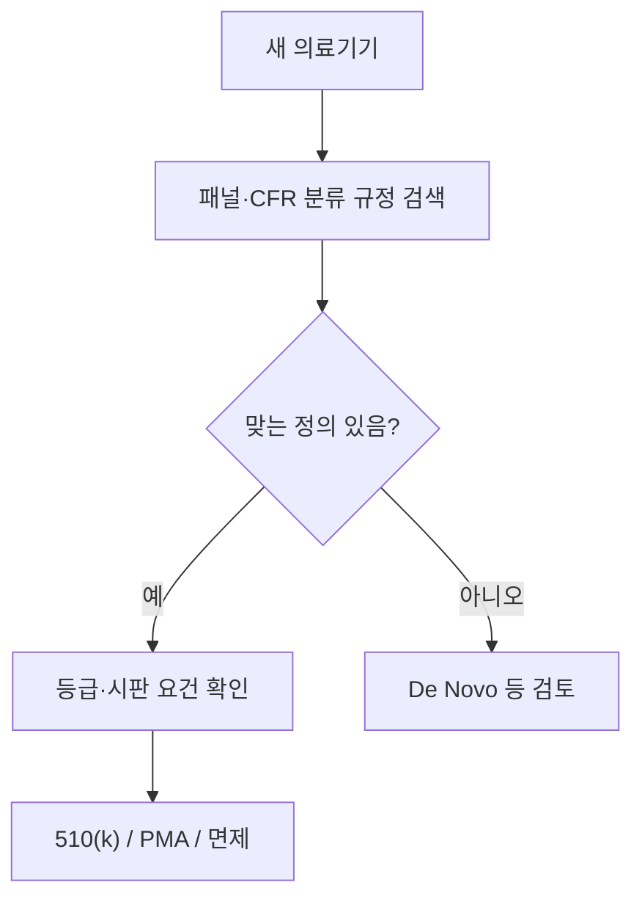

# FDA 심사 패널

> FDA가 의료기기를 전문 분야별로 나눈 분류 체계. 21 CFR 862~892에 분과별 기기 정의가 있고, AI 기기 목록의 "분야" 열도 이 패널명을 쓴다.

## 쉽게 말하면
도서관의 십진분류처럼 의료기기를 "심혈관", "영상의학", "신경" 같은 서가에 꽂아 두는 체계다. 새 기기는 자기 서가에서 가장 비슷한 설명을 찾아 등급과 허가 경로를 확인한다.

## 자세히
출처: FDA 기기 분류 패널 페이지(2026-11-15 확인).
- **구성**: 16개 패널에 19개 전문 분야 항목이 있고 21 CFR 862~892에 해당한다.
  - 화학·독성학(862), 혈액학·병리(864), 면역·미생물(866), 마취(868), 심혈관(870), 치과(872), 이비인후(874), 소화기·비뇨(876), 일반·성형외과(878), 일반 병원(880), 신경(882), 산부인과(884), 안과(886), 정형외과(888), 물리의학(890), **영상의학(892)**.
- **사용법**: 대부분 CFR에서 맞는 기기 설명을 찾는다. 각 항목에 의도 용도, 등급(I·II·III), 시판 요건이 있다. 기기는 862~892의 분류 규정 정의에 부합해야 한다.
- **다음 단계**: 사전 통지가 필요하면 510(k), III류로 사전 승인이 필요하면 PMA. I류와 일부 II류는 분류 규정에 따라 510(k) 면제일 수 있으나 등록·표시·제조 관리 같은 일반 통제는 적용된다.
- 제품 코드 부여 방식은 이 페이지에 설명이 없고 제품 코드 분류 데이터베이스로 연결될 뿐이다.
- **AI와의 관계**: [FDA AI 기기 목록](#fda-ai-enabled-device-list)에서 영상의학이 압도적으로 많은 것을 패널 분류로 확인할 수 있다. 영상의학 AI가 많은 이유 설명은 [영상의학 AI 비중](#radiology-ai-dominance) 참고.

## 그림으로 보기

## 예시
- 폐결절 탐지 AI → 영상의학 패널(21 CFR 892)에서 유사 소프트웨어 항목을 찾고 등급·경로 확인.
- 부정맥 판독 AI → 심혈관 패널(870).

## 헷갈리는 것과 비교
| 개념 | 차이 |
|---|---|
| 패널(분야) | 기기 종류별 분류 |
| [등급 I~III](#device-risk-classes) | 위험도 분류 |
| 자문 패널 회의 | 외부 전문가가 모이는 FDA 회의(다른 의미, 이 글 범위 밖) |

## 더 읽을거리
- [FDA: Device Classification Panels](https://www.fda.gov/medical-devices/classify-your-medical-device/device-classification-panels) — 패널과 CFR 파트 목록
