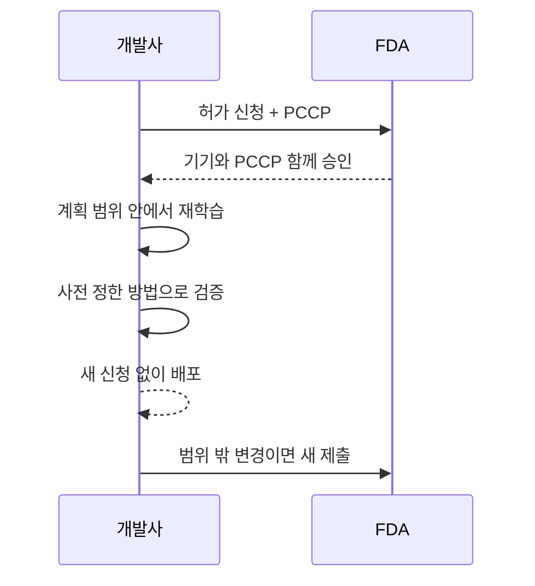

# PCCP 사전 변경 관리 계획

> 허가 후 AI 모델을 재학습·수정할 때마다 새로 허가받지 않도록, 변경 범위·방법·검증을 미리 계획서로 승인받는 FDA 구조(PCCP, Predetermined Change Control Plan).

## 쉽게 말하면
자동차를 개조할 때마다 검사를 다시 받으면 번거롭다. 그래서 "엔진 출력은 이 범위에서 이런 절차로 조정한다"를 미리 승인받으면 그 범위 안의 개조는 재검사 없이 한다.

## 자세히
- 법적 근거는 FD&C Act 515C조. 승인된 PCCP 범위 안의 변경은 새 510(k)·De Novo 보완·PMA 보완 없이 할 수 있다(기기가 안전하고 효과적이며, 510(k)는 실질적 동등성 유지).
- 계획서에는 계획된 변경 목록과 **수정 프로토콜**: 데이터 관리, 재학습 방식, 성능 평가, 업데이트 절차가 들어간다.
- 마케팅 신청과 함께 제출·심사된다. 범위를 벗어나면 일반 절차를 따른다.
- AI 전용 PCCP 최종 가이드 날짜는 자료마다 다르다(2024년 12월 vs 2025년 8월 18일 개정 표기) → FDA 공식 페이지 확인.
- 사례: 한 리뷰는 PCCP 보유 AI 기기 중 510(k) 24건·De Novo 2건. PMA는 법적으로 가능하나 사례가 불확실.
- 의미: 모델 드리프트나 새 데이터에 대응해 개선하되, 안전장치(성능 하한)를 사전에 합의.

## 그림으로 보기

## 예시
- 영상 분류 AI: "새 병원 데이터로 재학습, 민감도 하한 90% 유지"를 PCCP에 적어 승인받고, 이후 분기마다 갱신 배포.
- 범위를 벗어나는 새 용도(다른 장기 판독)는 PCCP로 처리 못 함.

## 헷갈리는 것과 비교
| 개념 | 차이 |
| --- | --- |
| [510(k)·De Novo·PMA](#fda-510k-de-novo-pma) | 최초 허가 경로, PCCP는 허가 후 변경의 틀 |
| 일반 변경 신청 | 변경마다 새 제출 |
| [SaMD](#samd) | 규제 대상 소프트웨어 정의 |

## 더 읽을거리
- [IntuitionLabs: FDA PCCP Guide](https://intuitionlabs.ai/articles/fda-pccp-implementation-guide-ai-ml-samd) — 구조와 사례(업체 블로그)
- [medRxiv: Regulating Flexibility for AI — FDA Experience with PCCPs](https://www.medrxiv.org/content/10.1101/2025.08.26.25334477.full.pdf) — 실제 PCCP 사례 분석(프리프린트, 요약 확인)
