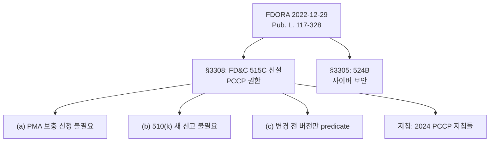

# FDORA

> Food and Drug Omnibus Reform Act of 2022. 2022-12-29 서명된 Consolidated Appropriations Act, 2023의 FF편에 들어 있는 식품의약품 개혁 조항 묶음. 의료기기에서는 AI 업데이트의 사전 승인(PCCP, 515C)과 사이버 보안(524B)을 법에 명문화했다. (법률 자문 아님)

## 쉽게 말하면
그동안 FDA는 "AI 업데이트를 미리 승인해 주겠다"를 지침으로만 약속했다. FDORA는 이를 법에 적어 FDA에 명시적 권한을 줬다. 법에 있어야 제조사가 계획을 믿고 업데이트할 수 있다.

## 자세히
출처: 21 U.S.C. 360e-4(Cornell LII, 열어서 읽음)와 검색 요약(524B).
- **시기**: 2022-12-29 서명, Pub. L. 117-328, FF편 III장. 515C는 §3308(a)로 신설(136 Stat. 5835). 기존 515C는 515B(21 U.S.C. 360e-3)로 번호가 바뀌었다.
- **515C(PCCP) 내용(조문 요지)**:
  - **(a) 승인된 기기(PMA)**: 승인된 PCCP와 일치하는 변경에는 보충 신청이 필요 없다. 변경 없이도 기기가 안전·효과적일 때만 FDA가 계획을 승인한다. 표시(라벨), 계획대로 작동하지 않을 때의 통지, 성능 요건을 요구할 수 있다.
  - **(b) 허가된 기기(510(k))**: 확립된 PCCP와 일치하는 변경에는 새 시판 전 신고가 필요 없다. 변경 없이도 안전·효과적이고 predicate와 "실질적 동등성이 유지"될 때만 계획을 허가한다.
  - **(c) predicate**: 실질적 동등성 판단에서 계획에 따라 변경된 버전을 predicate로 쓸 수 없고, **변경 전에 허가·승인된 버전만** 쓸 수 있다.
- **524B(사이버 보안)**: 검색 요약에 따르면 §3305가 신설. 인터넷 연결 능력이 있는 소프트웨어를 가진 "사이버 기기"의 시판 전 제출에 사이버 보안 준수 정보를 포함해야 하고, 524B(b)(2) 위반은 금지 행위가 된다. 원문은 열지 못했다.
- **지침과의 관계**: FDA는 이후 PCCP 지침(2024-08 초안, 2024-12 AI 기기 최종)을 냈다. 지침은 비구속, 법은 구속이다([변경 관리 계획 PCCP](#pccp)).
- 이 글은 515C 중심이며 FDORA의 다른 조항(약품·화장품·임상시험 다양성 등)은 다루지 않는다.

## 그림으로 보기

## 예시
- AI 영상 기기가 승인된 PCCP 범위 안에서 재학습 모델을 배포: 새 510(k) 없이 가능(515C(b)).
- 이후 다른 회사가 이 기기를 predicate로 삼을 때: 변경 후 버전이 아니라 변경 전 허가 버전만 인용 가능(515C(c)).

## 헷갈리는 것과 비교
| 개념 | 차이 |
|---|---|
| [FD&C Act 515C](#section-515c) | FDORA가 신설한 PCCP 조항 자체 |
| [변경 관리 계획(PCCP)](#pccp) | 제도의 실무 내용 |
| FDA 지침 | 비구속 권고, FDORA는 법률 |
| [predicate 사슬 문제](#predicate-creep) | 515C(c)는 변경 버전의 연쇄 인용을 일부 막음 |

## 더 읽을거리
- [21 U.S.C. 360e-4 (Cornell LII)](https://www.law.cornell.edu/uscode/text/21/360e-4) — 515C 조문과 제정 출처(열어서 확인)
- [FDA PCCP 해설 (Innolitics, 2024 초안 지침)](https://innolitics.com/articles/draft-fda-guidance-predetermined-change-control-plans-for-medical-devices/) — 검색 결과로만 확인
