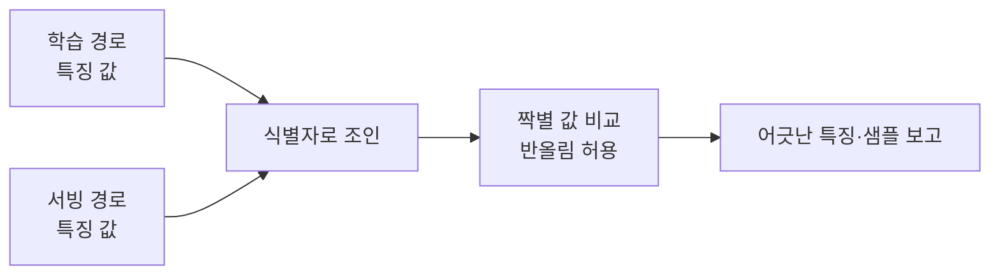
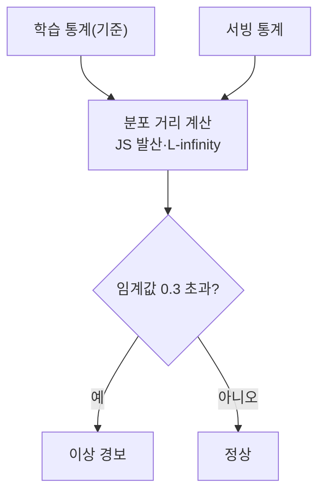

# 학습-서빙 특징 일관성 점검

> **같은 예시(같은 사용자·같은 시점)** 에 대해 학습 경로와 서빙 경로가 만든 특징 값을 짝지어 비교해, 값이 다르면(skew) 찾아내는 점검이다.

## 쉽게 말하면
같은 문제를 두 사람이 따로 계산했을 때 답이 같은지 맞춰 보는 것이다. 한 사람은 어제 밤 배치로, 한 사람은 실시간으로 "이 고객의 최근 30일 구매액"을 계산했는데 숫자가 다르면 둘 중 한쪽 계산법이 틀렸거나 시점이 다르다. 모델은 학습 때 본 숫자만 믿기 때문에 이 차이는 조용히 성능을 깎는다.

## 자세히
- **두 가지 비교 방식**
  1. **짝 비교(예시 단위)**: TensorFlow Data Validation(TFDV)의 `DetectFeatureSkew`(v1.16.1 문서, 직접 확인)는 학습·서빙 예시를 `identifier_features`(식별자)로 조인해 짝마다 특징을 비교한다. 옵션: `features_to_ignore`(제외), `sample_size`(어긋난 짝 샘플을 결과에 포함), `float_round_ndigits`(소수 자릿수를 반올림해 비교), `allow_duplicate_identifiers`(식별자 중복 허용, 같은 식별자 예시는 메모리에 다 들어가야 함). Apache Beam 파이프라인으로 돌리고 결과·샘플 짝을 TFRecord로 쓴다.
  2. **분포 비교(통계 단위)**: BigQuery `ML.TFDV_VALIDATE`의 `SKEW` 모드(직접 확인)는 학습 통계(기준)와 서빙 통계를 비교한다. 범주형은 L-infinity 거리(기본) 또는 Jensen-Shannon 발산, 숫자형은 Jensen-Shannon만 쓴다. 기본 임계값은 범주형·숫자형 모두 0.3이고 열별로 덮어쓸 수 있다(예: `feature1`은 0.2). 출력은 Anomalies 프로토콜 버퍼(JSON)이다.
- **어느 쪽을 쓰나**: 짝 비교는 "어느 예시가 왜 다른지"를 알려 주지만 두 경로의 로그에 공통 식별자가 있어야 한다. 분포 비교는 식별자 없이 싸게 돌지만 값이 서로 보완되는 오류(평균은 같고 개별값은 틀림)를 놓친다. 소수점·타임스탬프 경계 같은 허용 오차를 먼저 정한다.
- **흔한 원인(일반 원칙)**: 변환 코드가 두 벌, 결측 처리 기본값 차이, 시점 누수(학습엔 미래 정보), 범주 인코딩 사전 차이, 집계 창 경계 차이.
- **0.3은 출발점일 뿐**: 임계값은 도구 기본값이다. 특징별로 실제 성능 영향을 보며 조정한다.

## 그림으로 보기

## 예시
- 추천 모델: 어제 학습 데이터의 `purchase_30d`와 서빙 로그의 같은 사용자 값을 `user_id`+요청 시각으로 조인해, 소수 둘째 자리 반올림 후 불일치 비율을 매일 기록.
- 교육 소재: "같은 질문에 AI 두 경로가 다른 숫자를 쓰면?"을 엑셀 두 열 대조로 설명.

## 헷갈리는 것과 비교
| 개념 | 차이 |
|---|---|
| 학습-서빙 특징 일관성 점검 | 같은 예시의 두 경로 값을 대조 |
| [온라인·오프라인 특징 동등성](#online-offline-feature-parity) | 정의를 한 곳에서 재사용해 애초에 같게 만듦(예방) |
| [서빙 시점 특징 로깅](#log-serving-features) | 서빙 때 쓴 값을 기록해 skew를 피함 |

## 더 읽을거리
- [tfdv.DetectFeatureSkew (TensorFlow)](https://www.tensorflow.org/tfx/data_validation/api_docs/python/tfdv/DetectFeatureSkew) — 짝 비교 API와 옵션.
- [ML.TFDV_VALIDATE (BigQuery 문서)](https://docs.cloud.google.com/bigquery/docs/reference/standard-sql/bigqueryml-syntax-tfdv-validate) — 분포 비교, 지표·임계값.
