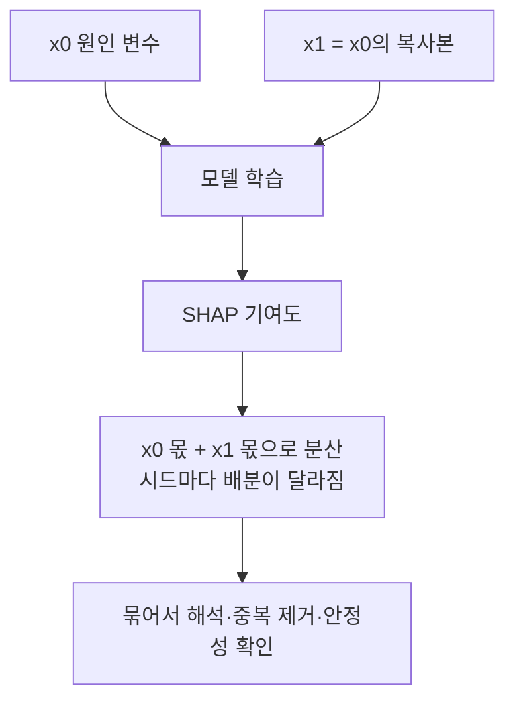

# 상관 변수와 SHAP

> 입력 변수들이 서로 강하게 상관돼 있으면, 같은 정보를 담은 변수들 사이에 SHAP 기여도가 **나뉘어 배분**되어 어느 변수가 진짜 중요한지 읽기 어려워진다. 변수 하나의 SHAP 값만 보고 "이 변수가 원인"이라 결론내기 위험하다.

## 쉽게 말하면
같은 사진을 두 장 인쇄해 두 사람에게 나눠 주면, 이 사진이 얼마나 중요한지 한 사람의 몫만 봐서는 알 수 없다. 모델이 쌍둥이 변수 중 어느 쪽을 쓸지는 학습 때의 우연에 따라 달라지고, 설명 값도 그에 따라 쪼개진다.

## 자세히
출처: Molnar "Interpretable ML" SHAP 장의 주의 문구(열어서 읽음: 특성이 상관되면 주변 표집이 비현실적 데이터에 가중을 줄 수 있음, 해석이 쉽게 오해됨) + 이 세션의 직접 실험.
- **직접 실험(합성 데이터, 이 세션)**: 진짜 모델은 y = 4·x0 + 1·x2 + 잡음. x1은 x0에 아주 작은 잡음을 더한 **거의 복사본**(상관 0.9987). XGBoost를 시드만 바꿔 3번 학습(`subsample=0.8`, `colsample_bytree=0.7`)하고 앞 500행의 평균 절댓값 SHAP를 비교했다.
  - 시드 0: x0 2.083, x1 0.846, x2 0.739
  - 시드 1: x0 1.789, x1 1.120, x2 0.738
  - 시드 2: x0 1.457, x1 1.436, x2 0.740
  - 복사본 x1을 제거한 모델: x0 2.862, x2 0.747
  - 해석: x0와 x1의 **합**은 대체로 일정하지만 두 변수 사이 배분이 학습 시드에 따라 흔들렸다. 복사본이 없을 때 x0의 중요도가 가장 뚜렷하다. 무상관 변수 x2는 안정적(약 0.74).
  - 한 가지 설정의 합성 실험이며 일반적 크기를 뜻하지 않는다. 트리 모델 특유의 현상일 수 있다.
- **이유(일반 설명)**: 모델은 상관된 변수 중 아무거나 분할에 쓸 수 있고, SHAP는 그 모델이 실제로 쓴 정도를 나눠 보여 준다. 변수 사이의 "대체 가능성"은 설명 값에 직접 드러나지 않는다.
- **책이 지적한 문제**: 특성이 상관될 때 주변 분포 표집은 현실에 없는 조합의 데이터 점에 가중을 줄 수 있고, 경로 의존 TreeSHAP은 모델이 쓰지 않는 특성에도 0이 아닌 값을 줄 수 있다.
- **대응(실무 정리)**: ① 상관이 높은 변수는 그룹으로 묶어 합산해 해석, ② 학습 전 중복 변수 제거·선택, ③ 시드·부트스트랩으로 설명의 안정성 확인, ④ 인과 주장은 별도 근거 없이 하지 않기.

## 그림으로 보기

## 예시
- 신용 모델에서 "월소득"과 "연소득"이 모두 입력이면 각각의 SHAP 중요도가 낮게 보일 수 있다. 둘의 합으로 소득의 영향을 본다.
- 점검: 상관 행렬을 먼저 보고, 상관이 높은 쌍의 SHAP를 합쳐 순위를 다시 매긴다.

## 헷갈리는 것과 비교
| 개념 | 차이 |
|---|---|
| 상관 변수와 SHAP | 기여도가 나뉘어 해석이 흔들림 |
| [SHAP 라이브러리](#shap-library) | 도구, 주의는 사용자가 함 |
| [SHAP 오해와 조작](#shap-misinterpretation) | 설명이 인과가 아니며 조작될 수 있음 |
| [Shapley 값](#shapley-values) | 이론적 배분 원리 |

## 더 읽을거리
- [Interpretable Machine Learning — SHAP (Molnar)](https://christophm.github.io/interpretable-ml-book/shap.html) — 특성 의존성 관련 주의(열어서 확인)
