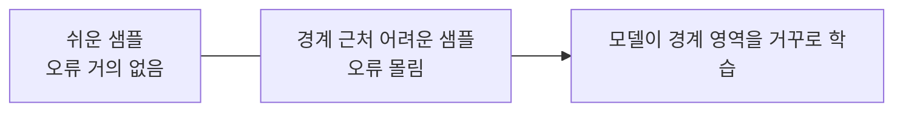
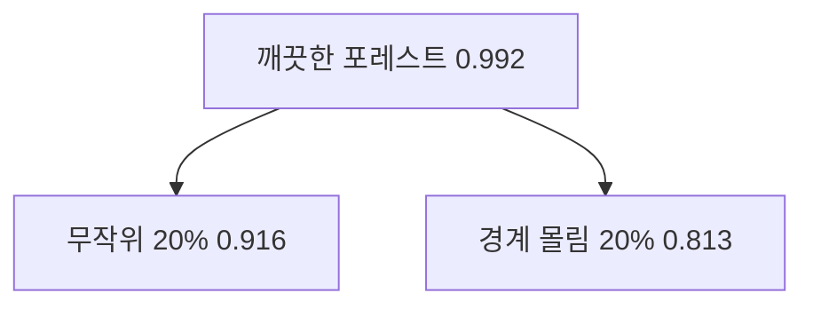

# 특징 의존 노이즈

> 특징 의존 노이즈는 라벨이 틀릴 확률이 샘플의 생김새에 따라 달라지는 오라벨이다. 경계에 가까운 어려운 샘플일수록 틀리게 라벨링되는 경우가 대표적이며, 클래스만 보고 오류율을 정하는 가정이 깨진다.

## 쉽게 말하면
사람이 사진을 보고 "개/고양이"를 라벨링할 때 누가 봐도 개인 사진은 거의 안 틀리지만, 개와 고양이 중간쯤 생긴 흐릿한 사진은 자주 틀린다. 오류는 무작위가 아니라 어려운 사진에 몰려 있다.

## 자세히
- **구분(해석)**: [대칭 노이즈](#symmetric-label-noise)는 어느 샘플이든 같은 확률로 틀리고, [클래스 조건부 노이즈](#class-conditional-noise)는 클래스에 따라 오류율이 다르며, 특징 의존 노이즈는 샘플의 특징(어려움)에 따라 오류율이 다르다. 실제 사람의 오라벨은 후자인 경우가 많다고 알려져 있지만, 이 글에서는 문헌으로 확인하지 못했다.
- **직접 해 본 실험(2차원 합성 데이터 6,000개, 정답 경계 x+y=0, 학습 3,600개 중 20%의 라벨을 뒤집음, 깨끗한 시험 2,400개로 평가)**: 같은 20% 오류율이라도 어디가 틀리느냐가 달랐다.

| 모델 | 깨끗한 라벨 | 무작위 20% 뒤집기 | 경계 가장 가까운 20% 뒤집기 |
| --- | --- | --- | --- |
| 로지스틱 회귀 | 0.999 | 0.995 | 1.000 |
| 랜덤 포레스트(200그루) | 0.992 | 0.916 | 0.813 |

  선형 모델은 경계 위치가 노이즈에 거의 흔들리지 않아(경계 각도 오차 0.0~1.1도) 세 경우 모두 0.995 이상이었다. 유연한 랜덤 포레스트는 무작위 뒤집기에서 0.916, 경계 근처에 몰린 뒤집기에서 0.813으로 더 크게 무너졌다. 어려운 샘플에 몰린 오류는 모델이 경계 부근 영역을 거꾸로 배우게 만든다.
- **시사점(해석)**: 모델 복잡도에 따라 노이즈 영향이 크게 다르고, 오류가 경계에 몰리면 같은 오류율이라도 피해가 크다. 노이즈 견고성 방법을 평가할 때 대칭 노이즈만으로 시험하면 낙관적일 수 있다. 단, 이 실험은 합성 2차원 데이터의 한 사례이며 경계 샘플을 정확히 가장 가까운 20%로 잡은 극단적 설정이다.
- **다루는 법(해석)**: ① 확률이 낮은 샘플의 라벨을 재검토(모델 확신도와 라벨이 어긋나는 샘플) ② 어려운 사례에 대한 라벨 가이드 강화와 다수 라벨러 합의 ③ 평가셋은 경계 사례일수록 두 번 이상 라벨링한다.

## 그림으로 보기

## 예시
- 의료 영상 라벨링에서 애매한 병변일수록 판독의가 엇갈린다. 이 사례들의 라벨을 다수 판독의 합의로 다시 정한다.
- 교육 활용: 같은 오류율로 무작위와 경계 몰림을 비교하는 실험을 학습자가 직접 돌려 본다.

## 헷갈리는 것과 비교
| 개념 | 차이 |
| --- | --- |
| [대칭 노이즈](#symmetric-label-noise) | 모든 샘플 같은 확률 |
| [클래스 조건부 노이즈](#class-conditional-noise) | 클래스별 확률 |
| 특징 의존 노이즈 | 샘플의 어려움에 따라 |
| [혼동 쌍 중심 라벨 가이드](#confusion-pair-guideline) | 자주 헷갈리는 쌍을 지침에 반영 |

## 더 읽을거리
- [Learning from Noisy Labels with Deep Neural Networks: A Survey (arXiv 2007.08199)](https://arxiv.org/abs/2007.08199) — 노이즈 라벨 학습 방법 개관
