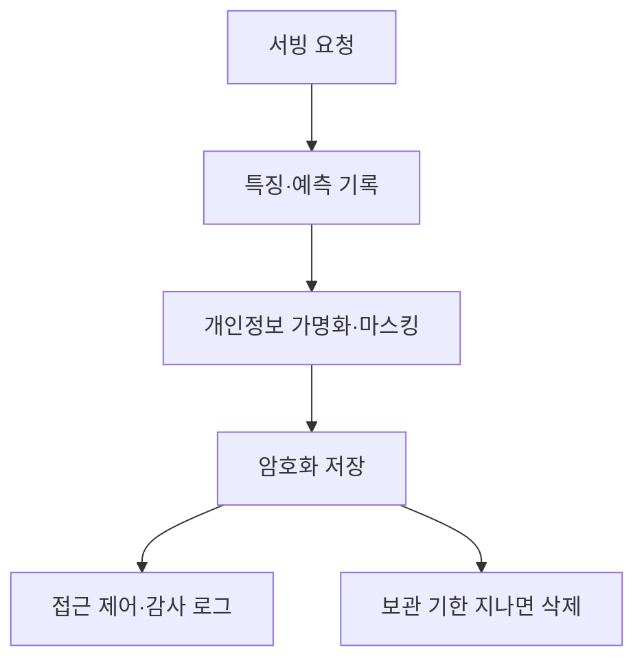

# 특징 로그 개인정보·보관

> 서빙 시점에 기록한 특징·예측 로그에는 이름·거래 내역 같은 **개인정보가 섞이기 쉬워서**, 무엇을 남기고 누가 볼 수 있으며 얼마나 보관·삭제할지 따로 정해야 한다.

## 쉽게 말하면
CCTV 영상은 사고 때 꼭 필요하지만, 아무나 보게 하거나 영원히 쌓아 두면 그 자체가 위험이다. 필요한 만큼만 찍고, 열람 권한을 제한하고, 보관 기한이 지나면 지워야 한다. 모델 로그도 같다.

## 자세히
(규제 해석은 법률 자문이 아니다. 아래 출처에는 법정 보관 기간을 확정해 주는 내용이 없다.)
- **왜 문제인가**: [서빙 시점 특징 로깅](#log-serving-features)은 입력·특징·출력을 그대로 남긴다. 입력에 개인정보가 들어 있으면 로그가 곧 개인정보 저장소가 된다. 특징 저장소는 같은 특징을 여러 모델이 재사용해 위험이 퍼진다(검색 요약).
- **EU AI Act 관점(practical-ai-act.eu, 직접 확인)**: 추론 로그는 "모든 추론의 영구 기록"으로, 입력·출력·모델·메타데이터를 담아 판단 과정을 재구성할 수 있어야 한다고 설명. 근거 조항으로 Art. 12(기록 보존), Art. 19(자동 생성 로그), Art. 26(5)(6)(배포자 의무), Art. 72(시판 후 모니터링)를 든다. 보관 기간은 AI Act·GDPR 등 요구에 맞추라고만 하고, GDPR은 구체 조항 없이 언급된다. 접근은 권한 있는 인원만, 암호화·접근 제어·감사 추적을 권한다. 개인정보 처리에 대한 상세 지침은 없고 프라이버시·법무 검토를 전제한다.
- **값 대신 키 이름만 감사 로그에(Feast 블로그, 직접 확인)**: Feast 감사 로그는 요청자 ID, 엔티티 **키 이름**(값 아님), 특징 뷰, 개수, 상태, 지연을 남긴다. "누가 언제 어떤 특징에 접근했나"에 답하되 `user_id` 값 자체는 로그에 없다. 보관 정책은 정의하지 않고 별도 컴플라이언스 저장소(SIEM, 쓰기 방지 객체 저장소)에서 설정하라는 전제. 오프라인 조회는 호출자를 식별 못 해 인프라 신원(서비스 계정·IAM 역할)이 필요하고, 감사 저장소 장애 시 기록이 빠질 수 있다.
- **보관·삭제 설계 체크리스트(일반 원칙)**: ① 로그에 넣을 필드를 허용 목록으로 제한, 식별자는 가명화·해시 ② 원문 페이로드는 암호화 저장하고 메타데이터와 보관 기한(TTL) 분리 ③ 운영용 로그는 짧게(벤더 가이드는 30~90일을 예로 들지만 법적 기준 아님) ④ 삭제 요청(GDPR 제17조) 때 사용자 단위로 로그·특징 사본을 찾아 지울 수 있는 키 ⑤ 로그 열람 자체의 감사.
- **긴장 관계**: AI Act는 기록을 남기라 하고 GDPR은 최소 보관을 요구한다. 두 요구를 어떻게 조정할지는 조직·법무 판단이다.

## 그림으로 보기

## 예시
- 신용 점수 모델: 로그에는 점수와 특징 이름·버전, 해시된 고객 ID만 남기고 원본 거래 내역은 남기지 않으며 90일 뒤 삭제(예시 설정).
- 교육 소재: "AI 로그도 개인정보다"를 로그 필드 목록에 빨간 줄 긋기 실습으로.

## 헷갈리는 것과 비교
| 개념 | 차이 |
|---|---|
| 특징 로그 개인정보·보관 | 로그의 보관·권한·삭제 문제 |
| [서빙 로그 샘플링](#serving-log-sampling) | 비용 때문에 일부만 기록 |
| [서빙 시점 특징 로깅](#log-serving-features) | 기록 행위 자체 |

## 더 읽을거리
- [Inference log — Practical AI Act](https://practical-ai-act.eu/development/engineering-practice/inference-log) — 추론 로그 내용·접근·조항 정리.
- [Extending Feast observability: SOX audit logging](https://feast.dev/blog/feast-offline-store-sox-metrics) — 값 없이 키 이름만 기록하는 감사 로그 설계.
