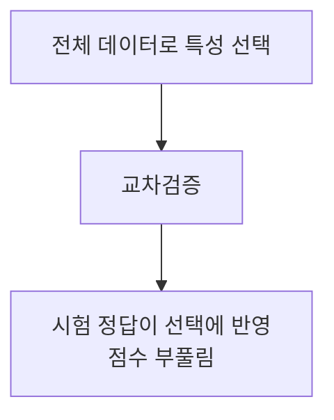
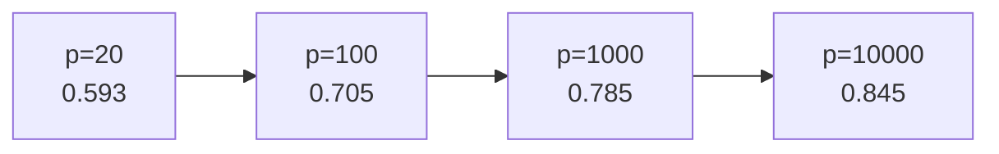

# 특성 선택 누수

> 전체 데이터에서 정답과 상관이 높은 특성을 먼저 고른 뒤 교차검증을 하면, 시험 조각의 정답이 특성 선택에 이미 반영된 셈이라 점수가 부풀려진다. 후보 특성이 많고 표본이 적을수록 부풀림이 커진다.

## 쉽게 말하면
시험 문제 1만 개 중 "정답과 우연히 잘 맞아 보이는 20개"를 정답지를 보며 먼저 고른 뒤, 그 20개로 연습하고 같은 시험을 보면 당연히 잘 맞힌다. 고르는 과정에서 정답을 이미 봤기 때문이다. 후보가 많을수록 우연히 잘 맞는 문제도 많이 섞여 있다.

## 자세히
- **공식 설명(scikit-learn 공통 함정 문서, 열람)**: 무작위 특성 10,000개·표본 200개·무작위 라벨에서 전체 데이터에 `SelectKBest(k=25)`를 먼저 적용하면 정확도가 0.76(우연보다 훨씬 높음)이고, 분할 후 학습 조각에서만 적용하면 0.5였다.
- **직접 해 본 실험(표본 100개, 무작위 특성 p개, 무작위 라벨, 상위 10개 선택, 로지스틱 회귀, 5겹, 15번 반복)**:

| 특성 수 p | 선택을 CV 밖에서(누수) | Pipeline 안에서(정상) |
| --- | --- | --- |
| 20 | 0.593 | 0.513 |
| 100 | 0.705 | 0.523 |
| 1,000 | 0.785 | 0.495 |
| 10,000 | 0.845 | 0.529 |

  정상 방식은 모두 0.5 안팎이지만 누수 방식은 후보가 많을수록 0.59에서 0.85까지 올랐다. 후보가 많을수록 우연히 정답과 맞는 특성이 많아지고, 그것을 전체 데이터로 골라 버리기 때문이다.
- **누수가 생기는 상황(해석)**: 유전자·텍스트 단어처럼 특성이 표본보다 훨씬 많은 데이터에서 특히 위험하다. 상관 기반 선택, 분산 기반 선택, L1 정규화, 모델 중요도로 고르기 모두 정답을 보는 단계라면 같은 문제가 있다. 정답을 보지 않는 선택(분산이 0인 특성 제거 등)은 누수가 작다.
- **해결**: 특성 선택을 `Pipeline`의 한 단계로 넣어 폴드마다 학습 조각에서만 고르게 한다([Pipeline으로 누수 막기](#sklearn-pipeline-leakage-guard)). 점검은 [정답 섞기 점검](#shuffled-label-sanity-check)으로 한다.
- **보고**: 특성 선택 방법·k·선택을 어느 데이터로 했는지 적는다.

## 그림으로 보기

## 예시
- 유전자 발현 5,000개·환자 80명 데이터에서 상위 유전자 20개를 전체 환자로 고른 뒤 CV하면 정확도가 과대평가된다. 파이프라인 안에서 고르면 현실적인 값이 나온다.
- 교육 활용: 무작위 데이터의 p를 늘려 가며 누수 점수가 오르는 곡선을 그린다.

## 헷갈리는 것과 비교
| 개념 | 차이 |
| --- | --- |
| 특성 선택 누수 | 정답을 본 선택이 시험에 반영 |
| 전처리 누수 | 평균·분산이 시험에 반영(보통 영향 작음) |
| [분할 전 오버샘플링](#oversampling-before-split) | 복제본이 시험에 포함 |
| [Pipeline으로 누수 막기](#sklearn-pipeline-leakage-guard) | 공통 해결책 |

## 더 읽을거리
- [scikit-learn: Common pitfalls — Data leakage](https://scikit-learn.org/stable/common_pitfalls.html) — 특성 선택 누수 예와 파이프라인 해법
