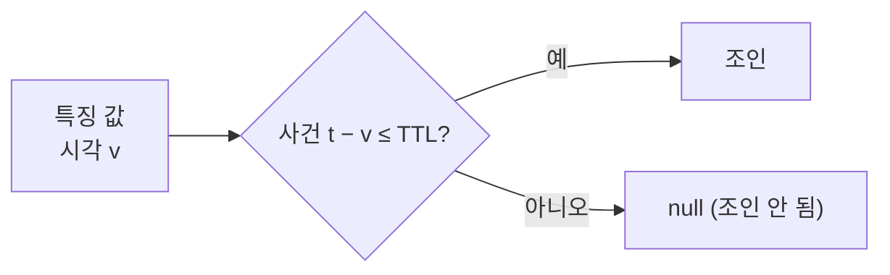
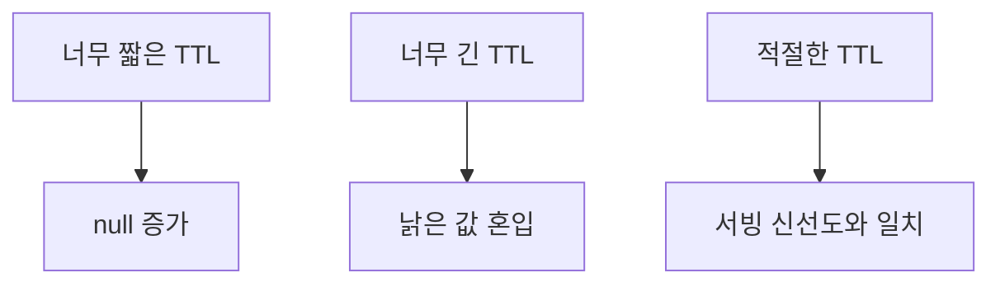

# 특징 TTL

> 특징 값을 **얼마나 오래된 것까지 유효하다고 볼지** 정하는 기간(Time To Live)이다. 시점 조인에서 사건 시각보다 TTL 이상 오래된 값은 붙이지 않는다.

## 쉽게 말하면
냉장고 속 우유의 유통기한과 같다. "어제 측정한 고객 잔액"은 쓸 만하지만 "석 달 전 잔액"은 지금 판단에 쓰면 위험하다. TTL은 "이만큼 지난 값은 상하지 않은 걸로 치지 않겠다"는 기준선이다.

## 자세히
(Feast·Azure ML·Databricks 문서 직접 확인. 같은 개념의 이름이 제품마다 다르다.)
- **Feast**: feature view의 TTL은 "과거 데이터셋을 만들 때 얼마나 먼 과거까지 볼지"를 제한한다(feature view 페이지). 기준은 **질의 시각이 아니라 각 엔티티 행의 타임스탬프**다. 문서 예: TTL 2시간이면 특징 행이 사건보다 2시간 넘게 오래됐을 때 조인하지 않는다(사건이 특징 행 11시간 뒤인 행은 제외, 가장 이른 특징 데이터보다 앞선 행도 조인 불가). 문서의 스트림 feature view 예에 `ttl=timedelta(seconds=8640000000)`(약 10만 일)이 쓰인다. 기본값, 온라인 서빙에서의 동작, materialization과의 관계는 해당 페이지에서 확인하지 못했다.
- **Azure ML**: `temporal_join_lookback`이 같은 역할(기본 무한대, 구간 `[t − lookback, t − source_delay]`). 너무 오래된 값은 낡았고 검색 성능도 해친다고 설명한다.
- **Databricks**: `lookback_window`(기본 None). 학습·배치 추론에만 적용되고 온라인 추론은 항상 최신 값.
- **고르는 법(일반 원칙)**: 특징이 갱신되는 주기보다 길게, 값이 의미를 잃는 시간보다 짧게. 너무 짧으면 null이 늘고, 너무 길면 낡은 값이 학습에 섞여 서빙과 어긋난다. 서빙 때 실제로 허용하는 신선도와 학습의 TTL을 맞춰야 [동등성](#online-offline-feature-parity)이 유지된다.
- **null 처리**: TTL 밖이면 null이 되므로, 모델이 학습 때 본 null 비율과 서빙의 null 비율이 같은지도 점검한다.

## 그림으로 보기

## 예시
- 운전자 시간별 통계(Feast 예): TTL 2시간. 3개 행은 조인됐고 1개는 11시간 차이로 제외.
- 교육 소재: "AI가 보는 데이터에도 유통기한이 있다"를 우유 비유로.

## 헷갈리는 것과 비교
| 개념 | 차이 |
|---|---|
| 특징 TTL | 유효한 값의 최대 나이 |
| [시점 기준 조인](#point-in-time-join) | 미래 값을 막는 규칙(상한), TTL은 하한 쪽 범위 |
| [룩백 윈도우](#lookback-window) | 같은 개념의 다른 제품 이름 |
| [원천 지연](#source-delay) | 값이 도착하기까지의 지연 |

## 더 읽을거리
- [Feast point-in-time joins](https://docs.feast.dev/getting-started/concepts/point-in-time-joins) — TTL 예제와 계산 기준.
- [Azure ML point-in-time join](https://learn.microsoft.com/en-us/azure/machine-learning/offline-retrieval-point-in-time-join-concepts) — temporal_join_lookback 설명.
- [Databricks point-in-time feature joins](https://docs.databricks.com/aws/en/machine-learning/feature-store/time-series.html) — lookback_window.
