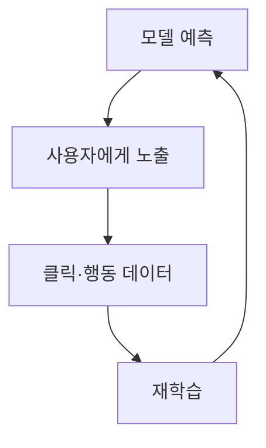
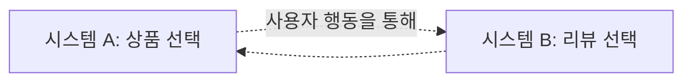

# 모델 피드백 고리

> 서비스 중인 ML 모델의 출력이 **세상과 데이터를 바꿔 미래의 입력(학습 데이터)에 영향을 주는** 순환이다. 모델을 출시하기 전에는 행동을 예측하기 어려운 "분석 부채"를 만든다.

## 쉽게 말하면
추천 시스템이 인기 영상을 더 많이 보여 주면 사람들이 그것을 더 많이 클릭하고, 그 클릭을 학습한 모델은 더 그 영상을 밀어 준다. 처음엔 작은 쏠림이었던 것이 스스로 커진다. 모델이 자기 시험 문제를 스스로 출제하는 셈이다.

## 자세히
(Sculley 외, "Hidden Technical Debt in Machine Learning Systems", NIPS 2015, PDF 본문 4절을 직접 읽고 정리.)
- **핵심 주장**: 살아 있는 ML 시스템은 시간이 지나 갱신되면서 **자기 행동에 영향을 준다**. 모델 갱신이 드문 경우처럼 천천히 일어나면 감지·대응이 더 어렵다.
- **직접 피드백 고리(Direct)**: 모델이 **자기 미래 학습 데이터의 선택**에 직접 영향을 준다. 이론적으로 맞는 해법은 밴딧 알고리즘이지만 실제 문제의 행동 공간 규모에서는 확장이 잘 안 된다고 한다. 완화책으로 **약간의 무작위화**나 모델의 영향을 받지 않는 데이터 부분을 **격리**하는 방법을 든다.
- **숨은 피드백 고리(Hidden)**: 직접 고리는 분석 비용이 크지만 통계 문제로서 연구자에게 자연스럽다. 더 어려운 것은 **두 시스템이 세상을 통해 간접적으로 서로 영향을 주는** 경우다. 논문 예: 한 시스템이 웹 페이지에 보여 줄 상품을 고르고 다른 시스템이 관련 리뷰를 고를 때, 한쪽을 개선하면 사용자가 다른 쪽을 더 또는 덜 클릭하게 된다. 이런 숨은 고리는 **완전히 별개의 시스템 사이에도** 있을 수 있다(서로 다른 투자사의 주가 예측 모델 두 개의 개선이나 버그가 상대의 매매 행동에 영향을 주는 예).
- **훈련-서빙 편향과의 연결(Google Rules of ML 문서, 직접 확인)**: 훈련-서빙 편향의 원인 중 하나로 "모델과 이를 쓰는 시스템 사이의 피드백 고리"를 든다([서빙 특징 로깅](#log-serving-features)).
- **대응(논문 언급 + 해석)**: ① 탐색용 무작위화(일부 트래픽은 모델 선택과 무관하게 보여 주기) ② 모델의 영향이 없는 보류 데이터 유지 ③ 모델 갱신 주기와 지표 추세를 함께 모니터링 ④ 다른 시스템이 같은 데이터·사용자 행동에 의존하는지 지도를 그려 둔다. ②·③·④는 논문의 명시 내용이 아니라 이 글의 실무적 해석이다.

## 그림으로 보기

## 예시
- 추천 모델이 상위에 노출한 항목만 클릭 데이터가 쌓여 다른 항목은 점점 학습 데이터에서 사라진다(직접 고리의 일반 예, 논문의 구체 사례는 아님).
- 교육 소재: "AI가 만든 결과가 다시 AI의 교과서가 되는" 순환을 그림으로 그려 보고 끊는 방법을 토론.

## 헷갈리는 것과 비교
| 개념 | 차이 |
|---|---|
| 직접 피드백 고리 | 모델이 자기 학습 데이터 선택에 영향 |
| 숨은 피드백 고리 | 서로 다른 시스템이 세상을 통해 상호작용 |
| [분포 변화의 종류](#distribution-shift-types) | 변화의 유형 분류 |
| [서빙 특징 로깅](#log-serving-features) | 서빙 입력 기록 |

## 더 읽을거리
- [Hidden Technical Debt in ML Systems (NIPS 2015)](https://papers.nips.cc/paper_files/paper/2015/file/86df7dcfd896fcaf2674f757a2463eba-Paper.pdf) — 4절 Feedback Loops(PDF 직접 확인).
- [Rules of Machine Learning (Google)](https://developers.google.com/machine-learning/guides/rules-of-ml) — 훈련-서빙 편향의 원인(직접 확인).
