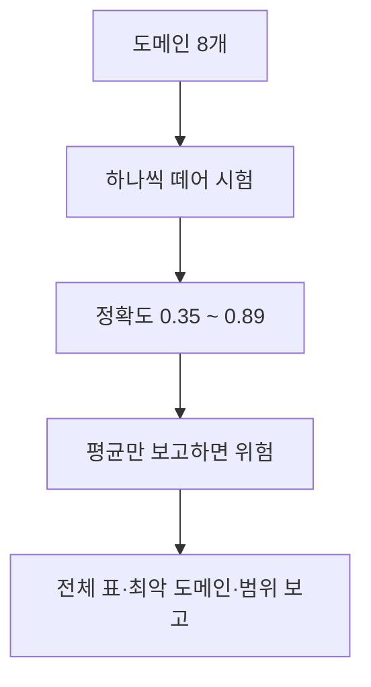
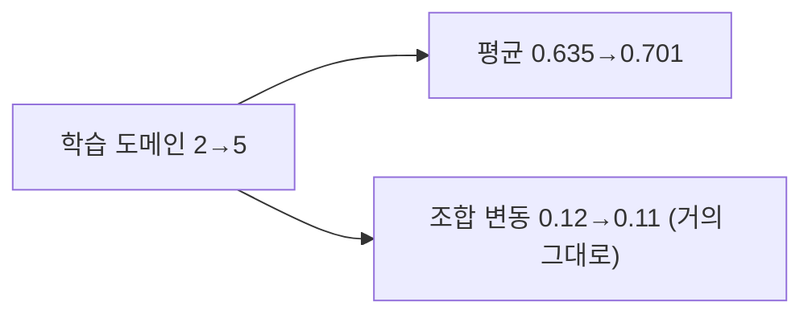

# 도메인 수가 적을 때의 변동

> 도메인(병원·시기·기기)이 몇 개 안 될 때는 **어느 도메인을 시험용으로 떼어 두느냐에 따라 결과가 크게 달라진다**. 도메인이 표본 단위가 되므로 도메인 4~5개로 낸 결론은 불확실성이 매우 크다.

## 쉽게 말하면
학교 5곳의 시험 점수로 "이 공부법이 전국에서 통한다"고 말하려는 것과 같다. 어느 학교를 시험용으로 빼 두느냐에 따라 점수가 크게 달라질 수 있고, 학교가 5개면 그 차이를 평균으로 지워 버리기도 어렵다.

## 자세히
(Gulrajani & Lopez-Paz의 DomainBed 논문 초록과 모델 선택 절(arXiv 2007.01434)을 직접 확인하고, 변동은 직접 시뮬레이션했다. 도메인 일반화·분할의 배경은 [도메인 홀드아웃](#held-out-domain-split).)
- **배경(논문)**: 도메인 일반화 평가는 데이터셋·구조·모델 선택 기준이 연구마다 달라 비교가 어렵다. DomainBed는 다중 도메인 데이터셋 7개를 포함한 테스트베드다. 도메인 수가 적으면 선택·평가가 도메인에 민감할 수 있다는 점이 모델 선택 논의의 출발점이다(논문이 도메인 수에 따른 변동 값을 직접 보고한 것은 이번에 확인하지 못했다).
- **직접 시뮬레이션(digits 손글씨로 도메인 8개를 합성: 밝기·잡음·좌우 반전 조합, 릿지 분류기)**
  - **하나를 떼어 시험 도메인으로 쓰는(leave-one-domain-out) 결과**: 도메인별 정확도 0.894, 0.894, 0.857, 0.733, 0.651, 0.559, 0.780, **0.352**. 범위 **0.352~0.894**, 평균 0.715, 표준편차 0.177. 같은 모델·같은 방법인데 어느 도메인을 시험으로 쓰느냐에 따라 정확도가 0.35에서 0.89까지 달라졌다.
  - **학습 도메인 수 k의 영향**: 임의의 k개 도메인으로 학습하고 나머지 도메인 평균을 시험했다.
  | 학습 도메인 수 | 조합 수 | 시험 평균 정확도의 평균 | 조합 간 표준편차 | 범위 |
  |---|---|---|---|---|
  | 2 | 28 | 0.635 | 0.121 | 0.321~0.791 |
  | 3 | 56 | 0.671 | 0.100 | 0.300~0.790 |
  | 5 | 56 | 0.701 | 0.108 | 0.266~0.856 |
  도메인이 늘면 평균은 약간 오르지만(0.635→0.701) **어떤 도메인 조합을 쓰느냐의 변동은 크게 줄지 않았다**(표준편차 0.12→0.11). 시뮬레이션은 한 가지 합성 구조의 결과이며, 실제 도메인 분포에서는 다를 수 있다.
- **해석(제안)**: 도메인이 표본 단위이므로 **도메인 수 ≈ 표본 수**다. 도메인 5개로 낸 평균 정확도 차이 몇 %p는 통계적으로 의미를 갖기 어렵다.
- **실무 지침(제안)**: ① 가능한 모든 leave-one-domain-out 조합의 결과를 **표로 모두 공개**(평균만 말하지 않기) ② 최악 도메인·범위·표준편차 보고 ③ 평균 비교 대신 **도메인 쌍별 승패** 같은 순위 비교 ④ 도메인이 더 필요하면 시기별·기기별로 세분하되 같은 출처의 쪼개기는 독립이 아님을 명시 ⑤ 결론을 "이 도메인 집합에서"로 한정 ⑥ 도메인별 표본이 작은 경우([작은 집단의 불확실성](#small-subgroup-uncertainty))와 구분해 두 층의 불확실성을 모두 표시.
- **한계**: 위 수치는 합성 도메인이다. 시험 도메인이 하나뿐인 실제 서비스에서는 그 도메인에서의 성능 자체가 목표이므로 일반화 주장과 구분해야 한다.

## 그림으로 보기

## 예시
- 병원 5곳 데이터로 만든 AI의 "외부 병원 일반화 85%"를 보고할 때 병원 5개를 하나씩 빼서 낸 5개 결과를 모두 표로 제시하고 최저 값을 함께 명시.
- 교육 소재: "평균 점수 뒤에 숨은 분산" — 학교별 점수를 표로 비교하는 실습.

## 헷갈리는 것과 비교
| 개념 | 차이 |
|---|---|
| 도메인 수가 적을 때의 변동 | 도메인이 표본 단위일 때의 불확실성 |
| [작은 집단의 불확실성](#small-subgroup-uncertainty) | 칸 안의 표본(예시) 수 부족 |
| [OOD 검증 세트](#ood-validation-set) | 모델 선택에 쓰는 도메인 세트 |
| [도메인 홀드아웃](#held-out-domain-split) | 도메인을 통째로 시험으로 떼어 놓는 설계 |

## 더 읽을거리
- [In Search of Lost Domain Generalization (arXiv 2007.01434)](https://arxiv.org/abs/2007.01434) — DomainBed와 도메인 일반화 평가의 비교 어려움(초록·모델 선택 절 직접 확인).
