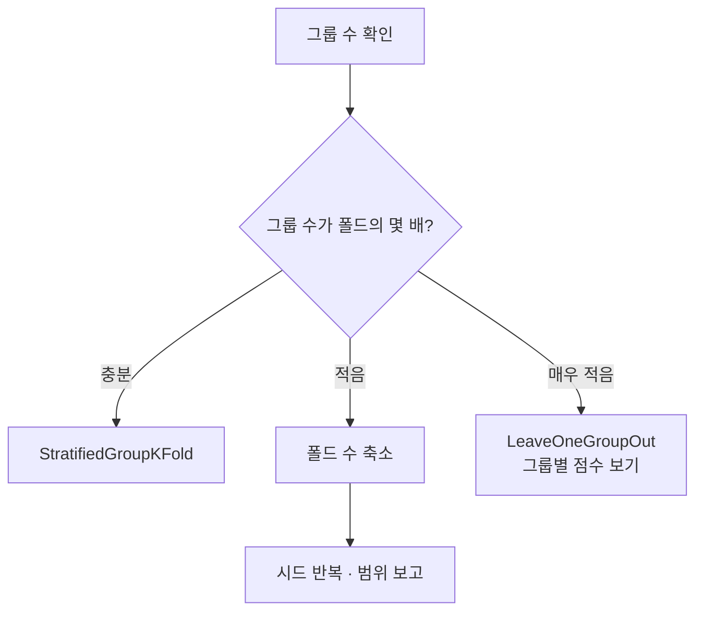

# 그룹이 적을 때 전략

> 그룹(환자·기관·사용자) 수가 10여 개로 적으면 그룹 단위 분할은 폴드마다 그룹이 한두 개뿐이라 **비율·점수가 크게 흔들린다**. 폴드 수를 줄이고, 분할을 반복하며, 분포를 함께 보고하는 것이 기본 대응이다.

## 쉽게 말하면
학급이 12개뿐인 학교에서 "반 단위로" 시험 집단을 나누는 경우다. 6조로 나누면 조마다 반이 2개뿐이라 한 반의 특성이 조 전체를 좌우한다. 조를 2~3개로 줄이면 훨씬 안정적이다.

## 자세히
- **직접 실행**(scikit-learn 1.9.1, 합성: 그룹 12개, 샘플 256개, 양성 비율 0.145, 그룹별 양성 확률 Beta(0.5,2.5), 시드 30개 평균):

| StratifiedGroupKFold 폴드 수 | 테스트 양성 비율의 최대 편차(전체 대비) |
|---|---|
| 2 | 0.009 |
| 3 | 0.015 |
| 4 | 0.046 |
| 6 | 0.118 |

- GroupShuffleSplit(테스트 25%) 200회 반복: 테스트 양성 비율이 **0.019 ~ 0.273**, 표준편차 0.072. 한 번의 분할 결과만 믿으면 위험하다는 뜻이다.
- **대응 전략**
  1. **폴드 수 축소**: 폴드당 그룹 수를 늘린다(그룹 12개면 2~3폴드).
  2. **반복**: 시드를 바꿔 여러 번 분할하고 점수의 평균과 범위를 함께 보고한다.
  3. **Leave-One-Group-Out**: 그룹마다 한 번씩 테스트(`LeaveOneGroupOut`). 그룹별 점수를 그대로 볼 수 있어 "어느 그룹에서 약한가"가 드러난다.
  4. **클래스별 지표 분리 보고**, 희귀 클래스 수 명시.
  5. 데이터를 더 모으거나 그룹을 합칠 수 있는지(의미 있게) 검토.
- 한계: 위 수치는 한 합성 설정의 결과이며, 실제 편차는 그룹 크기·양성 분포에 따라 다르다.

## 그림으로 보기


## 예시
```python
from sklearn.model_selection import LeaveOneGroupOut, cross_val_score
scores = cross_val_score(model, X, y, groups=site_id, cv=LeaveOneGroupOut())
print(dict(zip(sorted(set(site_id)), scores.round(2))))
```
- 병원 8곳의 영상 데이터에서 병원 단위로 한 곳씩 빼고 평가해 병원별 편차를 확인.

## 헷갈리는 것과 비교
| 개념 | 차이 |
|---|---|
| 그룹이 적을 때 전략 | 폴드 수 축소·반복·LOGO |
| [층화와 그룹의 충돌](#stratify-vs-group) | 일반적인 충돌, 그룹이 충분한 경우 포함 |
| [그룹 크기 편차](#group-size-skew) | 그룹 수는 충분하나 크기가 편중 |
| [폴드 균형 표](#fold-balance-table) | 분할 결과 점검 도구 |

## 더 읽을거리
- [scikit-learn 교차검증 가이드](https://scikit-learn.org/stable/modules/cross_validation.html) — LeaveOneGroupOut·GroupShuffleSplit 설명.
- [GroupShuffleSplit API](https://scikit-learn.org/stable/modules/generated/sklearn.model_selection.GroupShuffleSplit.html) — 반복 그룹 분할.
