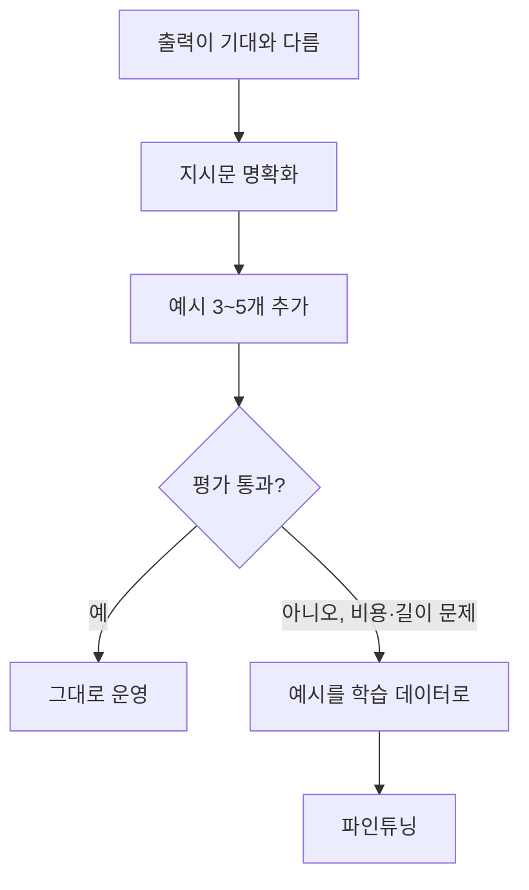

# 파인튜닝 전 few-shot

> 모델을 재학습시키기 전에 프롬프트에 예시 몇 개를 넣어 형식·말투·판단 기준을 먼저 맞춰 보는 접근. 대부분의 "출력 모양" 문제는 여기서 끝난다.

## 쉽게 말하면
신입에게 "보고서 잘 써 와"라고 말하는 대신 잘 쓴 보고서 3장을 보여 주는 것이다. 연수원에 보내기(파인튜닝) 전에 샘플부터 보여 주면 대개 충분하다.

## 자세히
- **Anthropic 가이드(2026-11 확인)**: 예시는 출력 형식·어조·구조를 조절하는 가장 믿을 만한 방법 중 하나다. 예시는 ① 실제 사용 사례와 비슷하고 ② 엣지 케이스를 포함해 다양하며 ③ `<example>` 태그로 지시와 구분하라. **3~5개**를 권한다. Claude에게 예시의 관련성·다양성을 평가하게 하거나 추가 예시를 생성시킬 수도 있다.
- **OpenAI 가이드**: 프롬프트 엔지니어링만으로 충분할 수 있으니 평가(evals)를 만들고 프롬프트를 다듬은 뒤에 파인튜닝을 고려하라고 한다. 파인튜닝이 맞는 경우: 한 요청에 안 들어가는 많은 예시, 토큰·지연 절감, 민감 데이터를 매 요청에 넣기 싫을 때, 작은 모델로 비용 절감. 참고로 OpenAI는 파인튜닝 플랫폼을 신규 사용자에게 닫고 단계적으로 종료 중이라고 안내한다(2026-11 문서 기준).
- **판단 기준**: few-shot으로 형식이 맞고 예시 개수가 감당되면 거기서 멈춘다. 예시가 수십 개 필요하거나 호출량이 커서 프롬프트 토큰 비용이 부담될 때 파인튜닝으로 넘어간다([파인튜닝 데이터 요건](#finetune-data-requirements)).
- few-shot 예시는 나중에 파인튜닝 학습 데이터의 씨앗이 된다.

## 그림으로 보기


## 예시
고객 문의 분류 프롬프트:
```
<examples>
<example><input>환불 언제 돼요?</input><output>{"category":"refund"}</output></example>
<example><input>앱이 계속 꺼져요</input><output>{"category":"bug"}</output></example>
<example><input>배송지 바꾸고 싶은데 환불도…</input><output>{"category":"refund","note":"복합"}</output></example>
</examples>
```
엣지 케이스(복합 문의) 예시를 넣은 것이 포인트.

## 헷갈리는 것과 비교
| 개념 | 차이 |
|---|---|
| few-shot | 프롬프트 안 예시, 가중치 불변, 즉시 수정 |
| 파인튜닝 | 가중치 학습, 데이터·비용·시간 필요 |
| [RAG](#rag) | 지식을 검색해 주입 |

## 더 읽을거리
- [Claude 프롬프트 모범 사례](https://platform.claude.com/docs/en/build-with-claude/prompt-engineering/claude-prompting-best-practices) — 예시 작성 원칙(3~5개, 다양·구조화)
- [OpenAI Model optimization](https://developers.openai.com/api/docs/guides/model-optimization) — 프롬프트 먼저, 파인튜닝 사용 시점
