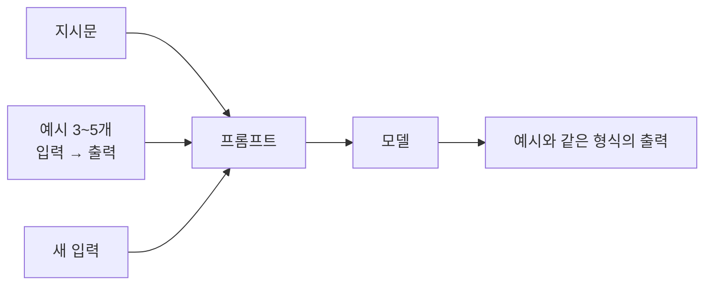
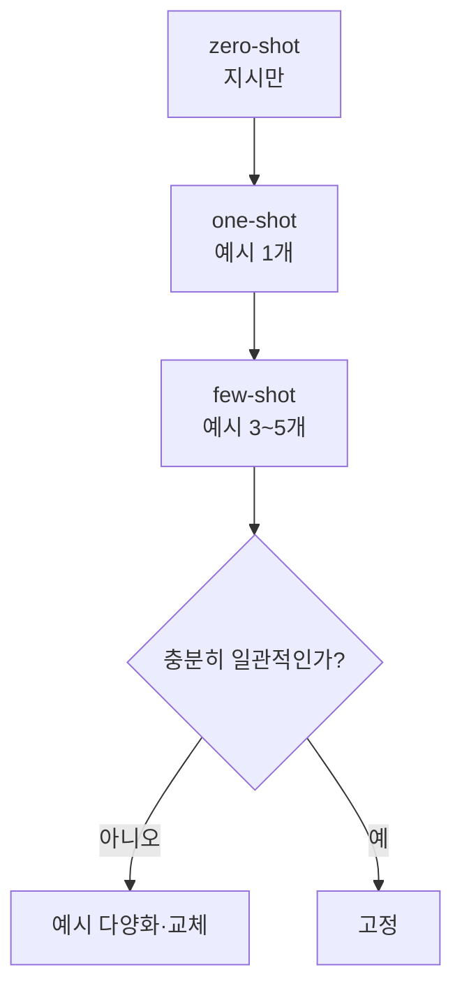

# 예시 프롬프트 (few-shot)

> 지시문 안에 "잘된 예시" 몇 개를 넣어, 모델이 원하는 형식·톤·판단 기준을 따라 하게 만드는 기법이다. 예시 없이 지시만 주면 zero-shot, 하나면 one-shot, 여러 개면 few-shot(multishot)이라 부른다.

## 쉽게 말하면
신입에게 "고객 메일 요약해 줘"라고만 하면 사람마다 결과가 다르다. 대신 "예전에 잘 쓴 요약 3건"을 보여 주면 길이·말투를 바로 따라 한다. 말로 설명하기 어려운 감각을 **견본**으로 전달하는 방법이다.

## 자세히
Anthropic 공식 Prompting best practices(2026-11 확인) 요약:
- 예시는 출력 형식·톤·구조를 조종하는 가장 믿을 만한 방법 중 하나이고, 정확도와 일관성을 높인다.
- 좋은 예시의 세 조건: **관련성**(실제 사용 사례와 비슷), **다양성**(엣지 케이스를 섞어 의도치 않은 패턴 학습을 방지), **구조화**(`<example>` 태그로 감싸 지시문과 구분. 여러 개는 `<examples>`).
- 권장 개수는 **3~5개**. 예시의 관련성·다양성을 모델에게 평가시키거나, 예시를 더 만들어 달라고 할 수도 있다.
- 주의: 예시가 너무 비슷하면 모델이 그 문장을 그대로 베낀다. 정답 예시만 주지 말고 "이건 하지 말 것" 사례를 한두 개 섞기도 한다.

## 그림으로 보기



## 예시
```
<instructions>고객 문의를 '결제/배송/기타' 중 하나로 분류하고 JSON으로만 답해.</instructions>
<examples>
<example><input>카드가 두 번 결제됐어요</input><output>{"type":"결제"}</output></example>
<example><input>일주일째 택배가 안 와요</input><output>{"type":"배송"}</output></example>
<example><input>앱 글씨가 작아요</input><output>{"type":"기타"}</output></example>
</examples>
<input>환불은 언제 되나요?</input>
```

## 헷갈리는 것과 비교
| 개념 | 차이 |
|---|---|
| few-shot | 프롬프트 안에 견본을 넣음. 모델 가중치는 그대로 |
| [파인튜닝](#fine-tuning-open-model) | 많은 예시로 가중치를 실제로 바꿈 |
| [XML 태그 구조화](#xml-tag-prompting) | 예시를 지시와 구분하는 포장 방법 |
| [역할 부여](#role-prompting) | 견본 대신 관점·어조를 지정 |

## 더 읽을거리
- [Prompting best practices — Use examples effectively](https://platform.claude.com/docs/en/build-with-claude/prompt-engineering/claude-prompting-best-practices) — 예시 3조건과 3~5개 권장.
