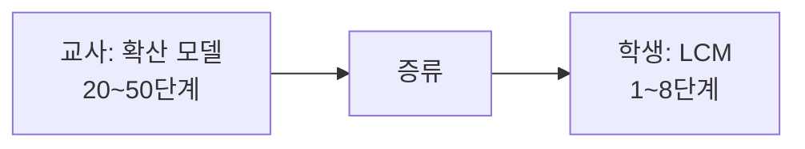
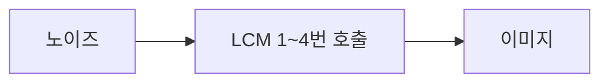

# 적은 단계 생성(LCM·TCD)

> 적은 단계 생성은 보통 20~50번 반복하는 확산 샘플링을 증류(distillation)로 1~8단계까지 줄여, 이미지를 거의 즉시 만드는 기법이다. LCM(Latent Consistency Model)이 대표적이다.

## 쉽게 말하면
요리사(원래 모델)가 50단계 레시피로 만드는 요리를, 제자(증류된 모델)가 "중간 과정은 생략하고 완성품만 바로" 내놓도록 가르치는 것과 같다. 품질은 조금 양보하더라도 속도가 크게 빨라져 실시간 미리보기 같은 용도에 쓸 수 있다.

## 자세히
- **LCM** (arXiv 2310.04378, 2023): 가이드가 적용된 역확산 과정을 확률 흐름 ODE(PF-ODE)의 해를 푸는 문제로 보고, 그 해를 잠재 공간에서 곧바로 예측하도록 사전학습 모델을 증류한다. 논문 초록은 768×768 해상도의 2~4단계 LCM이 A100 GPU 32시간 학습으로 얻어진다고 보고한다. 사용자 데이터에 맞추는 Latent Consistency Fine-tuning(LCF)도 제안했다.
- diffusers v0.42.1의 `LCMScheduler`는 1~8단계에서 좋은 샘플을 낼 수 있다고 문서에 적혀 있다. 주요 옵션: `original_inference_steps`(기본 50), `timestep_scaling`(기본 10.0), `timestep_spacing='leading'`.
- 증류 모델은 원래 모델과 가중치(또는 LoRA)가 다르므로 **스케줄러만 바꾼다고 되는 게 아니다**. LCM 가중치(또는 LCM-LoRA)를 함께 써야 한다.
- **TCD**: LCM과 같은 목적의 후속 기법으로 알려져 있으나 이번에 1차 출처를 열어 보지 못했다(*주장: 세부 차이는 미확인*).
- 대가: 단계가 줄수록 다양성·세부 품질이 떨어지는 경향이 있고, [guidance scale](#diffusion-scheduler)은 낮게 쓰는 경우가 많다(일반적 경험칙).

## 그림으로 보기



## 예시
```python
from diffusers import DiffusionPipeline, LCMScheduler
pipe = DiffusionPipeline.from_pretrained("stabilityai/stable-diffusion-xl-base-1.0")
pipe.scheduler = LCMScheduler.from_config(pipe.scheduler.config)
pipe.load_lora_weights("latent-consistency/lcm-lora-sdxl")
image = pipe("a cat in a spacesuit", num_inference_steps=4, guidance_scale=1.0).images[0]
```
(일반적 사용 예, 실행 확인은 하지 않았다.) 이미지 챗봇·실시간 스케치 도구처럼 지연이 중요한 곳에 쓴다.

## 헷갈리는 것과 비교
| 개념 | 차이 |
|---|---|
| [Karras sigmas](#karras-sigmas) | 같은 모델에서 노이즈 눈금 배치만 바꿈 |
| LCM·TCD | 모델을 증류해 단계 수 자체를 줄임 |
| [DiT](#dit-diffusion-transformer) | 뼈대 구조. 증류와 별개 축 |
| 양자화 | 가중치 정밀도를 낮춰 메모리·속도 개선 |

## 더 읽을거리
- [Latent Consistency Models (arXiv 2310.04378)](https://arxiv.org/abs/2310.04378) — 논문 초록.
- [HF LCMScheduler](https://huggingface.co/docs/diffusers/api/schedulers/lcm) — 1~8단계 및 매개변수 문서.
