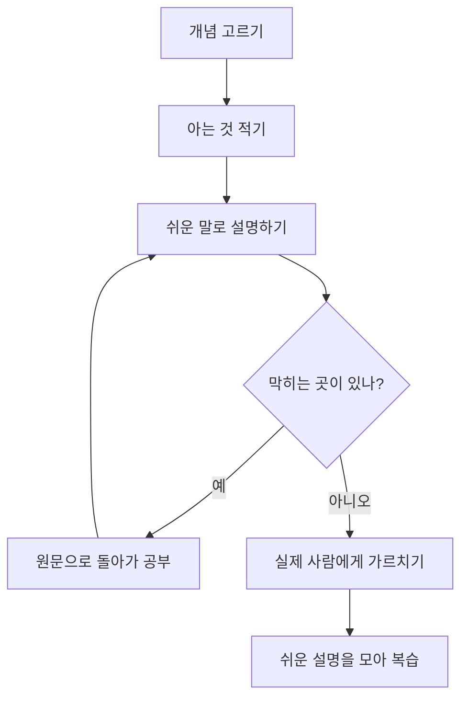
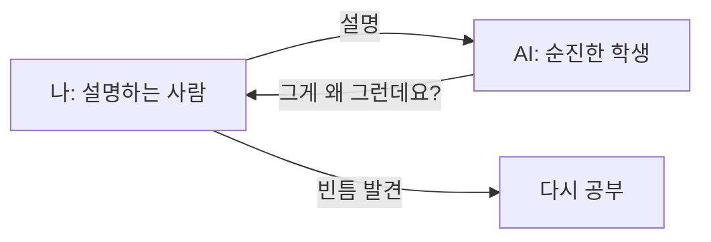

# 파인만 기법

> 배운 개념을 어린아이도 알아듣는 말로 직접 설명해 보며, 막히는 지점을 찾아 이해의 빈틈을 메우는 학습법. 물리학자 리처드 파인만의 이름을 땄다.

## 쉽게 말하면
요리를 "눈으로 레시피만 읽은" 사람과 "직접 만들어 본" 사람은 다르다. 개념도 마찬가지로, 읽을 때는 아는 것 같아도 남에게 설명하려 하면 말이 막힌다. 그 막힌 곳이 정확히 내가 모르는 곳이다. 파인만 기법은 일부러 그 막힘을 만들어서 찾아내는 방법이다.

## 자세히
Farnam Street 글이 소개하는 4단계:
1. **개념을 고르고 아는 것을 적는다**: 빈 종이에 아는 내용을 전부 쓴다.
2. **쉽게 설명한다**: 어린아이(글에선 12살)가 알아들을 말로 쓴다. 전문용어로 얼버무리면 아직 이해하지 못한 것이다.
3. **막힌 곳을 다시 공부해 고쳐 쓴다**: 약한 부분은 원문으로 돌아가 채운다.
4. **시험하고 보관한다**: 노트 없이 실제 사람에게 가르쳐 보고, 쉬운 설명을 모아 두고 가끔 복습한다.

주의할 점(같은 글의 주장 대비 내 평가): "가장 효과적인 방법"이라는 표현엔 연구 근거가 제시되지 않는다. 스스로 "쉽게 설명됐다"고 판단하는 건 주관적이라, 실제 청중이나 AI의 반문 같은 외부 확인이 있어야 한다. 말로 설명하기 어려운 실습 기술(코딩 손맛 등)에는 직접 해보는 연습이 더 필요하다.

AI와 쓰는 법: AI를 "아무것도 모르는 학생"으로 두고 내가 가르치게 한다. 그러면 AI가 순진한 질문을 던져 내 빈틈을 드러낸다. 또는 내가 쓴 설명을 주고 "어디가 비약인지, 용어를 설명 없이 쓴 곳이 어딘지" 찾게 한다.

## 그림으로 보기

## 예시
- 프롬프트: "너는 AI를 처음 듣는 중학생이야. 내가 [에이전트 루프]를 설명할 테니, 이해 안 되는 부분마다 질문해 줘. 정답을 가르쳐 주지는 마."
- 교육 설계: 수강생이 배운 개념을 3문장으로 카드에 쓰게 하고 옆 사람에게 읽어 주게 한다.

## 헷갈리는 것과 비교
| 개념 | 차이 |
| --- | --- |
| 파인만 기법 | 내가 설명하며 빈틈을 찾음. 혼자 가능 |
| [소크라테스 논증법](#socratic-method) | 상대의 질문이 빈틈을 드러냄. 대화 상대 필요 |
| [재귀적 공백 채우기](#recursive-gap-filling) | 찾은 빈틈 안에서 또 빈틈을 찾아 파고드는 반복 구조 |
| 요약 | 줄이는 것이 목적. 파인만 기법은 쉽게 풀어 이해를 확인하는 것이 목적 |

## 더 읽을거리
- [The Feynman Technique (Farnam Street)](https://fs.blog/feynman-technique/) — 4단계와 노트 정리법
- [Feynman Technique (Wikipedia)](https://en.wikipedia.org/wiki/Feynman_Technique) — 짧은 정의와 흐름도
