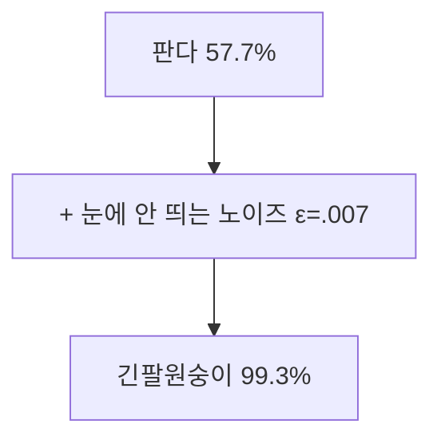

# FGSM

> Fast Gradient Sign Method. 입력 이미지를 손실이 커지는 방향으로 기울기의 부호만큼 한 걸음 살짝 움직여 적대적 사례를 만드는 가장 단순한 공격이다(Goodfellow 외, 2015).

## 쉽게 말하면
시험지 글자를 사람 눈에는 안 보일 만큼만 흐리게 바꿔서 채점 AI가 완전히 다른 답을 내게 만드는 것이다. 어느 방향으로 바꿔야 가장 헷갈리는지 기울기가 알려 준다.

## 자세히
(Goodfellow·Shlens·Szegedy arXiv 1412.6572 전문을 하위 에이전트가 읽은 노트 기준.)
- **공식**: η = ε · sign(∇ₓ J(θ, x, y)), 적대적 입력 x̃ = x + η. 기울기를 한 번만 계산하므로 빠르다.
- **GoogLeNet 판다 예**: ε=.007로 판다 57.7% → 긴팔원숭이 99.3%(잡음 벡터 자체는 "nematode" 8.2%로 분류).
- **MNIST ε=.25**: 얕은 softmax 분류기 오류 **99.9%**(오답 확신도 79.3%), maxout 네트워크 오류 **89.4%**(확신도 97.6%). **CIFAR-10 ε=.1**: 오류 87.15%(확신도 96.6%).
- **적대적 학습 목적함수**: J̃ = 0.5·J(x) + 0.5·J(x + ε·sign(∇ₓJ)). maxout의 FGSM 사례 오류가 89.4% → **17.9%**로 감소, MNIST 시험 오류 0.94% → 0.84%(더 큰 네트워크 0.782%).
- **한계(제안)**: 한 걸음 공격이라 반복 공격(PGD)보다 약하다. 방어 평가에 FGSM만 쓰면 과대평가될 수 있다([적대적 학습](#adversarial-training)).

## 그림으로 보기

## 예시
- 교육 시연: 숫자 이미지에 ε를 0.05, 0.1, 0.25로 키우며 오류율 변화 관찰.
- 교육 활용: "눈으로 같은데 모델은 다르게 본다"는 AI 안전 입문.

## 헷갈리는 것과 비교
| 개념 | 차이 |
|---|---|
| FGSM | 한 걸음 부호 기울기 공격 |
| PGD | 여러 걸음 반복 공격(더 강함) |
| [흔한 손상](#common-vs-adversarial-robustness) | 안개·잡음 같은 자연 변형(적대적 아님) |

## 더 읽을거리
- [Explaining and Harnessing Adversarial Examples (arXiv 1412.6572)](https://arxiv.org/abs/1412.6572) — FGSM 원논문.
