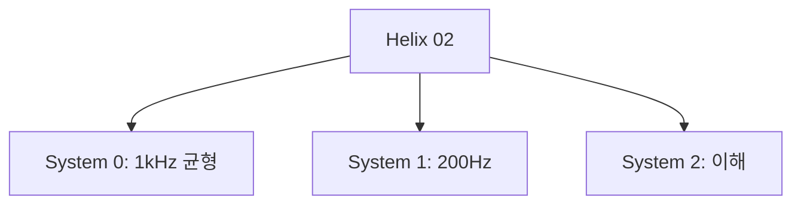

# Figure Helix

> Figure AI가 휴머노이드용으로 내놓은 **VLA(시각-언어-행동) 모델**. 느리게 생각하는 System 2와 빠르게 움직이는 System 1을 나눈 이중 구조다.

## 쉽게 말하면
사람이 "저 컵 선반에 올려 줘"라는 말을 듣고 천천히 이해한 뒤(생각), 손은 반사적으로 빠르게 움직이는(운동) 것과 같다. 이해는 느려도 되지만 손 제어는 1초에 수백 번 갱신돼야 한다.

## 자세히
- Figure 공식 발표(검색 결과로 확인): 원 **Helix**는 "System 1, System 2" VLA. **System 2**는 온보드 비전-언어 모델로 약 **7~9Hz**로 장면·언어를 이해. **System 1**은 시각운동 정책으로 **200Hz**에 연속 행동을 출력한다.
- S1 출력은 손목 자세, 손가락 굽힘·벌림, 몸통·머리 방향 목표를 포함하는 **상체 전체 제어**(제3자 설명은 약 35 자유도).
- **Helix 02**(후속 발표): **System 0**(1kHz)이 균형·접촉·전신 협응을 맡고, System 1은 전신 관절 목표를 200Hz로 낸다. Helix 02의 S2 속도는 확인하지 못했다.
- 위 속도는 모두 Figure 발표 기준 주장이며 독립 검증은 확인하지 못했다.
- 의미: 큰 모델의 일반 지식과 작은 모델의 고속 제어를 분리해 지연 문제를 푸는 설계 패턴이다([VLA](#vla) 개념 참고).

## 그림으로 보기

## 예시
- "서랍 열고 물건 정리해 줘"처럼 말로 지시하면 S2가 이해하고 S1이 손가락까지 제어.
- 교육: 빠른 판단과 느린 판단의 이중 사고(System 1/2) 비유.

## 헷갈리는 것과 비교
| 개념 | 차이 |
|---|---|
| Helix | Figure의 휴머노이드 VLA |
| [ALOHA/ACT](#aloha-act) | 작은 모방 학습 모델 |
| [휴머노이드 단가](#humanoid-unit-economics) | 도입 비용 관점 |

## 더 읽을거리
- [Figure: Helix](https://www.figure.ai/news/helix) — 공식 발표(검색 결과 확인).
- [Figure: Helix 02](https://figure.ai/news/helix-02) — 후속 발표(검색 결과 확인).
