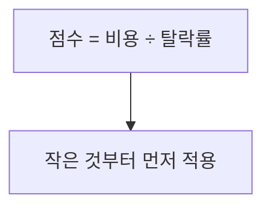

# 필터 순서와 비용

> 여러 필터를 차례로 적용할 때, **싸고 많이 걸러 내는 필터를 앞에 두면** 뒤의 비싼 필터가 처리할 문서가 줄어 전체 비용이 크게 준다. 최종적으로 남는 문서는 순서가 바뀌어도 같고, 달라지는 것은 비용이다.

## 쉽게 말하면
공항 보안검색에서 육안으로 빠르게 거르는 단계를 앞에, 정밀 스캐너를 뒤에 두는 것과 같다. 스캐너에 들어갈 가방 수가 줄어 줄이 짧아진다.

## 자세히
- 직접 측정(2026-11-27, Common Crawl WET 샘플 앞 2MB, 문서 587개, 단일 프로세스, 내가 구현한 필터 5개):
  | 필터 | 문서당 비용 | 통과율 |
  |---|---|---|
  | 길이 ≥ 50단어 | 53.3µs | 0.896 |
  | `{`·`lorem ipsum` 없음 | 38.7µs | 0.949 |
  | 종결 부호 줄 3개 이상 | 44.7µs | **0.470** |
  | 금칙어 없음(LDNOOBW 단일 단어) | 231.8µs | 0.913 |
  | fastText 영어 ≥ 0.65(앞 2,000자) | **380.7µs** | **0.274** |
- 기대 비용 모델(필터가 독립이라고 가정): 순서 (f₁, f₂, …)의 비용 = Σ (앞 필터를 모두 통과한 비율 × 해당 필터 비용). 5개의 모든 순열(120가지)에서 최소·최대:
  - **최적 순서**: 종결 부호 줄 3개 → 길이 → fastText 영어 → `{`/lorem → 금칙어. 예상 **260µs/문서**.
  - 최악 순서: 금칙어 → `{`/lorem → fastText → 길이 → 종결 부호 줄. 예상 619µs/문서.
  - 내가 나열한 순서(길이→`{`/lorem→줄→금칙어→fastText): 예상 358µs/문서.
- **실측 확인**: 최적 순서와 최악 순서로 실제 587문서를 처리하니 **각각 230ms, 421ms**(약 1.8배 차이)였고 **남은 문서는 둘 다 74개로 동일**했다. 즉 순서는 결과를 바꾸지 않고 비용만 바꾼다(필터가 서로 독립적인 통과/탈락 판정일 때).
- 순서 정하는 규칙(제안): **(비용) ÷ (걸러 내는 비율 = 1−통과율)**이 작은 것부터. 위 예에서 종결 부호 줄 필터는 비용 44.7µs·탈락 53%라 점수가 가장 좋고, 금칙어 필터는 231.8µs·탈락 8.7%라 뒤로 간다.
- 주의: ① 통과율은 **표본 데이터에서 잰 값**이라 전체와 다를 수 있다([파일 앞부분 샘플의 편향](#head-sample-bias)) ② 필터가 서로 **상관**이 있으면(예: 짧은 문서가 대부분 종결 부호 줄도 적음) 독립 가정 모델이 틀린다 ③ 일부 필터는 **앞 필터의 출력이 입력**이다(예: 본문 추출 후 줄 필터, 언어 식별 후 언어별 규칙) — 순서가 의미를 바꾼다 ④ 통계를 위해 각 필터가 얼마나 제거했는지 기록하려면 **독립 적용**(모두 평가)이 필요할 수 있고 이때는 비용이 더 든다.
- 한계: 5개 필터·587문서·단일 코어 측정이며 실제 대규모 파이프라인에서는 I/O·병렬화가 비용 비중을 바꾼다.

## 그림으로 보기
```mermaid
flowchart LR
  A["문서 100%"] --> F1["종결 부호 줄 3개: 47% 통과"] --> F2["길이: 약 40%"] --> F3["fastText 영어: 약 27%"] --> F4["`{`/lorem"] --> F5["금칙어"]
```


## 예시
```python
for f in sorted(filters, key=lambda f: f.cost / (1 - f.pass_rate)):
    docs = [d for d in docs if f(d)]
```
- 교육: 필터 5개의 순서를 바꿔 처리 시간을 직접 재 보는 실습.

## 헷갈리는 것과 비교
| 개념 | 차이 |
|---|---|
| 필터 순서 최적화 | 같은 결과·다른 비용 |
| 필터 선택 | 무엇을 거를지(결과가 달라짐) |
| [처리량 외삽](#throughput-extrapolation) | 총 비용을 규모로 확대 추정 |

## 더 읽을거리
- [FineWeb 논문 (arXiv 2406.17557)](https://arxiv.org/abs/2406.17557) — 필터 단계 구성(읽음).
- 직접 실행: 필터 5개 비용·통과율 측정과 120가지 순서 비교.
