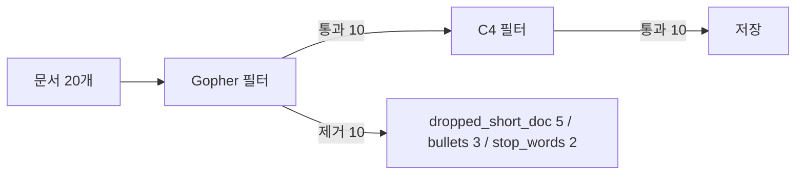
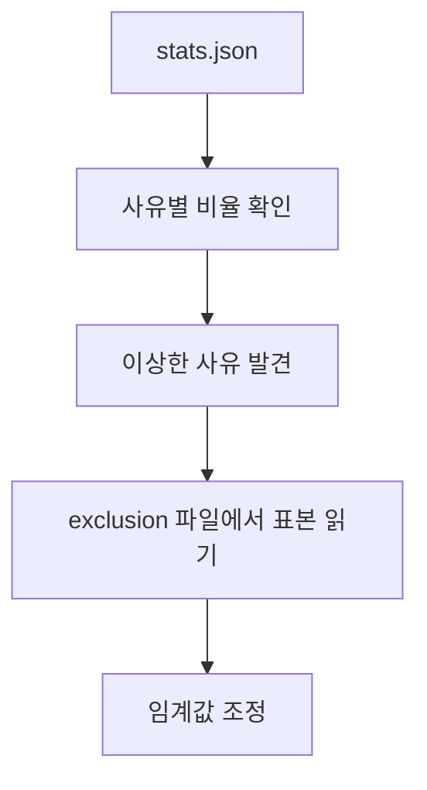

# 필터 이유별 통계

> datatrove는 각 필터가 문서를 버릴 때 **`dropped_<사유>` 카운터**를 자동으로 올리고, 실행이 끝나면 task별·전체 통계를 `logging_dir`에 남긴다. 이 숫자로 "어떤 규칙이 얼마나 지우는지"를 한눈에 본다.

## 쉽게 말하면
도서관이 반납 도서를 "표지 찢김 5권, 낙서 3권, 물에 젖음 2권"처럼 사유별로 세어 두는 장부다. 사유별 개수를 보면 어느 검사가 너무 엄격한지, 어느 검사가 일을 안 하는지 보인다.

## 자세히
- **어디에 남나**(README·직접 실행 확인): `logging_dir/stats/00000.json`(task별), `stats.json`(전체 합산), `logs/`(task별 로그), `completions/`. 필터가 거절 사유 문자열을 돌려주면 `dropped_<사유>` 카운터가 생긴다.
- **직접 실행**(datatrove 최신판, 합성 문서 20개 = 정상 10 + 짧은 광고 5 + 글머리표 3 + lorem 2, `GopherQualityFilter` → `C4QualityFilter` 순):

| 단계 | 들어온 문서 | 통과 | 사유별 제거 |
|---|---|---|---|
| Gopher 품질 | 20 | 10 | `gopher_short_doc` 5, `gopher_too_many_bullets` 3, `gopher_enough_stop_words` 2 |
| C4 품질 | 10 | 10 | 없음 |

- **읽는 법(해석)**: 숫자는 "그 필터에서 **처음** 걸린 사유"다. lorem ipsum 2건은 C4의 `lorem_ipsum` 규칙이 있어도 앞단 Gopher가 불용어 부족으로 먼저 버려서 C4 통계에는 안 보인다. 필터 순서를 바꾸면 사유별 카운트가 달라진다. 한 문서가 여러 규칙에 걸려도 한 사유만 기록된다.
- **쓰는 법**: ① 사유별 제거 비율이 갑자기 달라지면 입력 소스나 추출기가 바뀐 신호. ② 특정 사유가 전체의 대부분이면 임계값이 너무 세거나 입력 분포가 특이한 것. ③ 통계로 의심 사유를 찾은 뒤 `exclusion_writer`로 저장한 문서를 직접 읽어 확인한다([제외 문서 감사](#false-removal-audit)).
- 또 하나: 실행 시간 비율도 단계별로 나온다. 이 예에서 Gopher가 전체 시간의 99.67%였다(spaCy 토큰화 비용으로 추정, 확인하지는 않았다).
- 한계: 20개 합성 문서라 실제 비율과 무관하다. 통계는 개수만 알려 줄 뿐 **버린 것이 옳았는지**는 알려 주지 않는다.

## 그림으로 보기

## 예시
- 새 크롤링 소스를 넣었더니 `gopher_below_avg_threshold`가 평소 1%에서 30%로 증가 → 그 소스가 한국어·영어 혼합이라 평균 단어 길이가 짧게 계산된 것을 발견.
- 교육: 필터 순서를 바꿔 같은 문서에 돌리고 사유별 통계가 어떻게 달라지는지 비교.

## 헷갈리는 것과 비교
| 개념 | 차이 |
|---|---|
| 필터 통계 | 몇 개를 어떤 사유로 버렸나(개수) |
| [exclusion writer](#exclusion-writer) | 버린 문서 자체를 저장 |
| [품질 필터들](#fineweb-quality-filters) | 사유 이름의 뜻과 규칙 |
| [오삭제 표본 감사](#false-removal-audit) | 통계로 의심한 뒤 사람이 확인 |

## 더 읽을거리
- [huggingface/datatrove README](https://github.com/huggingface/datatrove) — stats/·logs/·stats.json 구조(열어 확인).
- [GopherQualityFilter 소스](https://github.com/huggingface/datatrove/blob/main/src/datatrove/pipeline/filters/gopher_quality_filter.py) — 사유 이름 목록(열어 확인).
