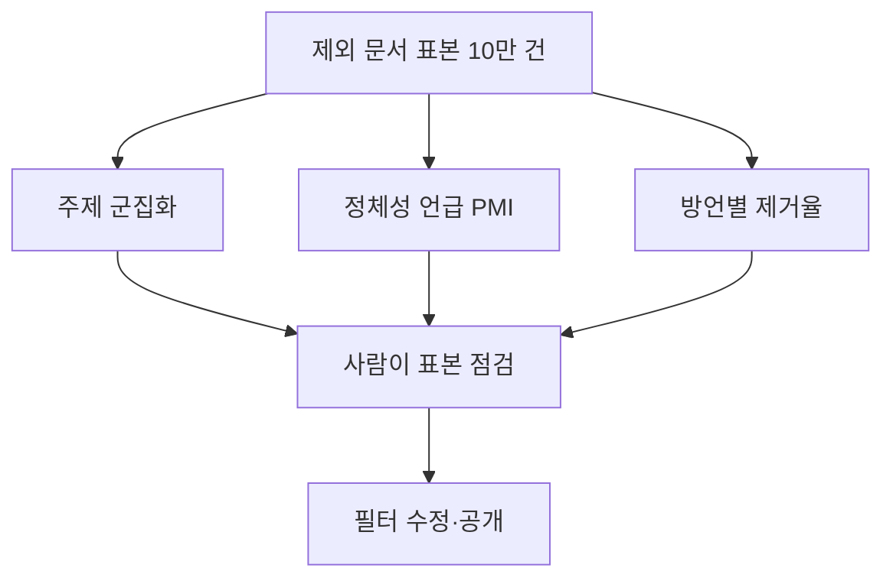
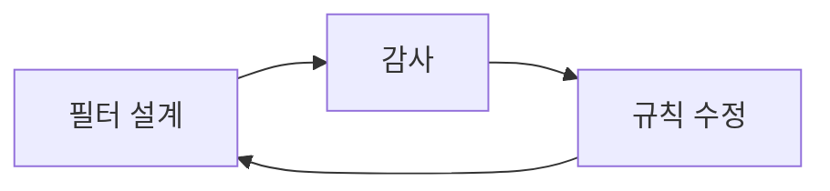

# 필터 제거율 감사

> 데이터 필터가 무엇을 얼마나 지웠는지, 어떤 주제·정체성·방언의 문서를 더 많이 지웠는지 집단별 제거율로 비교해 필터의 부작용을 확인하는 절차다.

## 쉽게 말하면
식당 위생 검사에서 폐기한 음식 목록을 보고 "정말 상한 것만 버렸나, 멀쩡한 것도 버렸나"를 확인하는 것과 같다. 걸러낸 쪽을 열어봐야 필터의 정체가 보인다.

## 자세히
(Dodge 외 arXiv 2104.08758 5장을 직접 읽고 확인한 절차를 단계로 정리. 마지막 항은 제안.)
1. **제외 문서 표본 추출**: 블록리스트 때문에 제외된 문서 10만 건을 무작위로 뽑는다(필터 전 코퍼스와 후 코퍼스의 차이로 구함).
2. **주제 군집화**: TF-IDF 임베딩 + PCA, k-means 50개 군집. 성적인 군집 16개가 전체 제외의 31%뿐이고 나머지는 과학·의학·법률·정치 등 → 필터가 겨냥한 대상 밖이 많다.
3. **정체성별 분석**: 22개 정규식 언급과 제외의 PMI([PMI로 본 정체성별 제거](#pmi-identity-removal)).
4. **방언별 제거율**: 문서를 방언 모델로 분류해(AAE·히스패닉 영어·백인 정렬 영어 WAE 등) 제거율을 비교 — AAE 42%, 히스패닉 영어 32%, WAE 6.2%, 기타 7.2%.
5. **수동 점검**: 의심 집단 문서 50건 같은 표본을 사람이 읽고 "정말 지울 만했는지" 확인.
6. **결과 공개(제안)**: 제거율 표와 표본을 필터 문서에 함께 싣는다.
- 한계: 방언 분류기도 오류가 있고(문서 전체에서 AAE는 0.07%뿐), 표본이 작으면 신뢰구간이 넓다.

## 그림으로 보기

## 예시
- 사내 필터에서 지워진 문서 중 직군별 비율을 표로 만들고 상위 5개 직군 표본을 읽기.
- 교육 활용: "AI 데이터 감사는 지운 쪽을 보는 일"을 실습.

## 헷갈리는 것과 비교
| 개념 | 차이 |
|---|---|
| 필터 제거율 감사 | 필터가 지운 것의 구성을 분석 |
| 모델 편향 평가 | 학습된 모델의 출력을 평가 |
| [블록리스트 필터 편향](#blocklist-filter-bias) | 감사로 드러난 구체 문제 |

## 더 읽을거리
- [Documenting Large Webtext Corpora (arXiv 2104.08758)](https://arxiv.org/abs/2104.08758) — 5.1~5.3절.
