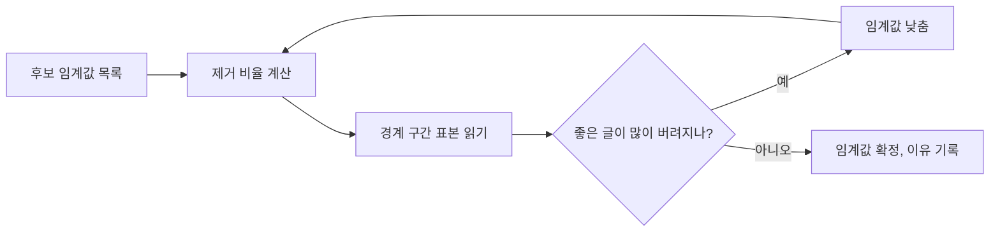
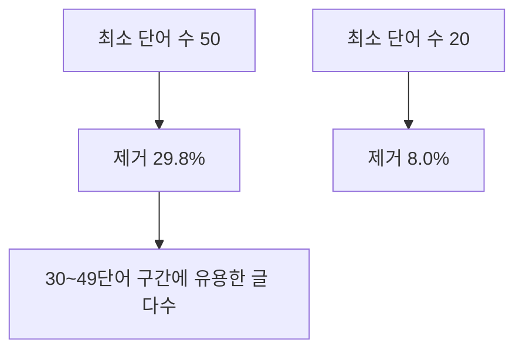

# 필터 임계값 조정 루프

> 필터의 숫자 기준(예: "50단어 미만 제거")은 **데이터 종류에 맞춰 다시 맞춰야 한다.** 임계값을 바꿔 가며 제거 비율을 보고, 경계 근처에서 버려지는 문서를 직접 읽는 반복이 조정 루프다.

## 쉽게 말하면
체에 걸러 쓸 만한 알갱이만 남기려는데 체 눈 크기를 정해야 한다. 눈이 너무 크면 좋은 알갱이도 빠지고, 너무 작으면 돌이 남는다. 눈 크기를 바꿔 가며 체 아래로 빠진 것을 손으로 만져 보고 정한다.

## 자세히
- **기준 필터**: Gopher 품질 필터는 단어 50개 미만을 `gopher_short_doc`으로 버린다([FineWeb 품질 필터들](#fineweb-quality-filters)). 이 값은 웹 페이지 본문을 겨냥한 기본값이다.
- **직접 실행**(scikit-learn의 20 newsgroups 학습셋, 헤더·서명·인용 제거 옵션 적용, 비어 있지 않은 글 11,014개. 실제 게시글 데이터이며 영어): 최소 단어 수를 바꿀 때 제거 비율은 다음과 같았다.

| 최소 단어 수 | 제거 비율 |
|---|---|
| 5 | 1.0% |
| 10 | 2.8% |
| 20 | 8.0% |
| 30 | 14.9% |
| 50 | **29.8%** |
| 100 | 55.5% |

- **경계 읽기**: 30~49단어 구간 글이 1,644개였고 무작위로 3개를 읽으니 "Motorola의 10밴드 이퀄라이저 앱 노트…", "Septra DS 복용 경험을 묻는 글", "Digital Eclipse 업그레이드 방법 질문" 같은 **내용이 있는 질문·정보 글**이었다. 반면 5~9단어 글은 "I'll see your 3 and raise you 4.", "Subject says it all. Please email soon." 같은 **정말 쓸 데 없는 글**이었다. 즉 이 데이터에서는 50이 너무 세고 10~20 근처가 낫다고 볼 수 있다(표본 6개 읽은 인상이므로 더 많이 읽어야 한다).
- **루프(제안)**: ① 후보 임계값마다 제거 비율 계산 ② 경계 구간(예: 30~49)에서 무작위 표본을 읽고 오삭제 비율 추정([오삭제 표본 감사](#false-removal-audit)) ③ 비율과 표본 판단으로 새 임계값 결정 ④ 이유를 기록 ⑤ 새 `logging_dir`로 재실행([낡은 완료 표시](#stale-completion-marker)).
- **주의**: 같은 필터라도 데이터 종류(게시판·뉴스·위키·코드)와 언어에 따라 맞는 값이 다르다. 임계값은 "내 데이터에서 쓸모 있는 최소 글"의 정의에서 거꾸로 정한다. 사용 목적이 질의응답 학습이면 짧은 글이 오히려 중요할 수 있다.
- 한계: 이 실험은 필터 결과의 질을 사람이 판정하지 않았고 제거 비율만 정량화했다.

## 그림으로 보기

## 예시
- 사내 메신저 대화를 학습용으로 정제할 때 웹 기본값 50단어를 그대로 쓰면 대화의 약 3분의 1이 사라질 수 있으니 먼저 분포를 본다.
- 교육: 20 newsgroups로 위 표를 재현하고 경계 구간을 직접 읽어 보게 한다(`pip install scikit-learn` 후 몇 줄).

## 헷갈리는 것과 비교
| 개념 | 차이 |
|---|---|
| 임계값 조정 | 필터 기준 숫자를 데이터에 맞추는 일 |
| [오삭제 표본 감사](#false-removal-audit) | 조정 판단 근거를 만드는 샘플 점검 |
| [필터 이유별 통계](#filter-reason-stats) | 어느 사유가 많이 지우는지 확인 |
| [exclusion writer](#exclusion-writer) | 버린 문서를 파일로 남김 |

## 더 읽을거리
- [scikit-learn 실제 데이터셋 문서](https://scikit-learn.org/stable/datasets/real_world.html) — 20 newsgroups와 remove 옵션(열어 확인).
- [GopherQualityFilter 소스](https://github.com/huggingface/datatrove/blob/main/src/datatrove/pipeline/filters/gopher_quality_filter.py) — 50단어 기본값과 사유 이름(열어 확인).
