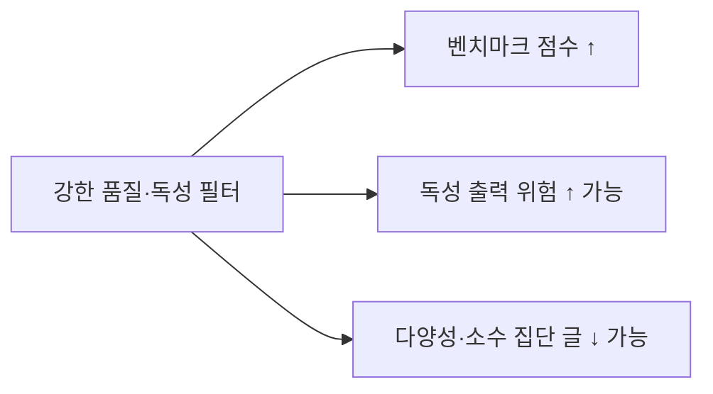
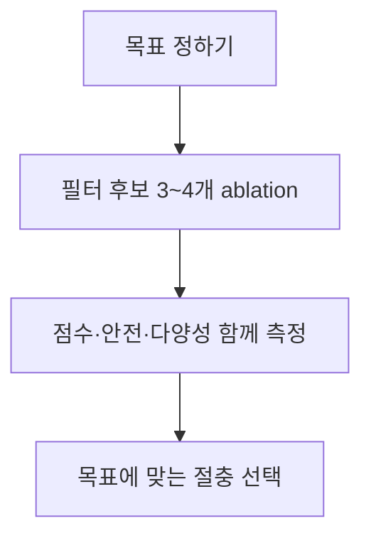

# 필터링에 만능 해법 없음

> Longpre 외(2023)가 28개 모델로 확인한 결론: 학습 데이터의 품질·독성 필터는 효과가 상황마다 달라서, 모든 경우에 맞는 하나의 정답 설정은 없다.

## 쉽게 말하면
쌀을 씻는 정도는 밥맛과 영양을 모두 바꾼다. 너무 많이 씻으면 영양이 줄고 안 씻으면 잡내가 난다. 데이터 필터도 "얼마나 세게 거르는가"가 한쪽만 좋게 하지 않는다.

## 자세히
(Longpre 외, "A Pretrainer's Guide to Training Data", arXiv 2305.13169 초록을 직접 열어 확인.)
- **실험 규모**: 1.5B 파라미터 디코더 전용 모델 **28개**를 사전학습하며 데이터 시기·필터링·도메인 혼합을 바꿨다.
- **데이터 나이**: 평가 데이터가 사전학습 데이터보다 시기적으로 뒤이면 성능이 떨어지고, 미세조정으로도 완전히 회복되지 않는다.
- **품질·독성 필터**: 표준 벤치마크 성능은 올리지만 **독성 출력 위험은 오히려 커질 수 있다**고 보고. 저자 표현: "no one-size-fits-all solution to filtering". 필터 효과는 텍스트 도메인의 특성만으로 예측할 수 없다.
- **도메인 혼합**: 책·웹 등 다양한 출처를 섞는 것이 대체로 도움이 되며 데이터 설계에서 더 강조할 가치가 있다.
- **시사점(제안)**: 필터는 목표(벤치마크 점수 vs 안전성 vs 다양성)별로 따로 평가하고, 필터 전후 비교 실험을 남긴다.

## 그림으로 보기

## 예시
- 사내 데이터에서 "엄격 필터 / 느슨 필터" 두 버전으로 소형 모델을 만들어 정확도와 부적절 응답률을 함께 비교.
- 교육 활용: "좋은 데이터"의 기준은 목적에 따라 달라진다는 토론.

## 헷갈리는 것과 비교
| 개념 | 차이 |
|---|---|
| 필터링 트레이드오프 | 필터 강도가 목표들 사이에서 상충 |
| [블록리스트 필터 편향](#blocklist-filter-bias) | 필터의 편향 한 사례 |
| [표집 비율 튜닝](#sampling-proportion-tuning) | 출처 혼합 비율 조정 |

## 더 읽을거리
- [A Pretrainer's Guide to Training Data (arXiv 2305.13169)](https://arxiv.org/abs/2305.13169) — 28개 모델 실험.
