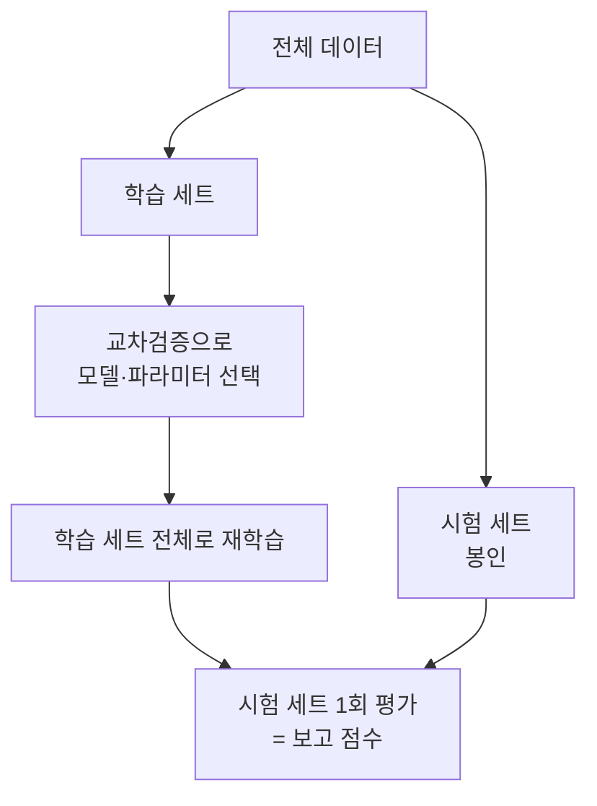
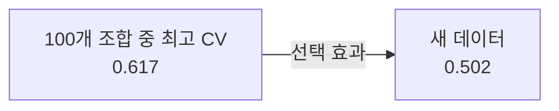

# 최종 테스트 세트 확인

> 하이퍼파라미터를 고르는 데 쓴 교차검증 점수는 선택 과정 때문에 낙관적이다. 보고할 최종 성능은 선택에 한 번도 쓰지 않은 별도 테스트 세트로 단 한 번 확인한다.

## 쉽게 말하면
모의고사를 여러 번 풀어 가장 잘 나온 회차의 점수를 "내 실력"이라고 말하면 과장이다. 잘 나온 회차는 운이 좋았을 가능성이 크기 때문이다. 진짜 실력은 한 번도 안 본 새 시험지로 한 번만 재야 안다.

## 자세히
- **근거(scikit-learn 교차검증 문서, 열람)**: 하이퍼파라미터를 계속 조정하면 시험 세트의 지식이 모델로 새어 들어가 평가 지표가 일반화 성능을 더 이상 보여 주지 못한다. 그래서 최종 평가용 시험 세트는 따로 남겨 두고, 교차검증은 그 안의 학습 세트에서만 한다. 또 학습 곡선 문서는 선택에 쓴 검증 점수는 편향되어 일반화 추정이 아니라고 설명한다.
- **직접 해 본 실험(신호가 전혀 없는 가짜 데이터)**: 무작위 특징 20개·무작위 라벨 120개 데이터에서 KNN의 k(20개 값)와 특징 조합(5개)을 5겹 교차검증으로 고르게 하고, 가장 높은 점수를 기록했다. 30번 반복한 평균은 최고 CV 점수 0.617이었고, 같은 모델을 새 데이터 2,000개로 평가하자 0.502(동전 던지기 수준)였다. 100개 조합 중 최고만 보고하면 0.62처럼 보이지만 실제 성능은 0.50이었다.
- **절차**: ① 처음에 시험 세트를 떼어 놓고 건드리지 않는다 ② 학습 세트에서만 교차검증으로 모델·하이퍼파라미터를 고른다 ③ 고른 뒤 학습 세트 전체로 다시 학습한다 ④ 시험 세트 점수를 한 번만 본다 ⑤ 점수가 마음에 안 든다고 다시 튜닝하면 그 시험 세트는 더 이상 시험 세트가 아니다.
- **데이터가 작아 시험 세트를 못 떼면(해석)**: 중첩 교차검증(바깥 루프가 평가, 안쪽 루프가 선택)으로 같은 효과를 낸다([중첩 교차검증](#nested-cv-intro)).
- **함께 보고(해석)**: 시험 점수와 함께 시험 표본 수를 적고 [부트스트랩](#bootstrap-resampling) 구간으로 불확실성을 보인다.

## 그림으로 보기

## 예시
- 고객 이탈 예측: 데이터의 20%를 처음부터 봉인하고, 80%에서 교차검증으로 모델을 고른 뒤 봉인한 20%로 한 번 보고한다.
- 교육 활용: 신호 없는 가짜 데이터로 "아무 의미 없는 데이터에서도 튜닝하면 점수가 오른다"를 시연한다.

## 헷갈리는 것과 비교
| 개념 | 차이 |
| --- | --- |
| 교차검증 점수 | 선택에 쓰임, 낙관적 |
| 시험 세트 점수 | 선택에 안 쓰임, 보고용 |
| [홀드아웃 vs 교차검증](#holdout-vs-cv) | 분할 방식 선택 |
| [중첩 교차검증](#nested-cv-intro) | 시험 세트 없이 같은 효과 |

## 더 읽을거리
- [scikit-learn: Cross-validation](https://scikit-learn.org/stable/modules/cross_validation.html) — 시험 세트 보류와 누수
- [scikit-learn: Validation curve](https://scikit-learn.org/stable/modules/learning_curve.html) — 선택에 쓴 검증 점수의 편향
