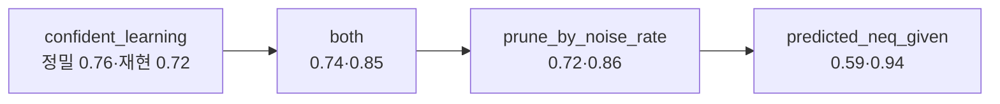
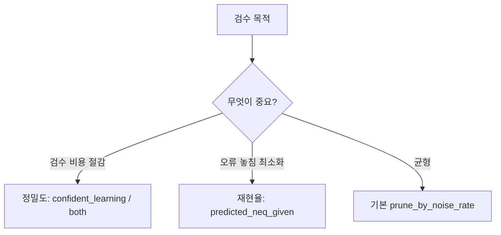

# find_label_issues 필터 방식

> cleanlab `find_label_issues`의 `filter_by` 옵션은 **어떤 기준으로 "라벨 오류 의심 샘플"을 골라낼지** 정한다. 기본값은 `prune_by_noise_rate`이며, 옵션에 따라 의심 개수·정밀도·재현율이 달라진다.

## 쉽게 말하면
의심 샘플을 고르는 체의 눈 크기를 정하는 것이다. 눈이 큰 체(`predicted_neq_given`)는 많이 걸러 오탐도 많고, 눈이 작은 체(`confident_learning`)는 적게 걸러 확실한 것만 남는다.

## 자세히
(cleanlab 문서 `cleanlab.filter`)
- **`prune_by_noise_rate`(기본)**: confident joint의 비대각선(오분류) 항목마다 오라벨일 확률이 높은 샘플을 표시한다.
- **`prune_by_class`**: 클래스마다 "주어진 라벨일 확률이 가장 낮은" 샘플을 표시한다.
- **`both`**: 위 두 방식이 **모두** 표시하는 샘플만(더 보수적).
- **`confident_learning`**: confident joint의 비대각선에 센 샘플, 즉 다른 라벨이 맞다고 "확신"하는 샘플.
- **`predicted_neq_given`**: 모델의 argmax 예측이 주어진 라벨과 다른 모든 샘플(가장 단순).
- **기타 옵션**: `frac_noise`(기본 1.0, 추정된 오류 중 상위 비율만; 문서는 1.0 권장), `min_examples_per_class`(기본 1, 희귀 클래스 과도 제거 방지), `return_indices_ranked_by`(기본 None이면 불리언 마스크, `'self_confidence'` 등을 주면 심한 순 정렬 인덱스), `n_jobs`.
- **직접 실험(cleanlab 2.9.0, 3클래스 합성 3,000개, 라벨 15% 오염 → 오류 약 450개, 5개 시드 평균, 로지스틱 회귀 5-폴드 확률)**
  | filter_by | 의심 수 | 정밀도 | 재현율 | F1 |
  |---|---|---|---|---|
  | prune_by_noise_rate | 559 | 0.721 | 0.861 | 0.785 |
  | prune_by_class | 601 | 0.691 | 0.886 | 0.777 |
  | both | 541 | 0.735 | 0.851 | **0.789** |
  | confident_learning | 444 | **0.761** | 0.723 | 0.741 |
  | predicted_neq_given | 754 | 0.587 | **0.942** | 0.723 |
  F1은 `both`와 기본값이 비슷하게 가장 높았다. 정밀도 우선(사람 검수 비용이 큼)이면 `confident_learning`, 재현율 우선(놓치기 싫음)이면 `predicted_neq_given`.
- **선택 지침**: 기본값으로 시작하고, 검수 인력이 부족하면 `both`·`confident_learning`으로 줄이고, 순위로 상위만 보려면 `return_indices_ranked_by='self_confidence'`를 쓴다([검수 순서](#human-relabel-triage)). 정밀도가 낮은 옵션을 자동 삭제에 쓰면 위험하다([자동 삭제](#auto-delete-risk)).
- 위 수치는 하나의 합성 설정이며 데이터·모델에 따라 순위가 바뀔 수 있다.

## 그림으로 보기



## 예시
```python
from cleanlab.filter import find_label_issues
idx = find_label_issues(labels, pred_probs, filter_by="both",
                        return_indices_ranked_by="self_confidence")  # 심한 순 인덱스
```
- 검수 인력이 하루 200건이면 `both`로 줄인 뒤 상위 200건만 검수.

## 헷갈리는 것과 비교
| 개념 | 차이 |
|---|---|
| `filter_by` | 의심 판정 기준(체의 눈) |
| `return_indices_ranked_by` | 의심 샘플의 정렬 기준 |
| [라벨 품질 점수](#cleanlab-label-quality-score) | 모든 샘플의 연속 점수 |
| `min_examples_per_class` | 클래스별 최소 보존 개수 |

## 더 읽을거리
- [cleanlab.filter 문서](https://docs.cleanlab.ai/stable/cleanlab/filter.html) — `filter_by` 옵션과 파라미터 정의.
- [cleanlab 튜토리얼](https://docs.cleanlab.ai/stable/tutorials/indepth_overview.html) — 옵션별 F1 비교 예시.
