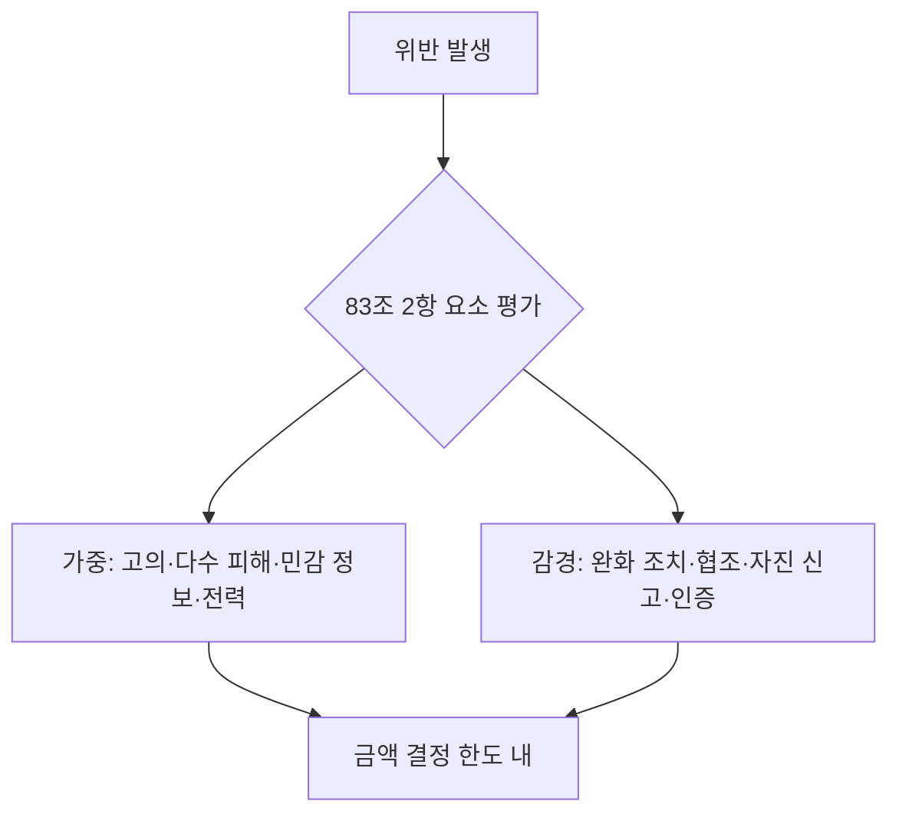
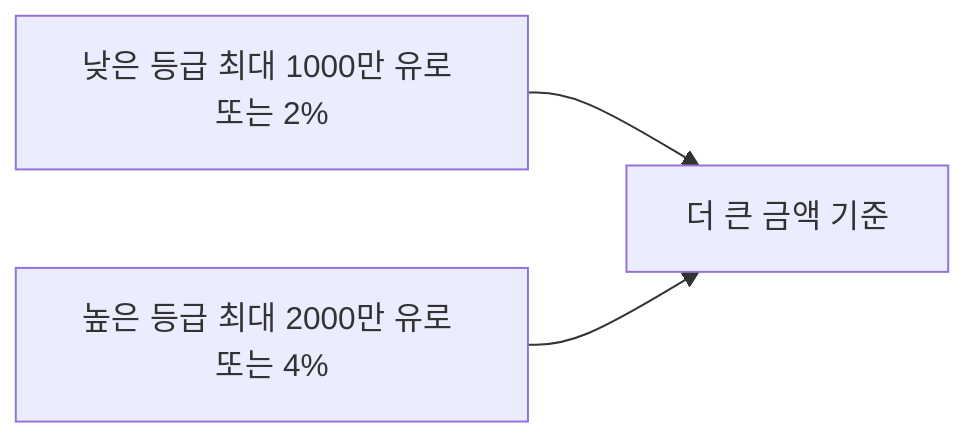

# 과징금 결정 요소

> GDPR 83조 2항이 감독기관에게 "과징금을 매길지, 얼마로 할지"를 정할 때 따지라고 열거한 요소들(a~k). 같은 위반이라도 고의성·협조·완화 조치에 따라 금액이 달라진다.

## 쉽게 말하면
교통 위반 벌금을 판사가 속도 초과 정도만 보지 않고, 고의였는지, 사고를 줄이려 노력했는지, 전과가 있는지, 수사에 협조했는지를 함께 보는 것과 같다. 법은 "효과적이고 비례적이며 억지력 있는" 금액이라는 원칙을 준다.

## 자세히
출처는 GDPR 83조 원문(gdpr-info.eu, 열람). 법률 자문이 아니다.
- **원칙(1항)**: 과징금은 개별 사건마다 "효과적이고 비례적이며 억지력이 있어야" 한다.
- **고려 요소(2항)**
  - (a) 위반의 성격·중대성·기간, 처리의 범위와 목적, 영향받은 정보주체 수, 입은 피해
  - (b) 고의 또는 과실
  - (c) 정보주체의 피해를 줄이려 취한 조치
  - (d) 책임 정도(25조·32조에 따른 기술적·조직적 조치 포함)
  - (e) 관련된 이전 위반
  - (f) 위반 시정을 위해 감독기관과 협조한 정도
  - (g) 영향받은 개인정보의 범주
  - (h) 감독기관이 위반을 알게 된 경위(관리자·처리자의 통지 여부 포함)
  - (i) 같은 사안에 대한 58조 2항 명령의 준수
  - (j) 승인된 행동강령(40조)이나 인증(42조) 준수
  - (k) 재정적 이익이나 회피한 손실 같은 그 밖의 가중·감경 요소
- **금액 한도**: 낮은 등급(4항: 8·11조, 25~39조, 42·43조 등)은 1,000만 유로 또는 직전 회계연도 전 세계 연 매출의 2% 중 큰 금액. 높은 등급(5항: 5·6·7·9조 기본 원칙과 동의, 12~22조 정보주체 권리, 44~49조 국외 이전 등)과 58조 2항 명령 불이행(6항)은 2,000만 유로 또는 4% 중 큰 금액. 같은 또는 연결된 처리에서 여러 위반이 있으면 총액은 가장 중대한 위반의 한도를 넘을 수 없다(3항).
- **AI 프로젝트에 대한 시사점(해석)**: (d)와 (j)가 보여 주듯 설계 단계 보호([25조](#data-protection-by-design))와 인증·행동강령 준수는 감경 요소로 고려될 수 있다. 기록(로그)을 남겨 협조·완화 조치를 입증하는 일이 중요하다.
- 조문은 금액 계산식을 주지 않고 재량을 준다. 실제 산정은 감독기관 지침과 사례를 함께 봐야 하며 여기서는 다루지 않았다.

## 그림으로 보기

## 예시
- 같은 유출이라도 즉시 신고하고 피해 완화 조치를 한 회사와 은폐한 회사는 (h)(c)(f)에서 평가가 갈린다.
- 교육 실습: 가상 유출 사건 하나에 (a)~(k) 중 가중·감경 요소를 각각 표시해 본다.

## 헷갈리는 것과 비교
| 개념 | 차이 |
|---|---|
| 과징금 결정 요소 | 금액을 정하는 기준 |
| 한도(2%/4%) | 부과할 수 있는 상한 |
| [설계 단계 개인정보 보호](#data-protection-by-design) | (d)에서 고려되는 사전 조치 |
| 58조 2항 명령 | 시정 조치 권한(별도) |

## 더 읽을거리
- [GDPR Art. 83](https://gdpr-info.eu/art-83-gdpr/) — 과징금 조건 원문(열람)
