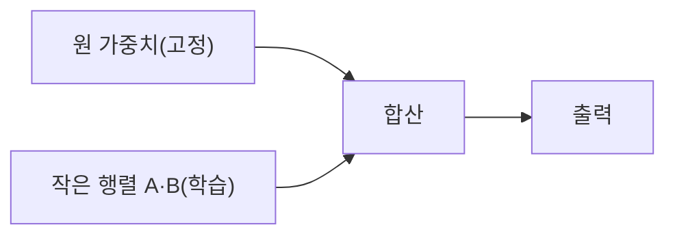
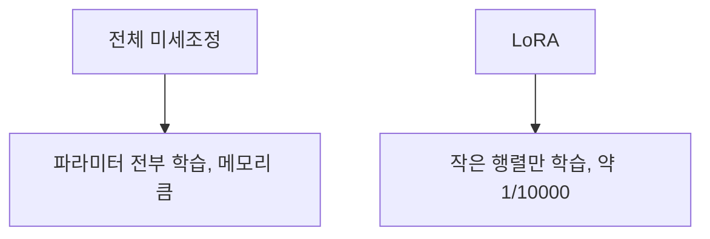

# 오픈 모델 미세조정(LoRA)

> 모델의 **원래 가중치는 얼려 두고**, 각 층에 **작은 저순위(low-rank) 행렬만 추가해 학습**하는 방법(LoRA). 적은 자원으로 오픈 모델을 내 업무에 맞춘다.

## 쉽게 말하면
두꺼운 교과서(원 모델)를 고치는 대신, 책 위에 얇은 메모지(작은 행렬)를 붙여 내 용도에 맞게 보충하는 것이다. 메모지만 따로 저장하고 교체할 수 있다.

## 자세히
- 원 논문: Hu 외, *LoRA: Low-Rank Adaptation of Large Language Models*(arXiv 2106.09685, 초록 읽음). 사전학습 가중치를 고정하고 Transformer 각 층에 학습 가능한 저순위 분해 행렬을 주입한다.
- 효과(GPT-3 175B를 Adam으로 전체 미세조정하는 것과 비교, 초록 기준): 학습 가능한 파라미터 **약 1만 분의 1**, GPU 메모리 **약 3분의 1**. RoBERTa·DeBERTa·GPT-2·GPT-3에서 전체 미세조정과 **동등하거나 더 나은 품질**, 학습 처리량도 더 높다고 보고.
- 어댑터와 달리 **추가 추론 지연이 없다**(학습한 행렬을 원 가중치에 합칠 수 있다는 의미, 해석).
- 쓰임: 말투·형식·도메인 용어 맞춤. 새로운 지식을 대량 주입하는 데는 한계가 있다는 의견이 일반적이나 이 출처에서는 확인하지 못했다.
- 실무: 오픈 가중치 모델과 짝으로 자주 쓰며 [라이선스](#model-license)가 미세조정본의 이름·배포 조건을 정할 수 있다. 허브의 [OpenVLA](#openvla)도 소비자 GPU에서 LoRA로 미세조정할 수 있다고 보고했다.
- 한계: 원 논문은 2021년 기준 결과이며 최신 모델·QLoRA 등 변형은 이 글에서 다루지 않았다.

## 그림으로 보기

## 예시
- 고객응대 말투를 맞추려고 오픈 모델에 어댑터 1개를 학습해 부서별로 교체해 사용.
- 교육: "지식 주입 vs 스타일 맞춤"에 대해 RAG와 미세조정의 역할을 비교하는 토론.

## 헷갈리는 것과 비교
| 개념 | 차이 |
|---|---|
| LoRA | 작은 행렬만 학습 |
| 전체 미세조정 | 모든 가중치 학습 |
| RAG | 모델은 그대로, 외부 문서를 찾아 붙임 |

## 더 읽을거리
- [LoRA 논문](https://arxiv.org/abs/2106.09685) — 파라미터 1만 분의 1, 메모리 3분의 1(초록 읽음).
