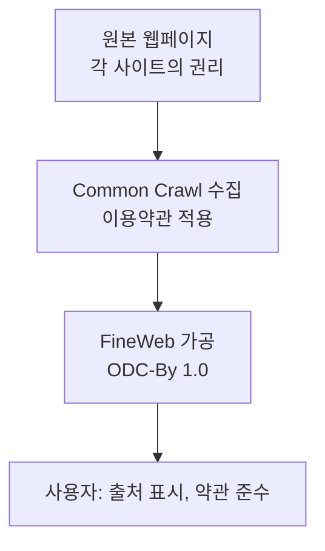
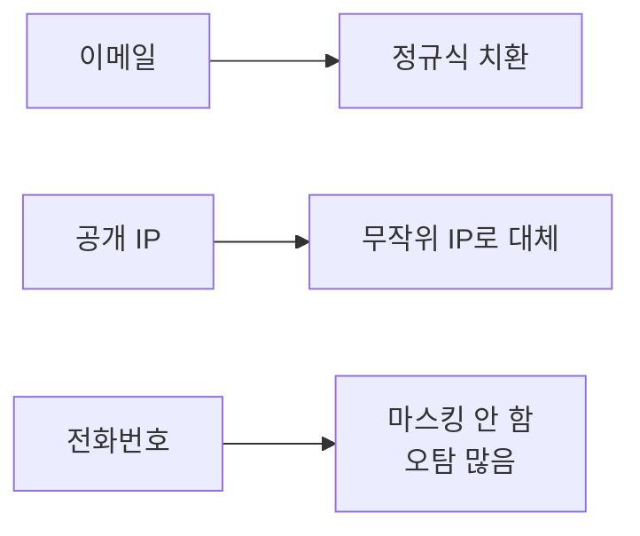

# FineWeb 이용 조건

> FineWeb은 **ODC-By 1.0 라이선스**로 공개됐고, 사용은 동시에 **Common Crawl 이용약관**의 적용도 받는다. 데이터 출처 웹페이지의 권리는 별개다. (법률 자문이 아니라 공개 문서 요약이다.)

## 쉽게 말하면
도서관에서 빌린 복사본에 "출처만 밝히면 마음대로 써도 된다"는 안내가 붙어 있다. 그런데 원본 책들은 저마다 저자의 권리가 있고, 복사본을 만든 도서관(Common Crawl)도 자기 이용 규칙을 따로 갖고 있다. 세 겹을 같이 봐야 한다.

## 자세히
- **데이터셋 카드**(Hugging Face `HuggingFaceFW/fineweb` README, 직접 읽음): "Open Data Commons Attribution License (ODC-By) v1.0"으로 공개하고, 사용은 CommonCrawl의 이용약관 적용도 받는다고 적는다.
- **ODC-By 요약**(Open Data Commons 요약 페이지, 직접 읽음): 데이터베이스를 복사·배포·사용하고(Share), 그로부터 작품을 만들고(Create), 수정·확장할 수 있다(Adapt). 조건은 **출처 표시(attribution)**이며, 공개 사용 시 어떤 라이선스가 적용되는지 표시하고 원본의 고지를 유지해야 한다. 요약에는 동일조건변경허락(share-alike) 요구가 없다. 요약은 법적 효력이 없고 정확한 조건은 전문에 있다.
- **Common Crawl 이용약관**(직접 읽음): 제한적·비독점 이용권을 주고, 불법 목적·괴롭힘·사생활 침해·스팸·크롤 콘텐츠와 무관한 개인정보 수집을 금지한다. 크롤된 내용은 소유자의 조건이나 제3자의 저작권 등 권리에 따를 수 있어 이를 존중해야 하며, 내용의 정확성·합법성·품질을 보증하지 않는다. AI 학습·생성물·지식재산 침해와 관련한 제3자 청구에 대한 면책 조항과 책임 상한(100달러), 분쟁 시 중재 조항이 있다.
- **개인정보(PII) 처리**(데이터셋 카드): 이메일 주소는 정규식으로 `email@example.com` 등으로 치환, 공개 IP 주소는 무작위 주소로 대체. **전화번호는 오탐이 많아 마스킹하지 않는다.** 카드는 PII가 남아 있을 가능성이 매우 높다고 경고하고, 자기 PII 제거를 요청하는 양식을 안내한다. v1.3.0에서는 삭제 요청(takedown) 통지에 따라 일부 도메인을 제거했다고 변경 이력에 적혀 있다.
- **실무 메모(일반 설명)**: 상업 이용 여부, 출처 표시 방법, 파생 데이터셋 공개 시 라이선스 표기, 개인정보·저작권 위험은 조직의 법무와 확인한다. 한국 번호·주민등록번호 규칙은 따로 추가 점검이 필요하다([추가 PII 단계](#extra-pii-pass)).

## 그림으로 보기

## 예시
| 항목 | 요약 |
|---|---|
| 라이선스 | ODC-By 1.0 (출처 표시) |
| 추가 약관 | Common Crawl 이용약관 |
| 이메일·공개 IP | 치환 |
| 전화번호 | 미처리 |
- 업무 장면: 사내 교육용으로 FineWeb 일부를 쓸 때 보고서에 데이터셋 이름·라이선스를 표기하고, 개인정보가 남아 있을 수 있어 샘플을 눈검사한다.

## 헷갈리는 것과 비교
| 개념 | 차이 |
|---|---|
| ODC-By | 데이터베이스 사용 조건(출처 표시) |
| 원본 사이트 저작권 | 콘텐츠 자체의 권리. 별개로 존재 |
| [Share-alike](#share-alike) | 파생물에도 같은 조건을 요구하는 방식. ODC-By 요약엔 없음 |
| [라이선스 요약과 전문](#license-summary-vs-legal-text) | 요약은 안내일 뿐 |

## 더 읽을거리
- [FineWeb 데이터셋 카드](https://huggingface.co/datasets/HuggingFaceFW/fineweb) — 라이선스·PII 처리 설명(README 직접 읽음).
- [ODC-By 요약](https://opendatacommons.org/licenses/by/summary/) — 자유와 조건(직접 읽음).
- [Common Crawl 이용약관](https://commoncrawl.org/terms-of-use) — 이용 제한·면책(직접 읽음).
