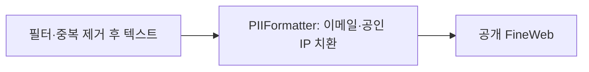
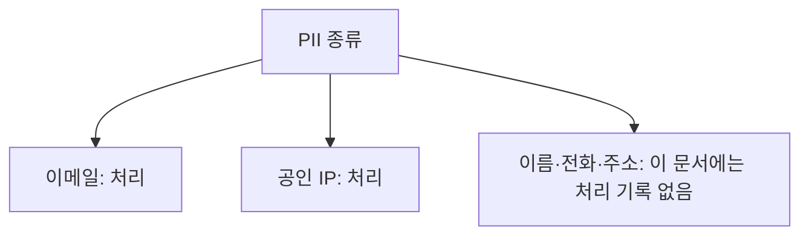

# FineWeb 개인정보 익명화

> FineWeb은 공개 배포 시 **이메일 주소와 공인 IP 주소를 정규식으로 찾아 가짜 값으로 치환**했다. 이름·전화번호 같은 다른 개인정보는 이 단계에서 처리하지 않으므로 "개인정보가 제거된 데이터"로 오해하면 안 된다.

## 쉽게 말하면
도서관 책 15조 단어를 공개하기 전에 "이메일 주소와 서버 IP"만 검은 펜으로 지우고 다른 연락처는 그대로 둔 것이다. 지운 부분은 안전하지만 지우지 않은 종류는 남아 있다.

## 자세히
(FineWeb 논문, arXiv 2406.17557 PDF 본문과 데이터 카드 부분을 직접 읽음)
- 본문: "공개 배포를 위해 개인 식별 정보(PII) 제거를 적용했다 — **이메일과 공인 IP를 익명화**". 데이터 카드의 "Personal and Sensitive Information" 항목도 "이메일과 공인 IP를 **정규식 패턴**으로 익명화한다"고만 적는다.
- 파이프라인 위치: 마지막 단계(MinHash 중복 제거 4단계의 마지막 `PIIFormatter`, [FineWeb 예제](#datatrove-fineweb-example))에서 실행된다. datatrove의 `PIIFormatter`는 이메일을 `email@example.com`·`firstname.lastname@example.org`로, 공인 IP를 미리 정한 값으로 바꾼다([학습 데이터 속 개인정보](#pii-in-training-data)에서 직접 실행해 확인: 이름·전화·주민번호는 남음).
- **범위의 한계**: 처리 대상은 이메일·공인 IP 두 종류뿐이다. 이 글이 읽은 문서에는 이름·주소·전화번호 처리나 삭제 요청 절차가 적혀 있지 않았다(다른 문서에 있을 수 있음).
- 라이선스·이용 조건(같은 문서): **ODC-By v1.0**이며 **Common Crawl 이용약관도 함께 적용**된다. 허깅페이스 허브에 호스팅하고 새 크롤이 나오면 갱신할 계획이라고 쓴다.
- 의미(제안): 사용자는 ① 이 데이터로 학습한 모델이 이름·전화번호를 출력할 수 있다고 가정하고 ② 자체 PII 규칙을 추가하며 ③ 민감 도메인에서는 추가 필터와 감사를 해야 한다([암기 완화](#memorization-mitigation)). 데이터 카드의 한 줄 서술은 "정규식으로 이 두 종류만"이라는 뜻으로 읽어야 한다.

## 그림으로 보기

## 예시
- FineWeb으로 사내 모델을 학습하기 전에 한국 전화번호·주민번호 정규식을 추가로 돌리고 표본 감사.
- 교육: 데이터 카드의 한 줄 문장을 정확히 읽는 훈련("무엇을" 처리했는가).

## 헷갈리는 것과 비교
| 개념 | 차이 |
|---|---|
| 이메일·IP 익명화 | FineWeb이 한 일 |
| 완전한 PII 제거 | FineWeb이 하지 않은 일(이름·번호 등) |
| ODC-By | 출처 표시 조건의 데이터 라이선스 |
| [옵트아웃](#opt-out-limits-existing-data) | 수집 전 신호, 이미 공개된 것에는 소급 안 됨 |

## 더 읽을거리
- [The FineWeb Datasets (arXiv 2406.17557)](https://arxiv.org/abs/2406.17557) — PII 익명화 서술과 라이선스(PDF 본문 읽음).
