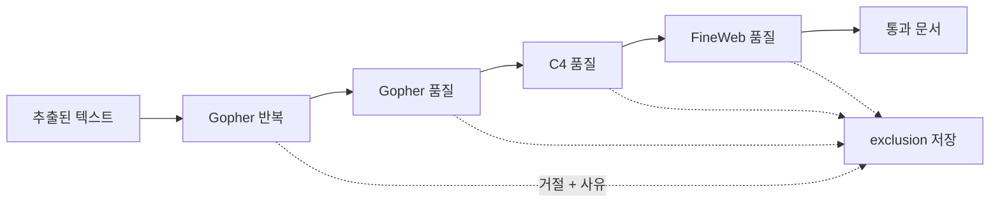
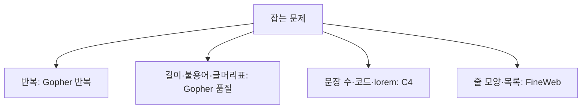

# FineWeb 품질 필터들

> FineWeb 파이프라인은 문서 품질을 **규칙 기반 필터 4종**(Gopher 반복·Gopher 품질·C4 품질·FineWeb 품질)으로 연달아 거른다. 각 필터는 서로 다른 종류의 쓰레기를 잡고, 거절 사유 이름을 남긴다.

## 쉽게 말하면
공항 보안 검색대가 네 개 줄지어 있다고 생각하자. 하나는 금속, 하나는 액체, 하나는 가방 속 모양을 본다. 한 검색대를 통과해도 다음 검색대에서 걸릴 수 있다. 품질 필터도 반복·길이·문장 모양·줄 모양을 각각 본다.

## 자세히
- **구성**: [FineWeb 예시](#datatrove-fineweb-example)는 GopherRepetitionFilter → GopherQualityFilter → C4QualityFilter → FineWebQualityFilter 순서다. 모두 사람이 정한 규칙(휴리스틱)이다.
- **GopherQualityFilter**(Gopher 논문 규칙, 소스 확인): 단어 50개 미만·10만 초과, 평균 단어 길이 3 미만·10 초과, `#`·말줄임표 비율 0.1 초과, 줄의 90% 넘게 글머리표, 30% 넘게 말줄임표로 끝남, 글자가 든 단어가 80% 미만, 불용어(the, be, to, of, and, that, have, with) 중 2개 미만. 사유 이름 `gopher_enough_stop_words`는 "불용어가 **부족**함"이라는 뜻이라 이름이 헷갈린다.
- **C4QualityFilter**: 문장 수 5개 미만, 줄당 단어 3개 미만 줄 제거, 마침표 없는 줄 제거 옵션, lorem ipsum·자바스크립트·중괄호·정책(약관) 문구 문서 제거 등(기본 인자 확인).
- **FineWebQualityFilter**(소스 확인): 줄이 문장부호로 끝나는 비율 0.12 이상, 30자 이하 짧은 줄 비율 0.67 이하, 중복 줄 글자 비율 0.01 이하, 줄바꿈/단어 비율 0.3 이하(목록형 문서 걸러내기). 임계값의 근거는 소스에 적혀 있지 않았다.
- **직접 실행**(datatrove + spacy, 합성 문서 7종, 각 필터가 내는 사유):

| 문서 | Gopher 품질 | C4 | FineWeb | Gopher 반복 |
|---|---|---|---|---|
| 정상 기사 | 통과 | 통과 | 통과 | 통과 |
| 짧은 광고 문구 | short_doc | 문장 부족 | short_line_ratio | top_2_gram |
| 글머리표 30줄 | too_many_bullets | 문장 부족 | line_punct_ratio | top_3_gram |
| 문장부호 없는 메뉴 줄 | stop_words 부족 | 문장 부족 | line_punct_ratio | dup_line_frac |
| lorem ipsum | stop_words 부족 | lorem_ipsum | line_punct_ratio | top_3_gram |
| 자바스크립트 섞인 글 | 통과 | curly_bracket | 통과 | 통과 |
| 같은 문장 40번 | below_avg_threshold | **통과** | line_punct_ratio | top_2_gram |

- 해석: **필터마다 놓치는 것이 다르다.** 자바스크립트 섞인 글은 C4만, 같은 문장 반복은 C4를 통과해 다른 셋이 잡았다. 그래서 겹쳐 쓴다. 합성 문서 하나씩의 예이며 실제 비율은 아니다.
- **한계(해석)**: 규칙은 영어 기준 문장부호·불용어를 전제한다. 다른 언어에는 `language` 설정과 규칙 조정이 필요하고, 규칙이 과하면 좋은 글(시, 대화록)도 버린다.

## 그림으로 보기



## 예시
```python
from datatrove.pipeline.filters import GopherQualityFilter
GopherQualityFilter(exclusion_writer=JsonlWriter("removed/")).filter(doc)  # 거절되면 (False, "사유")
```
- 사내 문서 정제 시 `exclusion_writer`로 제외 문서를 저장해 임계값이 너무 센지 샘플 검토.
- 교육: 합성 문서 7종에 필터 4개를 돌려 "누가 무엇을 잡나" 표를 직접 채우게 한다.

## 헷갈리는 것과 비교
| 개념 | 차이 |
|---|---|
| 규칙 기반 필터 | 사람이 정한 임계값 |
| [분류기 기반 필터](#fineweb-edu-classifier) | 모델이 교육적 가치를 점수화 |
| [중복 제거](#training-data-deduplication) | 같은 문서를 줄임. 품질과 별개 |
| [본문 추출](#trafilatura-extraction) | 필터 이전 단계 |

## 더 읽을거리
- [GopherQualityFilter 소스](https://github.com/huggingface/datatrove/blob/main/src/datatrove/pipeline/filters/gopher_quality_filter.py) — 규칙과 사유 이름(열어 확인).
- [FineWebQualityFilter 소스](https://github.com/huggingface/datatrove/blob/main/src/datatrove/pipeline/filters/fineweb_quality_filter.py) — 줄 단위 검사 5가지(열어 확인).
