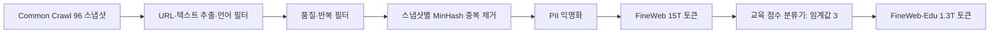
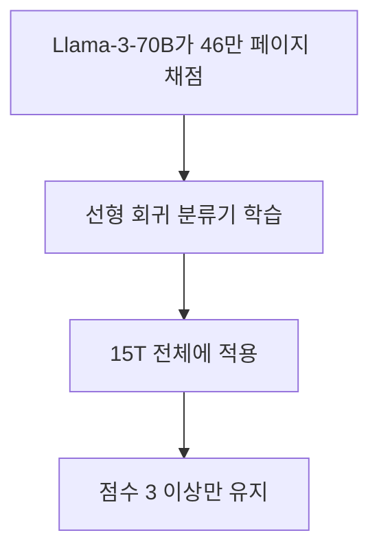

# FineWeb·FineWeb-Edu

> Hugging Face가 Common Crawl 96개 스냅샷에서 걸러 만든 약 15조 토큰의 공개 사전학습 코퍼스(FineWeb)와, 그중 "교육적" 텍스트만 고른 약 1.3조 토큰 부분집합(FineWeb-Edu)이다. 만드는 과정이 논문으로 공개돼 있어 사전학습 데이터 정제를 공부하기 좋은 사례다.

## 쉽게 말하면
인터넷에서 퍼 온 원재료(웹 아카이브)를 세척·선별해 "공개 레시피가 있는 밀키트"로 만든 것이다. FineWeb-Edu는 그 밀키트에서 "교과서처럼 가르치는 글"만 다시 고른 프리미엄 버전이다.

## 자세히
(논문 arXiv:2406.17557 v2 HTML 본문 앞부분과 HF 데이터셋 페이지의 메타데이터를 직접 확인. 논문 마지막 부분 약 8,800자는 읽지 못했다.)
- **FineWeb 파이프라인(논문)**: URL 필터링 → Trafilatura로 WARC에서 텍스트 추출 → fastText 언어 필터 → MassiveText 품질·반복 필터 → 일부 C4 필터 → 자체 휴리스틱 필터 → **스냅샷별 MinHash 중복 제거** → 이메일·공개 IP 익명화. 96개 스냅샷에서 15조 토큰.
- **중복 제거 발견**: 모든 스냅샷에 걸친 전역 MinHash 중복 제거는 오래된 데이터의 최대 90%를 지우고 성능이 나빴다. 그래서 스냅샷마다 독립적으로 중복 제거해 20조 토큰을 얻었고 RefinedWeb과 비슷한 성능을 냈다(논문 서술; 15조는 최종 FineWeb 공개 규모).
- **FineWeb-Edu 구성(논문)**: Llama-3-70B-Instruct가 CC-MAIN-2024-10 스냅샷의 웹페이지 46만 건에 0~5점 "교육 점수"를 매기고, 그중 41만 건으로 Snowflake-arctic-embed-m 임베딩 위에 선형 회귀 분류기를 학습, 5만 건으로 검증. 점수를 정수로 반올림해 **임계값 3**을 택했고(HellaSwag과의 절충) 검증 F1 82%. 15조 토큰 전체에 적용하는 데 H100 6,000 GPU시간이 들었고 결과가 약 1.3조 토큰.
- **효과(1.71B 파라미터 ablation 모델, 논문 주장)**: 350B 토큰 학습에서 MMLU 33%→37%, ARC 46%→57%. Matrix의 최종 MMLU를 약 10배 적은 토큰으로 맞춘다는 서술.
- **공개 조건**: 두 데이터셋 모두 ODC-By v1.0 라이선스이며 Common Crawl 이용약관의 적용도 받는다. datatrove 처리 코드와 ablation 모델도 허브에 공개.
- **HF 데이터셋 페이지 메타데이터(2026-11 확인)**: FineWeb 기본 train 25.9B행, 영어, 서브셋 114개(스냅샷별과 `sample-10BT`·`sample-100BT`·`sample-350BT`). FineWeb-Edu 기본 train 1.53B행, `score`·`int_score`(3~5) 컬럼 포함. 이 페이지에서는 데이터셋 카드 본문을 읽지 못했다.
- **한계(제안)**: "교육적" 판정은 LLM 점수에 의존하므로 편향이 있을 수 있고, 영어 중심이다. 다국어 확장 코퍼스는 이 노드의 범위 밖이다.

## 그림으로 보기



## 예시
```python
from datasets import load_dataset
ds = load_dataset("HuggingFaceFW/fineweb", name="sample-10BT", split="train", streaming=True)
for row in ds.take(2): print(row["url"], row["token_count"])
```
(컬럼명은 페이지 메타데이터에서 확인한 것이며 실행은 직접 해 보지 못했다.) 교육 소재: "같은 웹에서 점수 3 이상만 고르면 모델 성능이 어떻게 달라지나"를 논문 표로 설명.

## 헷갈리는 것과 비교
| 개념 | 차이 |
|---|---|
| [Common Crawl](#common-crawl) | 원천 아카이브 |
| FineWeb | 정제한 15조 토큰 코퍼스 |
| FineWeb-Edu | FineWeb의 교육성 높은 1.3조 토큰 부분집합 |
| [사전학습 데이터 필터링](#pretraining-data-filtering) | 이 파이프라인 전반의 개념 |

## 더 읽을거리
- [The FineWeb Datasets (arXiv:2406.17557)](https://arxiv.org/abs/2406.17557) — 파이프라인·FineWeb-Edu·중복 제거 실험(본문 앞부분 직접 확인).
- [HF: HuggingFaceFW/fineweb](https://huggingface.co/datasets/HuggingFaceFW/fineweb) — 라이선스·서브셋·컬럼(메타데이터 확인).
