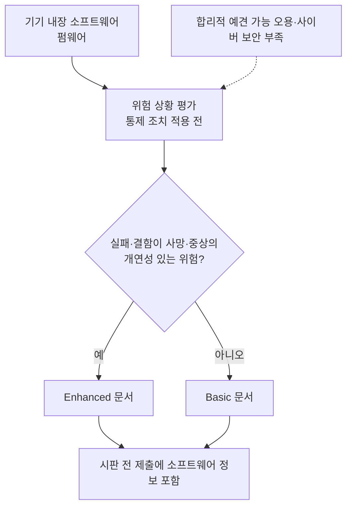

# 기기 펌웨어

> 하드웨어 의료기기 안에 들어 있어 기기를 직접 제어하는 소프트웨어. FDA는 펌웨어를 "device software function"의 한 예로 보며, 시판 전 제출 때 위험에 따라 Basic 또는 Enhanced 수준의 소프트웨어 문서를 요구한다.

## 쉽게 말하면
혈압계를 열어 보면 팽창·감압을 조절하는 작은 프로그램이 들어 있다. 이 프로그램이 오작동하면 환자가 다칠 수 있으므로, 기기를 허가받을 때 하드웨어뿐 아니라 이 소프트웨어를 어떻게 설계·시험했는지도 위험 크기에 맞춰 제출해야 한다.

## 자세히
출처: FDA 지침 "Content of Premarket Submissions for Device Software Functions"(2023-06-14 발행, 초안은 2021-11-04, PDF 내려받아 읽음). 머리글에 QMSR 발효(2026-02-02) 안내가 붙어 있다. 비구속 권고.
- **범위(III절)**: 이 지침은 device software function을 다루며, 예로 **펌웨어와 기타 소프트웨어 기반 제어 수단**, 의료기기의 소프트웨어 부속품, 기기에 해당하는 소프트웨어 단독 기능을 든다. "기능(function)"은 제품의 구별되는 목적이다(분석 하나, 저장·전송·분석이면 셋 등).
- **Documentation Level(V절)**: 위험에 기반해 **Basic**과 **Enhanced** 둘 중 하나.
  - **Enhanced**: 어떤 device software function의 실패나 결함이 환자·사용자·주변인에게 **사망이나 중상의 개연성 있는 위험**이 있는 위험 상황을 만들 수 있는 경우. 위험 통제 조치를 적용하기 **전** 기준으로 평가하고 의도한 용도 맥락에서 본다. "probable"은 순수한 가설적 위험을 배제한다는 뜻이다.
  - **Basic**: Enhanced가 해당하지 않는 모든 소프트웨어 기능 포함 제출.
  - 합리적으로 예견 가능한 오용과 사이버 보안 부족으로 기능이 손상될 가능성도 고려한다. 문서 수준은 기기 **전체**를 기준으로 한다.
  - 일부 범주(수혈 감염 검사 기기, 혈액 적합성 판정 기기, 자동 혈구 분리기, 혈액원 컴퓨터 소프트웨어)는 Enhanced를 권고한다.
- **부록 A 예시(발췌)**: 비접촉 적외선 체온계와 팽창식 커프 비침습 혈압계는 개연성 있는 사망·중상 위험이 일반적으로 없어 **Basic**. 소프트웨어가 전혀 없는 하드웨어 전용 고관절 삽입물은 문서 수준 없음. 다른 예시는 이번에 다 읽지 않았다.
- **설명**: 이 문서 수준은 2005년 "Level of Concern"을 대체했다는 설명이 검색 결과에 있다(지침 본문에서 직접 확인하지 않음).
- **AI 의료기기와의 관계(해설)**: AI 기기도 소프트웨어 기능이므로 같은 문서 수준 평가를 받고, 지속 변경 계획은 [PCCP](#pccp)가 다룬다.

## 그림으로 보기

## 예시
- 혈압계 펌웨어: 커프 팽창을 제어하지만 지침의 예시에서는 Basic.
- 점검 질문: "이 소프트웨어가 틀리면 환자가 죽거나 중상을 입을 개연성이 있는가? 사이버 보안이 뚫린 경우는?"

## 헷갈리는 것과 비교
| 개념 | 차이 |
|---|---|
| 펌웨어 | 기기 내장 제어 소프트웨어, SiMD의 전형 |
| [SaMD](#samd) | 하드웨어 없이 의료 목적을 수행하는 별도 소프트웨어 |
| [소프트웨어 기능 정책](#software-function-policy) | 어떤 소프트웨어를 감독할지, 이 지침은 제출 내용 |
| [일반 통제 vs 특별 통제](#general-vs-special-controls) | 기기 등급별 일반 규제 |

## 더 읽을거리
- [Content of Premarket Submissions for Device Software Functions (FDA, 2023-06-14)](https://www.fda.gov/media/153781/download) — 범위·Documentation Level·예시(내려받아 확인)
