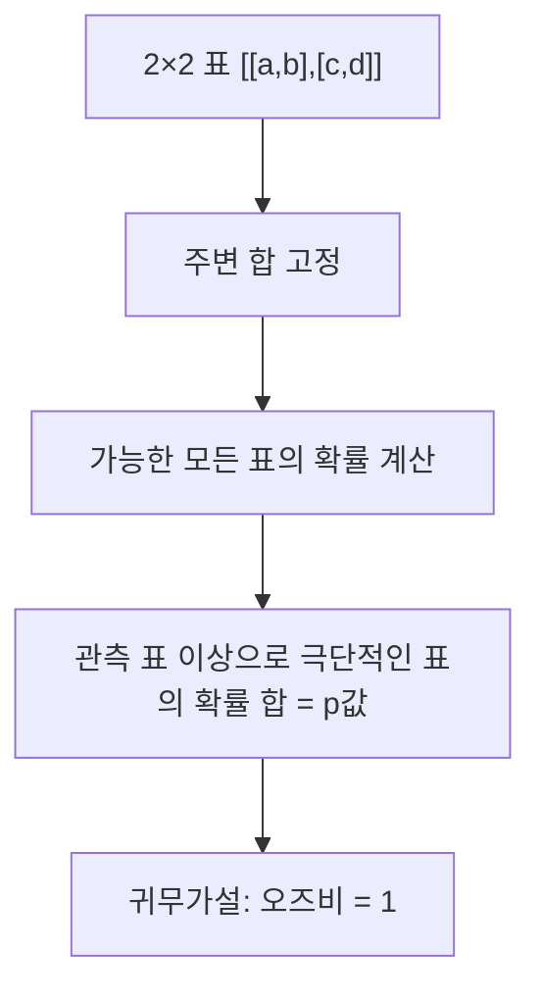

# Fisher 정확 검정

> 작은 표본의 분할표(주로 2×2)에서, 카이제곱의 근사 없이 **정확한 확률**로 p값을 계산하는 검정. 귀무가설은 두 집단의 실제 오즈비가 1이라는 것이다. 칸의 기대 빈도가 작아 카이제곱이 부정확할 때 쓴다.

## 쉽게 말하면
표본이 열 명 안팎일 때는 어림 공식 대신 "가능한 모든 표 배치 중 지금 표보다 극단적인 배치가 얼마나 되는지"를 직접 센다. 어림이 없는 대신 계산이 정확하다.

## 자세히
출처: SciPy 공식 문서 `scipy.stats.fisher_exact`(열어서 읽음) + 이 세션의 직접 실행(scipy 1.17.1).
- **검정(문서)**: 2×2 표에서 귀무가설은 모집단의 실제 **오즈비가 1**이다. 관측한 표와 **주변 합이 같은 표들**을 기준으로(주변 합 고정) 관측 표와 같거나 더 극단적인 표가 나올 확률이 p값이다.
- **통계량(문서)**: 기본 방법에서 2×2 표의 통계량은 표본(무조건) 최대우도 **오즈비** 추정이다. R의 `fisher.test`는 조건부 최대우도 추정을 보고해 값이 다르다. 조건부 추정이 필요하면 `scipy.stats.contingency.odds_ratio`를 쓴다.
- **대립가설(2×2 한정)**: `'two-sided'`(기본), `'less'`, `'greater'`.
- **다른 크기의 표**: 행·열 합이 고정되고 독립이라는 귀무가설이며, 통계량은 관측 표의 확률 질량, p값은 질량이 같거나 작은 표의 비율이다. `PermutationMethod`나 `MonteCarloMethod`로 재표집 p값도 계산할 수 있다.
- **문서 예 검증(이 세션)**: `fisher_exact([[8, 2], [1, 5]])`의 통계량 **20.0**, 양측 p ≈ **0.034965**로 문서와 일치했다(직접 실행).
- **카이제곱과의 비교(이 세션)**: 표 [[8,2],[3,7]]은 기대 빈도에 4.5인 칸이 있다. 보정 없는 카이제곱 p=0.0246은 Fisher 정확 p=0.0698보다 훨씬 작아 근사가 과대 유의를 냈다([기대 빈도 5 이상 규칙](#expected-frequency-rule)). 한 표의 결과다.
- **쓰임**: 희귀 범주가 많은 소표본 드리프트 점검, 임상 소규모 비교. 표가 커지면 계산이 무거워져 재표집 방법을 쓴다.
- **한계**: 주변 합 고정 가정은 설계에 따라 어색할 수 있고, 매우 큰 표본에서는 카이제곱과 거의 같은 결론이어서 이점이 없다(일반 설명).

## 그림으로 보기


## 예시
```python
from scipy.stats import fisher_exact
res = fisher_exact([[8, 2], [3, 7]])
print(res.statistic, res.pvalue)   # 오즈비 약 9.33, p ≈ 0.0698
```
- 점검: 기대 빈도 5 미만 칸이 있는 2×2 표에서는 카이제곱 대신 Fisher 정확 p값을 병기.

## 헷갈리는 것과 비교
| 개념 | 차이 |
|---|---|
| Fisher 정확 검정 | 정확 p값, 작은 표본용 |
| 카이제곱 검정 | 점근 근사, 기대 빈도 조건 필요 |
| 오즈비 | 효과 크기, 이 검정의 귀무가설이 1 |
| [카이제곱 드리프트 검정](#chi-square-drift) | 큰 표본·범주형 분포 비교 |

## 더 읽을거리
- [scipy.stats.fisher_exact (SciPy 문서)](https://docs.scipy.org/doc/scipy/reference/generated/scipy.stats.fisher_exact.html) — 정의·통계량·문서 예(열어서 확인)
