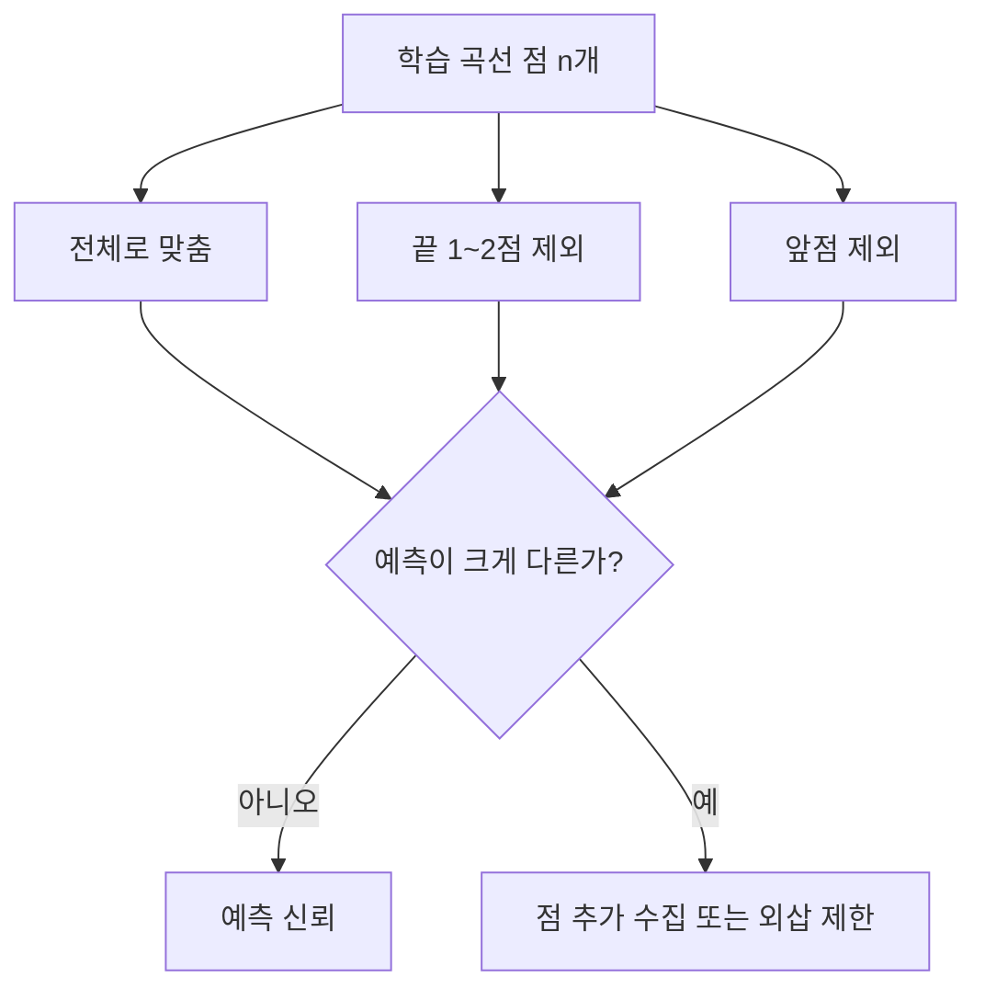

# 맞춤 범위 안정성

> 학습 곡선에 멱법칙을 맞출 때 **어느 크기 구간의 점을 썼는지**에 따라 지수 β와 점근 오류 γ, 그리고 미래 예측이 달라진다. 결론을 믿기 전에 **점 수·구간을 바꿔 맞춰도 같은 답이 나오는지** 확인한다.

## 쉽게 말하면
도로의 처음 5km만 보고 "이 길은 계속 오르막"이라고 예측했는데 알고 보니 곧 평지가 되는 경우와 같다. 구간을 바꿔 가며 같은 결론이 나오는지 확인하면 예측의 신뢰도가 보인다.

## 자세히
- **근거(Hestness 외, arXiv 1712.00409, 본문 확인)**: 학습 곡선은 작은 데이터의 best-guessing 영역, 멱법칙 영역, 포화 영역의 세 부분으로 이뤄진다. 곡선의 어느 부분을 맞추느냐에 따라 모양이 달라진다. 논문은 단일 모델군에서는 ε = a·m^β + γ가 잘 맞지만 **여러 크기의 최적 모델을 조합한 곡선에서는 γ 없이 더 긴 멱법칙 영역(β≈−0.128로 투영)** 이 보인다고 서술한다 — 같은 현상도 어떤 곡선을 쓰느냐에 따라 상수 항이 필요하기도 하고 아니기도 하다.
- **직접 실험(순수 파이썬, 가상 곡선 ε=2.0·m^(−0.35)+0.05, 곱셈 잡음 2%, m=10³~10⁶ 2배 간격 11점)**: 앞쪽 일부 점만 쓰면 γ·β·예측이 크게 틀리고, 점을 더하면 안정된다.
  | 맞춤에 쓴 구간 | 점 수 | γ(진짜 0.05) | β(진짜 0.35) | m=10⁸ 예측(진짜 0.0532) |
  |---|---|---|---|---|
  | 10³~1.6×10⁴ | 5 | 0.075 | 0.463 | 0.0758 |
  | 10³~6.4×10⁴ | 7 | 0.0455 | 0.346 | 0.0490 |
  | 10³~2.6×10⁵ | 9 | 0.0485 | 0.357 | 0.0515 |
  | 10³~1.0×10⁶ | 11 | 0.0505 | 0.368 | 0.0532 |
  | 8×10³~1.0×10⁶(앞 3점 제외) | 8 | 0.0520 | 0.388 | 0.0542 |
  | 3.2×10⁴~1.0×10⁶ | 6 | 0.0495 | 0.347 | 0.0526 |
  처음 5점만으로는 예측이 **약 42% 높게**(0.0758 vs 0.0532) 나온다. 점이 9~11개로 늘고 큰 크기를 포함하면 5% 이내로 안정된다. 앞쪽 점을 빼도(작은 크기는 곡선 모양이 달라 오히려 제외가 도움이 되기도 함) 답이 거의 같다. 한 번의 무작위 잡음 실험이라 정확한 수치는 시드에 따라 달라진다.
- **안정성 점검 절차(권장)**
  1. **끝점 뒤로 줄이기**: 마지막 1~2점을 빼고 맞춰 예측이 크게 바뀌는지.
  2. **앞점 제외**: 작은 크기(best-guessing 영역) 점을 빼고 맞춰도 같은지.
  3. **구간별 지수 표**: 지수 β를 구간별로 계산해 일정한지(일정하면 멱법칙 영역).
  4. **부트스트랩**: 점을 재표집해 맞춘 γ·β의 분포로 불확실성 보고([부트스트랩](#bootstrap-ci-for-cv)).
  5. 예측은 **보간이 아니라 외삽**이므로 맞춘 최대 크기의 10배 이내로 제한하는 보수적 규칙(권장).
- **함정**: γ를 0으로 고정하면 지수를 과소 추정한다([점근 오류](#asymptotic-error)의 직접 계산: 지수 −0.18). 각 점의 시험 잡음이 크면 작은 구간 맞춤은 더 흔들린다.
- **보고 서식**: "점 8개(8천~100만)에서 β=0.39, γ=0.052; 앞 3점 제외·끝 2점 제외 시 예측 변동 ±3%".

## 그림으로 보기



## 예시
```python
for lo, hi in [(0, 5), (0, 7), (0, 9), (0, 11), (3, 11)]:
    b, g = fit_powerlaw(sizes[lo:hi], errors[lo:hi])      # γ 포함 맞춤
    print(sizes[lo], sizes[hi - 1], b, g, predict(1e8, b, g))
```
- 사내 모델 학습 곡선(1천~6.4만 7점)으로 "50만 건이면 오류 몇 %"를 예측하기 전에 구간을 바꿔 맞춰 보고 ±범위를 함께 보고.

## 헷갈리는 것과 비교
| 개념 | 설명 |
|---|---|
| 보간 | 측정 범위 안의 값 |
| 외삽 | 범위 밖 예측(불확실성 큼) |
| 맞춤 범위 안정성 | 구간을 바꿔도 같은 결과인지 |
| [로그 간격 표본 크기](#log-spaced-sample-sizes) | 곡선 점을 만드는 방법 |

## 더 읽을거리
- [Deep Learning Scaling is Predictable, Empirically (arXiv 1712.00409)](https://arxiv.org/abs/1712.00409) — 학습 곡선의 세 영역과 단일/조합 곡선 차이(PDF 본문 확인). 구간별 표는 이 글의 직접 시뮬레이션.
