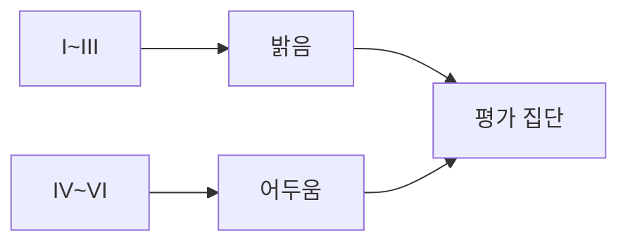
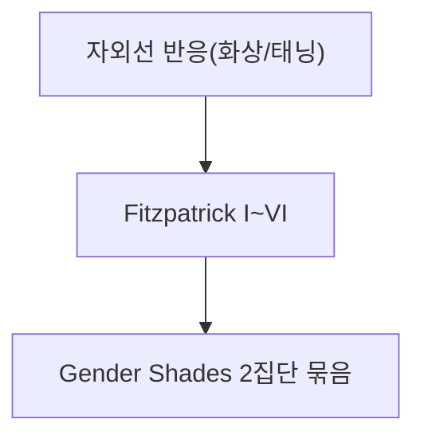

# Fitzpatrick 피부 유형

> 자외선에 대한 피부 반응(화상·태닝)을 기준으로 피부를 I~VI 6단계로 나눈 피부과 분류다. Gender Shades는 이를 밝음(I–III)과 어두움(IV–VI) 두 집단으로 묶어 평가에 썼다.

## 쉽게 말하면
"햇볕을 쬐면 잘 타는가, 그을리는가"로 피부를 6칸 표에 나눈 것이다. 피부색 자체가 아니라 자외선 반응을 기준으로 삼는다.

## 자세히
(Gender Shades 논문과 위키백과 요약을 하위 에이전트가 읽은 노트. Fitzpatrick 원 논문은 열지 못해 연대·세부는 2차 자료 기준이라 **미확인**.)
- **분류**: 6단계, UV 반응 기반. 위키백과는 Thomas B. Fitzpatrick가 1975년에 제안(처음엔 4유형, V·VI은 이후 추가)했고 주된 인용은 1988년 Arch Dermatol 논문이라고 적는다.
- **Gender Shades의 사용**: 피부과 의사의 "표준"으로 소개하면서도 밝은 피부에 치우쳐 설계되었다고 지적한다. 사진으로 라벨링하면 한 단계 오차가 생기므로 I–III은 **밝음**, IV–VI은 **어두움**으로 묶어 오차를 흡수했다. PPB의 최종 라벨은 전문 외과 피부과 의사가 부여.
- **한계(제안)**: 6단계는 어두운 피부 안의 다양성을 충분히 구분하지 못한다는 비판이 있다(이 노드는 해당 문헌을 확인하지 않았다). 사진 기반 라벨은 조명·카메라 영향을 받는다.
- **데이터 설계 관점(제안)**: 평가에 피부색 속성을 쓰려면 라벨링 방식(사진/대면), 주석자 자격, 묶음 기준을 문서화한다.

## 그림으로 보기

## 예시
- 피부 질환 이미지 데이터셋 점검 시 Fitzpatrick 유형 분포표를 먼저 확인.
- 교육 활용: "피부색 같은 속성을 어떻게 측정하고 묶느냐"가 공정성 평가를 좌우한다는 토론.

## 헷갈리는 것과 비교
| 개념 | 차이 |
|---|---|
| Fitzpatrick 유형 | UV 반응 기반 6단계 |
| 피부색(색상값) | 이미지 색 자체 |
| [교차 평가](#intersectional-evaluation) | 이 유형을 성별과 조합 |

## 더 읽을거리
- [Gender Shades (PMLR 81)](http://proceedings.mlr.press/v81/buolamwini18a/buolamwini18a.pdf) — 사용 방식.
