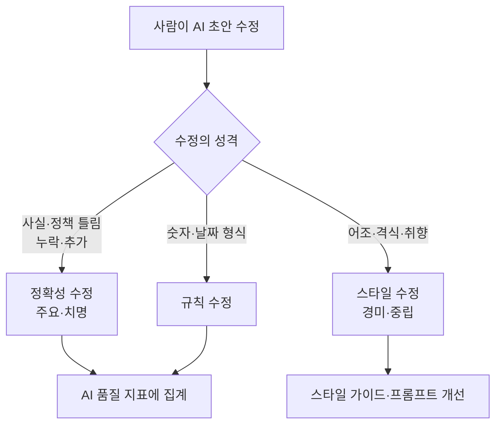

# 오류 수정과 스타일 수정 구분

> 사람이 AI 초안을 고친 내용을 **"틀린 것을 바로잡은 수정(정확성·사실)"과 "취향·문체를 다듬은 수정(스타일)"으로 나눠 세는 것**. 같은 수정 횟수라도 의미가 전혀 다르므로, 수정량만 보면 AI의 품질을 잘못 읽는다.

## 쉽게 말하면
선생님이 학생 답안에 빨간 줄을 많이 그었다고 해서 모두 오답은 아니다. "계산이 틀렸다"와 "문장이 어색하다"는 점수에 미치는 영향이 다르다. 수정의 성격을 구분해야 AI가 사실을 틀리는지, 말투만 다른지 알 수 있다.

## 자세히
출처: MQM(Multidimensional Quality Metrics) 오류 유형 페이지와 채점 모델 페이지(둘 다 본문 확인, 2026-11-18). MQM은 번역 품질 평가 틀이지만 오류의 성격과 심각도를 분류하는 구조를 후편집 분석에 빌려 쓸 수 있다(적용은 제안).
- **MQM 핵심 7개 차원**: 용어(Terminology), 정확성(Accuracy: 오번역·과번역·누락·추가 등 7개), 언어 규칙(Linguistic Conventions: 문법·맞춤법 등), **스타일(Style: 문체 지침 위반, 어조·격식, 어색함, 관용 부적절, 일관성 등 7개)**, 로케일 규칙(숫자·통화·날짜 형식), 독자 적합성(문화 참조·불쾌), 디자인·마크업.
- **정확성 vs 스타일(문서 정의)**: 정확성 오류는 번역문이 원문의 명제적 내용과 대응하지 않는 왜곡·누락·추가이고, 스타일 오류는 문법적으로 허용되지만 문체 지침이나 어조 면에서 부적절한 것이다. 경계 사례의 판정 규칙은 해당 페이지에 없고 별도 결정 트리가 있다고 안내만 한다.
- **심각도(MQM 채점 모델)**: 중립 0, 경미 1, 주요 5, 치명 25의 곱수(권장은 지수적 진행). 치명은 목적에 부적합하거나 신체·재정·평판의 중대한 위험이며 많은 체계에서 치명 1건이면 불합격. 오류 유형 가중치(ETW) 기본값은 1이고 중요한 유형에 더 높게 줄 수 있다.
- **점수식**: 총 벌점(APT) = 심각도별 건수 × 곱수의 합 × ETW, 단어당 벌점 = APT ÷ 평가 단어 수, 정규화 벌점(NPT) = 단어당 벌점 × 기준 단어 수(보통 1,000). 합격선은 100점 만점에 99가 전형적이라고 한다. 상세 환산식은 이미지로만 제시된다.
- **직접 계산 예(가상)**: 800단어 초안에서 경미 1건, 주요 2건, 치명 1건이면 APT = 1×1 + 2×5 + 1×25 = 36, 1,000단어당 정규화 벌점은 36×1000/800 = 45. 치명 1건이 전체의 약 70%를 차지한다. 수정 횟수는 4건이지만 심각도 가중으로 보면 사실 오류가 압도한다.
- **상담 문서 적용(제안)**: 수정 태그를 ①사실·정책 오류(치명·주요) ②누락·추가 ③숫자·날짜 형식 ④어조·격식 ⑤단순 취향으로 분류하고, 정확성 계열 수정만 AI 품질 문제로 집계한다. 스타일 수정이 많으면 스타일 가이드·프롬프트 문제다.
- **한계**: 분류 자체가 주관적이므로 정의문과 보정 세션이 필요하다([코드 정의 보정 세션](#code-definition-calibration)). 번역과 상담 요약은 오류 분포가 다를 수 있다.

## 그림으로 보기

## 예시
| 수정 | 분류 | 심각도 |
|---|---|---|
| 환불 기한 7일 → 14일 | 정확성(정책) | 치명/주요 |
| 고객 이름 오기 정정 | 정확성 | 주요 |
| "안내드립니다" → "알려드립니다" | 스타일(어조) | 경미/중립 |
교육 활용: 후편집 로그 30건을 직접 분류해 "수정 횟수 대비 사실 오류 비율"을 구해 본다.

## 헷갈리는 것과 비교
| 개념 | 차이 |
|---|---|
| 오류 수정 | 사실·정책이 틀려서 바로잡음 |
| 스타일 수정 | 문체·어조·취향 조정 |
| [정규화 편집 거리](#normalized-edit-distance) | 수정의 양, 성격은 모름 |
| [작지만 중요한 수정](#critical-small-edit) | 글자 변화는 작지만 의미가 큰 수정 |

## 더 읽을거리
- [MQM 오류 유형 체계](https://themqm.org/the-mqm-typology/) — 7개 차원과 하위 유형
- [MQM 채점 모델](https://themqm.org/mqm-pillars/the-mqm-scoring-models/) — 심각도 곱수와 점수식
