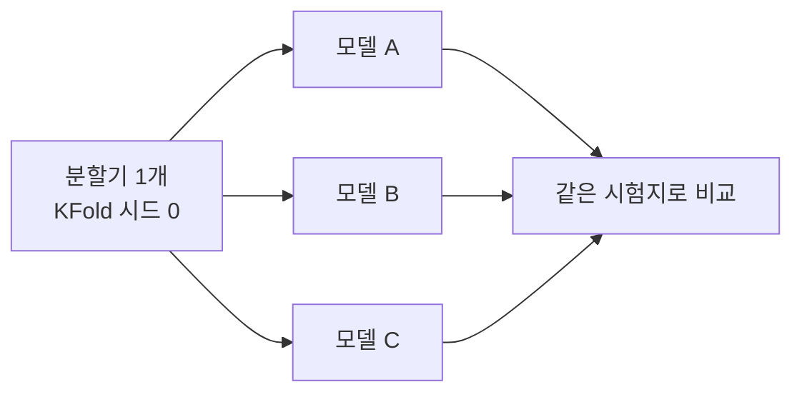
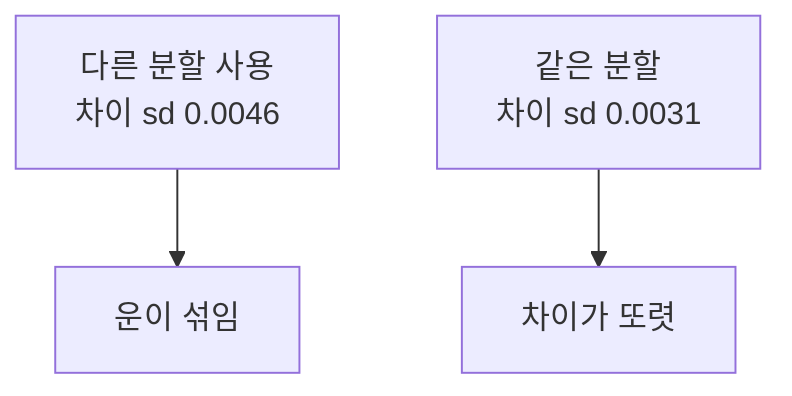

# 비교용 k 고정

> 모델을 비교할 때는 모든 모델에 같은 K와 같은 분할(같은 시드)을 써야 한다. 그래야 점수 차이에 분할 운이 섞이지 않고, 점수가 비슷한 모델일수록 차이를 더 정확히 볼 수 있다.

## 쉽게 말하면
두 학생의 실력을 비교하는데 한 명에게는 쉬운 시험지를, 다른 한 명에게는 어려운 시험지를 주면 안 된다. 같은 시험지를 풀게 해야 점수 차이가 시험지 때문이 아니라 실력 때문이라고 말할 수 있다. 교차검증에서는 "같은 분할"이 같은 시험지다.

## 자세히
- **방법**: `cv=KFold(5, shuffle=True, random_state=0)`처럼 분할기 객체를 하나 만들어 모든 모델의 `cross_val_score`에 넘긴다. 정수 `cv=5`만 쓰면 분류에서는 섞지 않는 층화 분할이 기본이다(scikit-learn 문서, 열람)라 결정적이지만, 섞는 분할기를 쓸 때는 시드를 고정해야 같은 분할이 된다.
- **직접 해 본 실험(유방암 데이터 569개, 5겹, 200번 반복)**: 거의 같은 두 모델(표준화+로지스틱 회귀 C=1 대 C=0.3)의 평균 점수 차이를 구했다. 두 모델에 같은 분할을 쓰면 차이의 표준편차가 0.0031, 모델마다 다른 분할을 쓰면 0.0046으로 약 33% 더 흔들렸다. 같은 분할을 쓰면 차이가 부호가 +인 비율도 0.42였고 다른 분할은 0.39였다. 두 모델은 사실상 동률이며, 분할을 다르게 쓰면 우연히 한쪽이 앞서 보이는 폭이 커진다.
- **차이가 큰 모델에서는(같은 실험)**: 로지스틱 회귀와 결정나무처럼 점수가 5%p 이상 차이 나면 같은 분할(차이 sd 0.0093)과 다른 분할(0.0096)의 효과가 거의 없었다. 같은 분할은 비슷한 모델끼리의 미세한 비교에서 가장 쓸모 있다.
- **K도 고정**: K가 다르면 학습 크기가 달라 점수가 달라진다([가파른 학습 곡선 위험](#steep-learning-curve-risk)). 비교표의 모든 모델은 K·시드·지표를 같게 한다.
- **한계(해석)**: 같은 분할을 써도 [점수 비독립성](#score-non-independence) 문제는 남으므로 판정은 [보정 검정](#model-comparison-cv)이나 새 시험 세트로 확인한다.

## 그림으로 보기



## 예시
```python
cv = KFold(5, shuffle=True, random_state=0)
for name, m in models.items():
    print(name, cross_val_score(m, X, y, cv=cv).mean())
```
교육 활용: 시드를 모델마다 다르게 줘서 순위가 뒤집히는 경험을 해 보고, 같은 분할로 바로잡는다.

## 헷갈리는 것과 비교
| 개념 | 차이 |
| --- | --- |
| 같은 분할 | 모든 모델이 같은 폴드 |
| 같은 K | 학습 크기를 맞춤 |
| [짝지은 점수 비교](#paired-score-comparison) | 같은 분할의 점수 차를 쌍으로 분석 |
| [교차검증 점수 보고법](#cv-score-reporting) | 설정 기록 |

## 더 읽을거리
- [scikit-learn: Cross-validation](https://scikit-learn.org/stable/modules/cross_validation.html) — 분할기와 기본 cv 동작
