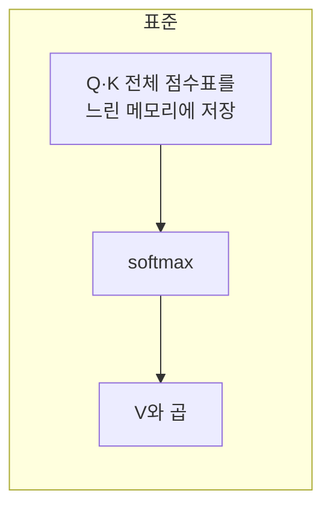

# FlashAttention

> FlashAttention은 어텐션을 수학적으로 똑같은 결과(exact)로 계산하면서 GPU 메모리 입출력을 줄여 더 빠르고 메모리를 덜 쓰게 만든 구현이다.

## 쉽게 말하면
요리사가 재료를 창고(느린 메모리)에서 매번 가져오는 대신 작업대(빠른 메모리) 위에서 한 번에 처리하고 결과만 창고에 넣는 것과 같다. 요리 결과는 같은데 왔다 갔다 하는 시간이 줄어든다.

## 자세히
저장소 README(Dao-AILab/flash-attention) 기준:
- 이름 그대로 "빠르고 메모리 효율적인 **정확한** 어텐션". 근사(approximation)가 아니다.
- 메모리 사용이 시퀀스 길이에 **선형**(표준 어텐션은 제곱). README는 길이 2K에서 10배, 4K에서 20배 메모리 절감을 보고한다.
- 버전: FA2(주력, 2배 빠르다고 변경 기록에 서술), FA3(베타, Hopper GPU, FP16/BF16 + FP8 forward), FA4(CuTeDSL, Hopper·Blackwell).
- 하드웨어: FA2는 Ampere·Ada·Hopper(A100, RTX 4090, H100), fp16/bf16. Linux, PyTorch 2.2+. 설치는 `pip install flash-attn --no-build-isolation`(컴파일이 무거워 `MAX_JOBS` 제한 권장).
- GPT 학습이 HF 기본 구현 대비 3~5배, A100당 최대 225 TFLOPs/s라고 보고(저자 주장).
- 긴 컨텍스트 모델·긴 문서 처리의 비용을 낮추는 기반 기술이다. [어텐션 마스크](#attention-mask)의 인과 옵션(`causal=True`)도 지원한다.

## 그림으로 보기



## 예시
```python
from flash_attn import flash_attn_func
# q, k, v: (batch, seqlen, nheads, headdim)
out = flash_attn_func(q, k, v, causal=True)
```
Hugging Face 등에서는 `attn_implementation="flash_attention_2"` 옵션으로 켜는 경우가 많다(이번에 열어 본 문서에는 없음, 일반 사용법).

## 헷갈리는 것과 비교
| 개념 | 차이 |
|---|---|
| FlashAttention | 계산 방식 최적화, 결과 동일 |
| 희소·선형 어텐션 | 계산 자체를 근사해 줄임 |
| [KV 캐시](#kv-cache) | 이미 계산한 값을 재사용 |
| [양방향 어텐션](#bidirectional-attention) | 무엇을 보느냐의 문제, 속도와 별개 |

## 더 읽을거리
- [flash-attention (GitHub)](https://github.com/Dao-AILab/flash-attention) — 버전, 지원 하드웨어, 설치·사용 코드.
