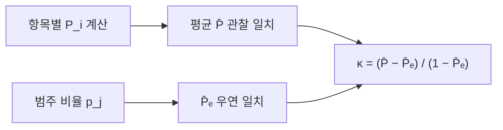
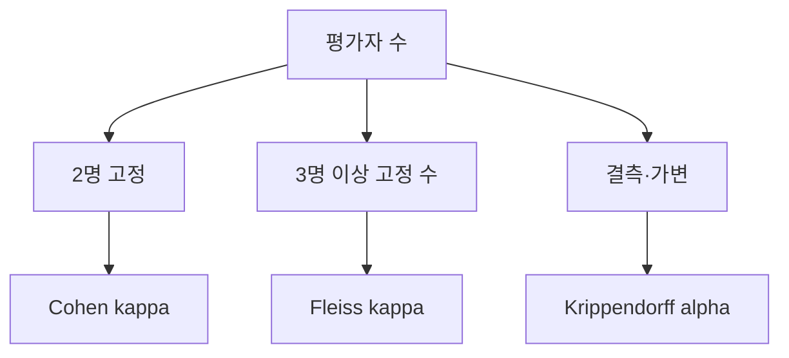

# Fleiss kappa

> 평가자가 3명 이상일 때, 범주형 라벨의 일치도를 우연히 일치할 정도를 빼고 계산하는 지표. 한 항목마다 평가자 수는 같아야 하지만 항목마다 다른 평가자가 해도 된다.

## 쉽게 말하면
여러 채점자가 답안지를 "상/중/하"로 나눴을 때 얼마나 같은 결론을 냈는지를 재는데, 그냥 찍어도 어느 정도 맞는 몫(우연 일치)을 빼고 남은 "진짜 합의"만 본다.

## 자세히
출처는 위키백과 "Fleiss' kappa"(열람, 2차 출처)다.
- **기호**: N = 항목 수, n = 항목당 평가자 수(고정), k = 범주 수, n_ij = 항목 i를 범주 j로 분류한 평가자 수.
- **식**: 범주 비율 p_j = (1/(N·n)) Σ n_ij. 항목별 일치 P_i = [1/(n(n−1))] Σ n_ij(n_ij − 1). 평균 관찰 일치 P̄ = (1/N) Σ P_i. 우연 기대 일치 P̄ₑ = Σ p_j². κ = (P̄ − P̄ₑ) / (1 − P̄ₑ).
- **해석(Landis & Koch 1977)**: <0 나쁨, 0.01~0.20 약간, 0.21~0.40 보통 이하(fair), 0.41~0.60 중간, 0.61~0.80 상당, 0.81~1.00 거의 완벽. 이 구간은 근거보다 의견에 가깝고 보편적으로 합의된 것이 아니다. 범주 수와 항목에 따라 κ가 달라 연구 간 직접 비교는 조심한다.
- **Cohen's kappa와의 차이**: Cohen은 평가자 2명이고 같은 두 명이 모든 항목을 평가, Fleiss는 고정된 임의 인원수이며 항목마다 다른 평가자여도 된다. Scott의 pi를 일반화한 것이다.
- **한계**: 평가자가 항목마다 무작위로 뽑힌다고 가정하므로 모든 평가자가 모든 항목을 평가하는 설계에는 Conger's kappa가 대안으로 언급된다. 유의한 p값은 우연보다 낫다는 뜻일 뿐 예측에 쓸 만큼 높다는 뜻이 아니다. 문서는 kappa 역설(편중 분포에서 낮은 값)은 다루지 않았다.

## 직접 계산한 가상 예시
문의 10건을 평가자 3명이 환불/교환/기타 세 범주로 분류(가상 데이터, 각 행은 (환불, 교환, 기타)를 고른 평가자 수).

| 항목 | 1 | 2 | 3 | 4 | 5 | 6 | 7 | 8 | 9 | 10 |
|---|---|---|---|---|---|---|---|---|---|---|
| 분포 | 3,0,0 | 3,0,0 | 2,1,0 | 2,1,0 | 0,3,0 | 0,2,1 | 1,1,1 | 0,0,3 | 0,1,2 | 3,0,0 |
| P_i | 1 | 1 | 1/3 | 1/3 | 1 | 1/3 | 0 | 1 | 1/3 | 1 |

- P̄ = 6.333/10 ≈ 0.633
- p_j = (환불 0.467, 교환 0.300, 기타 0.233) → P̄ₑ = 0.467² + 0.300² + 0.233² ≈ 0.362
- κ = (0.633 − 0.362) / (1 − 0.362) ≈ 0.425 → Landis & Koch 기준 "중간(moderate)". 단순 일치로 보면 63%인데 우연 몫을 빼면 0.43으로 낮아진다.
(이 계산은 스크립트로 확인한 값이며, 위키백과 예시 N=10, n=14, k=5의 κ≈0.210과는 별개다.)

## 그림으로 보기

## 예시
- 위 가상 표를 스프레드시트에 넣어 P_i, P̄, P̄ₑ를 계산해 본다.
- 교육 실습: 라벨링 20건을 3명이 따로 하고 κ를 계산한 뒤, 일치율과의 차이를 설명.

## 헷갈리는 것과 비교
| 개념 | 차이 |
|---|---|
| Fleiss kappa | 3명 이상, 인원 수 고정 |
| [코헨 카파](#cohens-kappa) | 정확히 두 평가자 |
| [크리펜도르프 알파](#krippendorff-alpha) | 결측·가변 인원 허용 |
| 단순 일치율 | 우연 보정 없음 |

## 더 읽을거리
- [Wikipedia: Fleiss' kappa](https://en.wikipedia.org/wiki/Fleiss%27_kappa) — 식과 해석(열람, 2차 출처)
