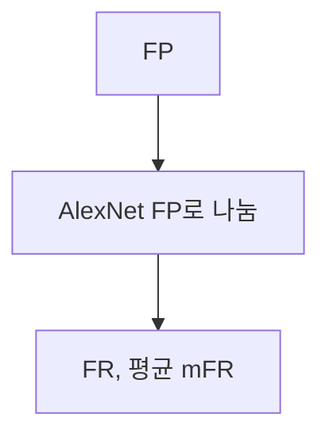

# Flip Rate

> 점진적으로 변하는 입력 시퀀스(ImageNet-P)에서 모델의 예측이 인접 프레임 사이에 얼마나 뒤집히는지를 재는 안정성 지표다.

## 쉽게 말하면
영상에서 물체가 조금씩 움직이는데 AI가 "개→고양이→개"를 오락가락하면 불안정하다. 그 오락가락 비율을 센다.

## 자세히
(Hendrycks & Dietterich arXiv 1903.12261을 하위 에이전트가 원문으로 읽은 노트 기준.)
- **ImageNet-P**: 10가지 섭동 시퀀스, 각각 30프레임 이상.
- **정의**: 뒤집힘 확률 FP = (1/(m(n−1))) Σ 1[f(x_j) ≠ f(x_{j−1})](m개 시퀀스, n프레임). **Flip Rate FR = FP / FP^AlexNet**, mFR은 평균. 순위 기반 T5D/mT5D도 있다.
- **수치**: ResNet-18의 Scale 섭동 FP 15.6%. mFR — ResNet-50 58.0, DenseNet-121 56.4, ResNeXt-50 52.4, DenseNet-161 46.9, ResNeXt-101 43.2.
- **의미(제안)**: 정확도가 같아도 예측이 흔들리는 모델은 영상·센서 입력 서비스에서 신뢰하기 어렵다. 예측 일관성은 정확도와 별도 지표로 본다.

## 그림으로 보기

## 예시
- 영상 분류 모델의 프레임별 예측 기록으로 뒤집힘 횟수 세기.
- 교육 활용: 정확도 높은 모델도 불안정할 수 있음을 영상 예로 설명.

## 헷갈리는 것과 비교
| 개념 | 차이 |
|---|---|
| Flip Rate | 예측 안정성 |
| [mCE](#mean-corruption-error) | 손상 하의 오류 수준 |
| 정확도 | 맞힌 비율 |

## 더 읽을거리
- [Benchmarking Neural Network Robustness (arXiv 1903.12261)](https://arxiv.org/abs/1903.12261) — ImageNet-P·FR.
