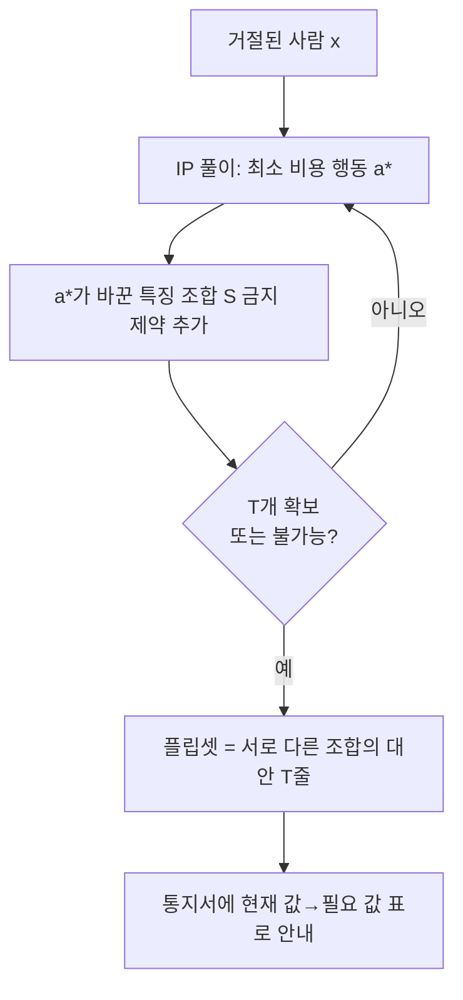

# 플립셋

> **플립셋(flipset)**은 모델에게 불리한 결정(예: 대출 거절)을 받은 사람에게, **결정을 뒤집을 수 있는 구체적인 변경 목록**(현재 값 → 필요한 값)을 몇 가지 대안으로 보여 주는 통지서 형식이다. Ustun·Spangher·Liu(2019)가 제안했다.

## 쉽게 말하면
시험에서 떨어진 학생에게 "점수가 낮았습니다"라고만 하지 않고, "A안: 수학 +10점, B안: 영어 +5점과 과제 제출, C안: ..."처럼 합격 가능한 경로를 여러 개 적어 주는 성적 통지서와 같다. 하나만 주면 그 사람이 할 수 없는 길일 수 있으니, **서로 다른 특징을 건드리는 대안**을 여러 줄 준다.

## 자세히
(논문 「Actionable Recourse in Linear Classification」(arXiv 1809.06514) PDF 본문을 직접 읽어 확인.)
- **구성**: 각 줄(item)은 바꿀 특징의 **현재 값 → 필요한 값**이다. 논문 Figure 1의 가상 예: `n_credit_cards 5→3`, `current_debt $3,250→$1,000`, `has_savings_account FALSE→TRUE`와 `has_retirement_account FALSE→TRUE`. 한 줄을 실행하면 예측이 ŷ=−1에서 +1로 뒤집힌다.
- **쓰임새(논문 주장)**: 미국 ECOA는 신용 거절 시 "주된 이유"를 담은 **불리한 조치 통지서(adverse action notice)**를 보내게 하는데, 이유 설명만으로는 행동 가능한 정보가 아닐 수 있다. 플립셋을 넣으면 "이렇게 바꾸면 다음에 승인된다"는 정확한 변경을 알려 줄 수 있다.
- **생성법(논문 Algorithm 1)**: 정수 계획법(IP)으로 최소 비용 행동 a*를 구한다 → a*가 바꾼 특징 조합 S를 쓰지 못하도록 제약을 추가한다 → 다시 푼다. 이를 T개를 얻거나 IP가 불가능해질 때까지 반복한다. 그래서 **각 줄이 서로 다른 특징 조합**이고, 조합마다 최소 비용 행동이다. 불가능해지면 "뒤집을 수 있는 조합을 모두 나열했다"는 뜻이다.
- **비용**: 로그-백분위 이동 합계 `Σ log((1−Q_j(x_j+a_j)) / (1−Q_j(x_j)))`. 이미 높은 백분위일수록 더 올리기 어렵다고 본다(소득 90→95백분위가 50→55보다 어렵다). → [백분위 이동 비용](#percentile-shift-cost)
- **감사 도구로도**: 불리한 결정을 받은 모든 사람에게 플립셋을 만들면, **빈 플립셋이 처음 나오는 순간** 그 모델이 recourse를 못 준다는 사실을 배포 중에 발견한다.
- **한계(논문이 직접 언급)**
  - **축약(abridged)**: 플립셋은 모델의 모든 특징을 보여 주지 않는다. 보여 주지 않은 행동 가능 특징을 사람이 무심코 바꾸면 따라 해도 안 뒤집힐 수 있다. 해결로 "바꾸면 안 되는 특징 목록"을 같이 주거나, 여유(buffer)를 둔 robust한 행동을 쓴다.
  - **모델 탈취**: 플립셋이 쌓이면 모델을 역공학할 위험이 있어 모델 소유자가 제공을 꺼릴 수 있다.
  - **예측만 뒤집힘**: ŷ만 뒤집고 실제 상환 능력 y는 그대로면 소비자에게 해가 될 수 있다. 예측과 실제를 함께 바꾸는 행동(인과 모델 등)만 골라 주는 방식을 논의한다(제안 수준).

## 그림으로 보기

## 예시
- 대출 거절 통지서: "다음 중 하나를 하시면 승인됩니다 — ① 신용카드 수 5→3 ② 현재 부채 $3,250→$1,000 ③ 저축계좌·퇴직계좌 보유." (논문 Figure 1을 바탕으로 한 가상 예)
- 교육 활동: 수강생이 가상 채용 모델의 거절 이유를 받았을 때, "이유 한 줄"과 "플립셋 세 줄" 중 어느 쪽이 행동하기 쉬운지 비교한다.

## 헷갈리는 것과 비교
| 개념 | 차이 |
|---|---|
| 플립셋 | 결정을 뒤집는 **대안 행동 여러 개**를 사람에게 보여 주는 형식 |
| 단일 거절 사유 | "주된 이유" 한 줄. 무엇을 하면 되는지는 모름 |
| [recourse 점검(정수 계획법)](#recourse-audit-integer-programming) | 모집단 전체에서 대안 유무·난이도를 재는 감사 |
| [행동 집합 정의](#action-set-definition) | 플립셋이 제안할 수 있는 변화의 범위를 정하는 전제 |
| [불가능 증명](#certified-infeasibility) | 플립셋이 비어 있음을 수학적으로 인증 |

## 더 읽을거리
- [Actionable Recourse in Linear Classification (arXiv 1809.06514)](https://arxiv.org/abs/1809.06514) — 플립셋 정의, Algorithm 1, 한계 논의(PDF 직접 확인).
