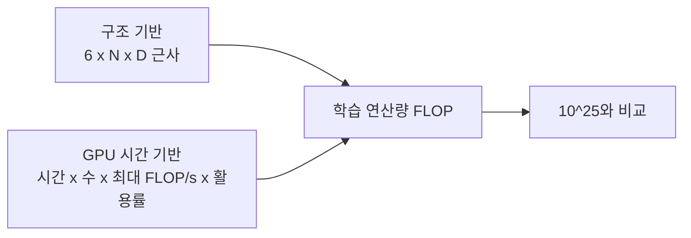
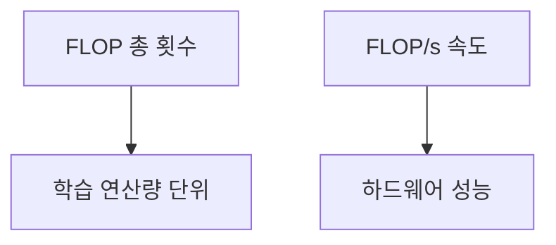

# FLOP(연산량)

> 모델을 학습하는 동안 수행한 부동소수점 연산의 총 횟수. 모델의 "학습에 쓴 계산량"을 재는 단위이며, EU AI Act는 10^25 FLOP를 시스템 리스크 추정 기준으로 쓴다.

## 쉽게 말하면
책 한 권을 쓰는 데 든 "계산 문제를 푼 총 개수"다. 계산기가 1초에 몇 개를 푸는지(FLOP/s)와 총 몇 개를 풀었는지(FLOP)는 다르다.

## 자세히
출처는 Epoch AI "Estimating training compute"(열람)와 AI Act 51조(열람).
- **FLOP vs FLOP/s**: FLOP는 총 횟수(학습 연산량 단위), FLOP/s는 속도(하드웨어 최대 성능). 곱셈-덧셈 하나(FMA)는 2 FLOP로 센다. 페타플롭-일(petaflop-day)은 약 1e20 FLOP.
- **방법 1: 구조 기반**: 순전파 연산량을 구조로 추정한다(여러 층에서 대략 연결 수 또는 매개변수 수의 2배). 역전파는 순전파의 약 2배라 한 학습 단계는 순전파의 약 3배다. `학습 연산량 ≈ 3 × (예제당 순전파 FLOP) × 에폭 × 학습 예제 수`. 조밀(dense) 모델에서는 대략 6 × 매개변수 수 × 토큰 수가 된다(이 등치는 글 필자의 해석, 원문 표현 아님).
- **방법 2: GPU 시간 기반**: `연산량 = 학습 시간 × 가속기 수 × 최대 FLOP/s × 활용률`. 최대 FLOP/s는 하드웨어 데이터시트. 활용률은 100%보다 훨씬 낮아 대형 언어 모델은 약 0.3, 다른 신경망은 약 0.4가 제안되고 0.75 초과는 드물다. 정밀도(FP16, FP32)도 맞춰야 한다.
- **글의 예**: V100 2,500일, 125 TFLOP/s(FP16 텐서), 활용률 30% → 0.30 × 125e12 × 2,500 × 86,400 ≈ 8.1e21 FLOP(직접 재계산해 일치).
- **권장**: 구조를 알면 방법 1이 낫다(활용률 추정이 어려움). 가능하면 둘 다 계산해 확인하며 보통 약 2배 안쪽으로 일치한다고 한다.
- **규모 감각(이 글의 계산)**: 6 × N × D 근사로 700억 매개변수 × 15조 토큰은 6.3×10^24 FLOP로 10^25보다 약간 작다. 10^25를 넘으려면 매개변수 1,000억일 때 토큰이 약 16.7조여야 한다. 이는 근사 계산이며 실제 학습의 연산량 산정은 별도다.
- **규제 맥락**: 51조 2항은 누적 학습 연산량이 10^25 FLOP를 넘으면 높은 영향 능력을 추정하고, 위임법으로 이 기준값을 바꿀 수 있다([시스템 리스크 모델](#systemic-risk-model)). 부속서 XIII (c)는 연산량 외 대리 지표(비용·시간·에너지)도 허용한다([부속서 XIII 기준](#annex-xiii-criteria)).

## 그림으로 보기

## 예시
- 위 근사: 700억 매개변수 × 15조 토큰 → 6.3×10^24 FLOP.
- 교육 실습: 자기 소개용 가상 모델(매개변수 10억, 토큰 1조)의 학습 연산량을 6×N×D로 계산하고 10^25와 몇 배 차이인지 구한다.

## 헷갈리는 것과 비교
| 개념 | 차이 |
|---|---|
| FLOP | 총 연산 횟수 |
| FLOP/s | 초당 연산 속도 |
| 매개변수 수 | 모델 크기 |
| [부속서 XIII 기준](#annex-xiii-criteria) | 연산량을 포함한 지정 기준 |

## 더 읽을거리
- [Epoch AI: Estimating training compute](https://epoch.ai/blog/estimating-training-compute) — 두 추정 방법(열람)
- [AI Act Article 51](https://artificialintelligenceact.eu/article/51/) — 10^25 FLOP 추정(열람)
