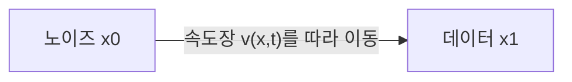
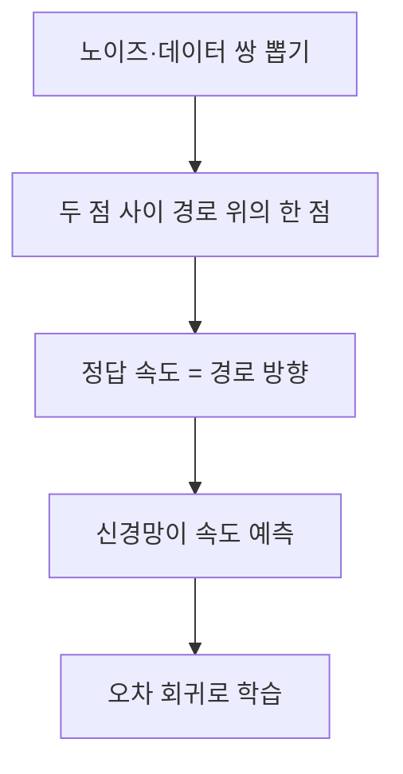

# 플로 매칭

> **플로 매칭(Flow Matching)** 은 노이즈를 데이터로 옮기는 "흐름(속도장)"을 직접 회귀로 학습하는 생성 모델 학습법이다. 확산 모델의 친척이며, 이미지·로봇 행동 생성에 쓰인다.

## 쉽게 말하면
물감 한 방울이 물에 퍼지는 영상을 거꾸로 돌려, 흩어진 점들이 그림으로 모이는 길을 배우는 것이다. 확산 모델이 "노이즈를 조금씩 걷어내는 법"을 배운다면, 플로 매칭은 "각 점이 어느 방향으로 얼마나 빨리 가야 하는지(속도)"를 배운다.

## 자세히
(Lipman 외, arXiv 2210.02747 초록 확인)
- **CNF(연속 정규화 흐름)** 를 **시뮬레이션 없이** 학습한다: 고정된 조건부 확률 경로의 **벡터장을 회귀**한다.
- 노이즈↔데이터를 잇는 **가우시안 경로 족** 전반에 적용되며, 확산 경로는 그중 특수한 경우다. 저자들은 확산 모델을 FM으로 학습하면 더 견고·안정적이라고 보고한다.
- **최적 수송(OT)** 변위 보간 경로가 확산 경로보다 학습·샘플링이 빠르고 일반화가 낫다고 주장하며, ImageNet에서 우도·샘플 품질 모두 확산 기반 방법을 앞섰다고 보고한다.
- 샘플링은 표준 **ODE 풀이기**로 적은 단계에 가능하다.
- 로봇 쪽 활용(예: 행동 생성 정책)은 이 글에서 직접 확인하지 않았다(일반 지식).

## 그림으로 보기



## 예시
```python
# 개념 코드: 직선 경로 플로 매칭
x0 = torch.randn_like(x1)           # 노이즈
t = torch.rand(len(x1),1)
xt = (1-t)*x0 + t*x1                # 경로 위의 점
loss = ((model(xt,t) - (x1-x0))**2).mean()
```
- 업무 예: 로봇 팔의 다음 동작 묶음을 노이즈에서 생성해 낼 때 확산 대신 쓰는 방식.

## 헷갈리는 것과 비교
| 개념 | 차이 |
|---|---|
| 확산 모델 | 노이즈 제거 과정을 학습, 단계 많음 |
| 플로 매칭 | 속도장 회귀, 경로 선택이 자유롭고 샘플링이 빠른 편 |
| GAN | 판별자와 경쟁 학습 |
| 정규화 흐름 | 가역 변환, CNF는 그 연속 버전 |

## 더 읽을거리
- [Flow Matching for Generative Modeling](https://arxiv.org/abs/2210.02747) — 원 논문 초록.
