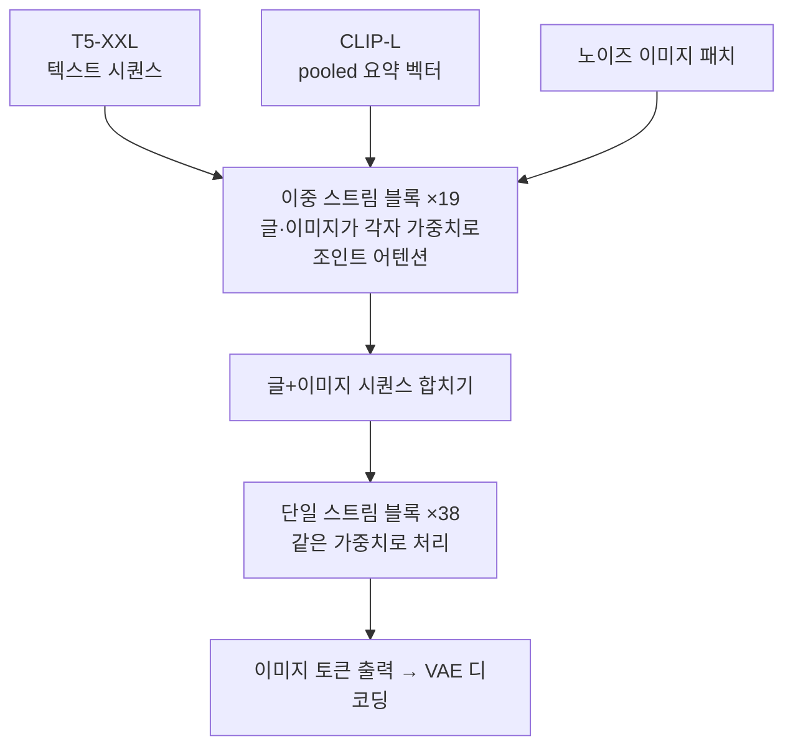

# FLUX 구조

> Black Forest Labs의 FLUX.1 이미지 생성 모델. MMDiT 계열 트랜스포머를 변형해, 글·이미지 토큰을 함께 처리하는 "이중 스트림" 블록 다음에 합쳐서 처리하는 "단일 스트림" 블록을 쌓았다.

## 쉽게 말하면
조인트 어텐션이 "주문서와 캔버스를 한 테이블에 펼쳐 놓는" 방식이라면, FLUX는 앞쪽 공정(이중 스트림)에서는 주문서와 캔버스를 각자 전담 직원이 다루며 서로 참고하게 하고, 뒤쪽 공정(단일 스트림)에서는 둘을 하나의 문서로 합쳐 한 팀이 마무리한다. 앞에서 서로의 특성을 살리고 뒤에서 효율을 챙기는 분업이다.

## 자세히
**구성 요소(Hugging Face diffusers 문서)**
- **텍스트 인코더 2개**: CLIP ViT-L/14(문장 전체를 요약한 pooled 임베딩 담당)와 T5-XXL(토큰 시퀀스 임베딩, `max_sequence_length`로 길이 조절). SD3보다 CLIP이 하나 적다.
- **트랜스포머**: `FluxTransformer2DModel`. 기본 설정은 **이중 스트림 DiT 블록 19층 + 단일 스트림 블록 38층**, 어텐션 헤드 24개 × 헤드 차원 128, 조인트 어텐션 차원 4096, pooled 투영 768, 회전 위치 임베딩(RoPE) 축 차원 (16, 56, 56). 이중 스트림은 이미지·텍스트가 각자 가중치를 쓰는 [조인트 어텐션](#joint-attention), 단일 스트림은 합쳐진 시퀀스를 같은 가중치로 처리한다(코드 파라미터 설명 기준).
- **스케줄러**: 흐름 매칭 오일러. VAE는 `AutoencoderKL`.
- **메모리**: 모든 구성요소 로딩에 약 50GB RAM/VRAM이 든다고 문서에 안내되어 있고, CPU 오프로딩·그룹 오프로딩·양자화(8비트, FP8)로 줄인다.

**변형(저장소 모델 표·문서)**
| 모델 | 용도 | 라이선스 |
|---|---|---|
| FLUX.1 [schnell] | 텍스트→이미지, 타임스텝 증류로 약 4스텝, `guidance_scale=0` | Apache-2.0 |
| FLUX.1 [dev] | 텍스트→이미지, 가이던스 증류(`guidance_scale≈3.5`, 약 50스텝) | FLUX.1-dev 비상업 |
| Fill / Canny / Depth [dev] | 인페인팅·구조 조건(채널 연결 방식, ControlNet 아님) | 비상업 |
| Redux [dev] | 이미지 변형 | 비상업 |
| Kontext [dev] | 문맥 이미지 편집 | 비상업 |
| Krea [dev] | 텍스트→이미지 | 비상업 |
Pro 등급은 API로만 제공되고 가중치가 공개되지 않는다. 오픈 가중치의 상업적 사용은 Black Forest Labs 라이선스와 월 사용량 기반 요금이 필요하다(저장소 안내).

**주의**: 이 노드는 문서에서 확인되는 구조·기본 설정만 적었다. 파라미터 수(보통 12B로 알려짐)와 정류 흐름 방식 설명은 이 세션에서 확인한 1차 문서에 없어 쓰지 않았다.

## 그림으로 보기



## 예시
```python
import torch
from diffusers import FluxPipeline
pipe = FluxPipeline.from_pretrained("black-forest-labs/FLUX.1-schnell",
                                    dtype=torch.bfloat16)
pipe.enable_model_cpu_offload()
image = pipe("A cat holding a sign that says hello world",
             guidance_scale=0.0, num_inference_steps=4,
             max_sequence_length=256).images[0]
```
업무 예: 마케팅 시안을 빠르게 뽑을 땐 schnell(상업 이용 가능한 라이선스), 품질이 중요하면 API의 Pro 등급을 검토한다(라이선스 조건은 직접 확인).

## 헷갈리는 것과 비교
| 개념 | 차이 |
|---|---|
| [MMDiT](#mmdit)(SD3) | 글·이미지 별도 가중치 + 조인트 어텐션 블록만 반복 |
| FLUX | 이중 스트림 이후 단일 스트림 블록을 추가한 변형 |
| 증류(schnell·dev) | 스텝 수·가이던스 계산을 학습으로 압축해 빠르게 |
| [확산 모델](#diffusion-model) | 노이즈에서 이미지를 만드는 큰 갈래 |

## 더 읽을거리
- [FLUX (Hugging Face diffusers)](https://huggingface.co/docs/diffusers/api/pipelines/flux) — 파이프라인·변형·메모리 최적화
- [FluxTransformer2DModel 문서](https://huggingface.co/docs/diffusers/api/models/flux_transformer) — 블록 수와 기본 하이퍼파라미터
- [black-forest-labs/flux (GitHub)](https://github.com/black-forest-labs/flux) — 모델 표와 라이선스
