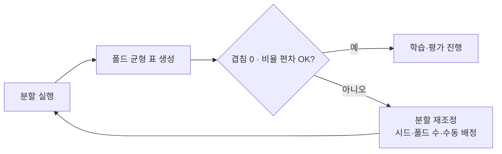

# 폴드 균형 표

> 교차검증으로 나눈 뒤 **폴드별 크기·양성 비율·그룹 수·학습/테스트 겹침**을 한 표로 모아 확인하는 습관. 분할이 의도대로 됐는지 모델 학습 전에 잡아내는 가장 싼 검사다.

## 쉽게 말하면
반 배정을 마친 뒤 "반별 인원, 남녀 수, 형제 겹침"을 출석부 한 장에 정리해 훑어보는 것이다. 이상한 반이 있으면 시험을 보기 전에 고친다.

## 자세히
- **열 구성**: fold, n_test(테스트 크기), pos_rate(양성 비율), groups(테스트 그룹 수), overlap(학습·테스트에 걸친 그룹 수, 0이어야 함).
- **직접 실행**(scikit-learn 1.9.1, 합성 환자 100명·샘플 약 1,570개, StratifiedGroupKFold 5-폴드, seed 1):

| fold | n_test | pos_rate | groups | overlap |
|---|---|---|---|---|
| 0 | 308 | 0.140 | 16 | 0 |
| 1 | 309 | 0.133 | 25 | 0 |
| 2 | 314 | 0.134 | 18 | 0 |
| 3 | 323 | 0.152 | 21 | 0 |
| 4 | 320 | 0.141 | 20 | 0 |

- **읽는 법**: overlap이 0이 아니면 누수, pos_rate가 전체 비율에서 크게 벗어나면 층화 실패, groups 수가 폴드마다 크게 다르면 그룹 크기 편차가 큰 것(위 표는 16~25)이다. 폴드 크기가 달라도 폴드별 점수를 **가중 평균**할지 점검한다.
- **자동화**: 분할 직후 assert로 겹침 0, 비율 편차 한도(예: ±0.03)를 검사하면 파이프라인이 알아서 멈춘다. 한도는 데이터에 맞게 정하는 값이지 표준이 아니다.

## 그림으로 보기


## 예시
```python
import pandas as pd
rows = [dict(fold=k, n=len(te), pos=y[te].mean(),
             groups=len(set(g[te])), overlap=len(set(g[tr]) & set(g[te])))
        for k,(tr,te) in enumerate(cv.split(X, y, g))]
print(pd.DataFrame(rows))
assert all(r["overlap"] == 0 for r in rows)
```

## 헷갈리는 것과 비교
| 개념 | 차이 |
|---|---|
| 폴드 균형 표 | 분할 **구조** 점검(학습 전) |
| [그룹 겹침 검증](#group-overlap-check) | 표의 overlap 열만 따로 검사 |
| 폴드별 성능 보고 | 학습 후 점수 점검 |
| [층화와 그룹의 충돌](#stratify-vs-group) | 표에서 비율·겹침이 동시에 보이는 이유 |

## 더 읽을거리
- [scikit-learn 교차검증 가이드](https://scikit-learn.org/stable/modules/cross_validation.html) — 그룹·층화 분할기 설명.
- [StratifiedGroupKFold API](https://scikit-learn.org/stable/modules/generated/sklearn.model_selection.StratifiedGroupKFold.html) — 분할기 동작과 한계.
