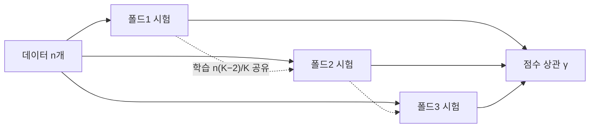
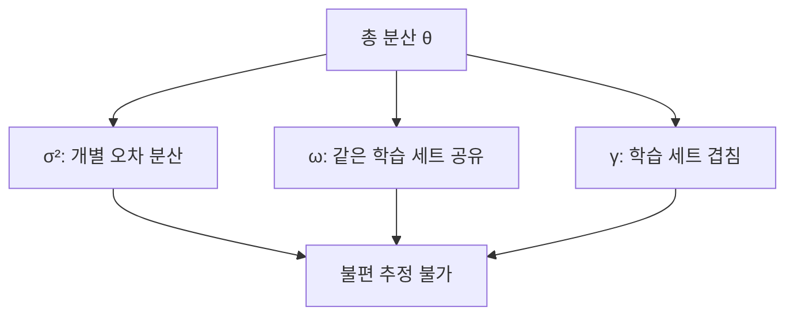

# 폴드 간 상관

> k겹 교차 검증에서 각 폴드(시험 블록)의 오차는 **서로 독립이 아니다.** 학습 세트가 크게 겹치고 한 폴드가 다른 폴드들의 학습에 쓰이기 때문에 오차 사이에 양의 상관이 생기고, 이를 무시하면 분산을 크게 과소평가한다.

## 쉽게 말하면
시험 5번을 보는데, 매번 교재의 80%가 같다고 하자. 5번의 점수는 서로 다른 독립 실험이 아니라 "거의 같은 공부를 한 사람의 점수"다. 평균의 흔들림을 "5개 독립 관측"처럼 계산하면 너무 자신만만해진다.

## 자세히
- **겹침의 크기**: n개 데이터, K겹이면 두 폴드의 학습 세트가 공유하는 데이터가 n(K−2)/K개(Bengio & Grandvalet 2004). 10겹이면 학습 데이터의 약 89%가 서로 겹친다.
- **분산의 세 성분(논문 분석, 공분산 행렬의 고유값이 3종뿐)**
  1. σ²: 같은 크기 학습 세트로 학습한 모델의 "진짜 새 데이터" 오차 분산.
  2. ω(블록 내 공분산): 같은 학습 세트로 평가된 시험 예제들의 오차가 공유하는 의존성.
  3. γ(블록 간 공분산): 학습 세트 겹침과 "폴드 k가 다른 모든 학습에 쓰임" 때문에 생기는 의존성.
- **결론(JMLR 5, 2004)**: 어떤 분포에서도 성립하는 **K겹 CV 분산의 불편 추정량은 존재하지 않는다.** 세 성분을 분리해 추정할 수 없기 때문이다.
- **순진한 추정**: 모든 오차를 독립으로 놓은 θ̂1은 상관을 무시해 큰 표본에서도 크게 편향된다(논문 Figure 1). 상관을 반영한 θ̂2는 불편이라고 그림에서 보이지만 이는 데이터를 새로 반복 생성할 수 있는 설정 얘기이고, 실제 단일 데이터셋에서는 쓸 수 없다.
- **실무 대응**: 오차 막대에 √K를 그대로 쓰지 말고 ① 반복 CV로 안정화, ② [보정 재표집 t-검정](#nadeau-bengio-corrected-ttest), ③ 외부 시험 세트, ④ 폴드 간 점수 상관을 직접 확인(같은 분할의 두 모델 점수 상관이 높으면 쌍체 비교가 유리하지만 독립 가정은 여전히 깨짐).
- scikit-learn 예시에서 두 모델의 폴드별 점수 상관이 0.88(rbf-linear)에 달했다(분할 난이도가 모두에게 영향).

## 그림으로 보기

## 예시
- 10겹 CV에서 폴드 점수 sd=0.02면 naive SE=0.02/√10≈0.0063이지만, 상관이 있으면 실제 불확실성은 이보다 크다. "±0.6%p"를 그대로 발표하지 않는다.
- 두 모델을 같은 폴드로 비교할 때 폴드별 차이의 분산만 쓰면(쌍체) 공통 난이도는 제거되나 독립성 문제는 남는다.

## 헷갈리는 것과 비교
| 개념 | 설명 |
|---|---|
| 폴드 간 상관 | 폴드 오차 사이의 의존성(원인) |
| [오차 막대 과소평가](#cv-error-bar-underestimation) | 상관을 무시한 결과 |
| 데이터 누수 | 시험 정보가 학습에 새는 오류(별개 문제) |
| 홀드아웃 | 단일 시험 세트: 상관 문제는 적지만 학습 분산을 못 봄 |

## 더 읽을거리
- [Bengio & Grandvalet 2004, JMLR 5](https://jmlr.org/papers/volume5/grandvalet04a/grandvalet04a.pdf) — 원문 열어 확인(요약·세 성분 해석).
- [scikit-learn: 그리드 서치 통계 비교](https://scikit-learn.org/stable/auto_examples/model_selection/plot_grid_search_stats.html) — 폴드 상관 0.88 등 수치.
