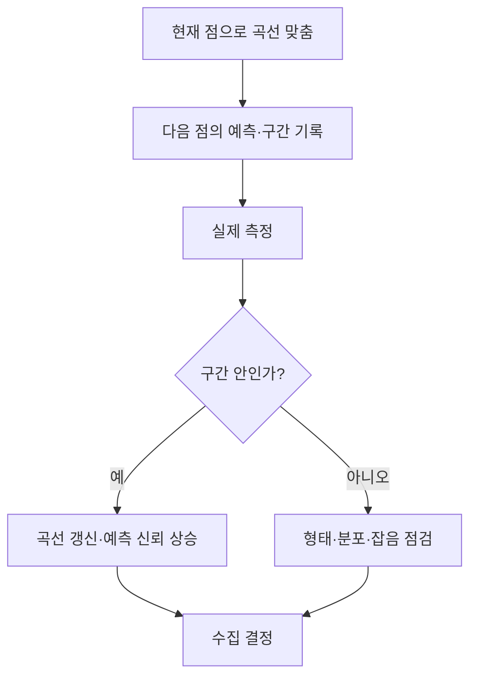

# 후속 실측 검증

> 학습 곡선 외삽이 가리킨 구간의 **일부를 실제로 학습·측정해** 예측이 맞는지 확인하고, 그 점을 곡선에 더해 다시 맞춘다. 가장 싸고 효과 큰 외삽 불확실성 감소 방법이다.

## 쉽게 말하면
지도 없이 걷다가 한참 앞의 지형을 짐작할 때, 다음 언덕까지 한 번 가 보고 확인하면 그 뒤의 예측이 훨씬 정확해진다. 실측 점 하나가 외삽 거리를 줄여 준다.

## 자세히
- **직접 시뮬레이션(순수 파이썬, 300회 반복)**: 진짜 곡선 ε = 2.0·m^(−0.35) + 0.05(곱셈 잡음 2%), 기본 7점(10³~6.4×10⁴)으로 맞춘 뒤 **16배·100배** 지점의 평균 절대 상대 오차(올바른 형태 가정):
  | 사용한 점 | 16배 지점 오차 | 100배 지점 오차 |
  |---|---|---|
  | 기본 7점 | 10.6% | 17.0% |
  | + 2배 지점 1점 추가 | 6.2% | 10.5% |
  | + 2배·4배 2점 추가 | **3.6%** | **6.4%** |
  새 점 두 개로 100배 외삽 오차가 17.0% → 6.4%(약 1/3)로 줄었다. 점을 하나 늘리는 비용(2~4배 데이터 학습)이 큰 외삽 오차를 줄이는 가치가 있다([외삽 거리 제한](#extrapolation-distance-limit)).
- **절차(권장)**
  1. 기존 점으로 곡선을 맞추고 **다음 한 점**(예: 최대 크기의 2배)의 예측과 [구간](#curve-fit-uncertainty-bootstrap)을 **미리 기록**한다.
  2. 그 크기로 실제 학습·측정한다(시드 2~3개).
  3. 측정값이 예측 구간 안인가? 밖이면 형태 오류·잡음·분포 변화를 의심([형태 오지정](#model-misspecification-extrapolation)).
  4. 새 점을 포함해 다시 맞추고 목표 크기 예측을 갱신.
  5. 데이터 수집·라벨링 투자 결정은 **갱신된 예측**으로.
- **이점**: ① 예측이 틀렸음을 빨리 발견 ② 외삽 배수 감소 ③ 사전에 예측을 적어 두면 사후 합리화를 막는다.
- **비용 대비 판단**: 후속 측정 비용 = 해당 크기 학습 비용 + 라벨링 비용. 목표 데이터 크기가 매우 크면(예: 100만 건 라벨링) 중간 점 하나가 수백만 원 라벨링 결정을 바꿀 수 있다.
- **대안/보완**: 사람 라벨 없이 이미 확보한 **미라벨 데이터**로 자기지도·의사 라벨 효과를 별도 측정하거나, 같은 크기의 다른 도메인 곡선과 비교(일반 아이디어).
- **한계**: 위 시뮬레이션은 올바른 형태·고정 검증 세트 가정이다. 측정 점도 시험 세트 잡음을 가지므로 [신뢰구간](#independent-test-ci)을 붙인다.

## 그림으로 보기

## 예시
- 라벨 6.4만 건에서 오류 9.8%. 25만 건이면 8.9%(구간 8.5~9.4%)라고 예측했는데 12.8만 건(2배)을 실제 측정해 9.3%(예측 9.3%와 일치) → 25만 건 투자 계획을 진행.
- 측정 후 예측 갱신: `fit(sizes + [128000], errors + [0.093]).predict(1_000_000)`.

## 헷갈리는 것과 비교
| 방법 | 역할 |
|---|---|
| 외삽 | 측정 없이 예측 |
| 후속 실측 | 외삽을 일부 검증하고 보강 |
| 사전 기록 | 예측 구간을 사전에 남겨 사후 합리화 방지 |
| [외삽 낙관 편향](#extrapolation-optimism) | 보완 대상 |

## 더 읽을거리
- [Deep Learning Scaling is Predictable, Empirically (arXiv 1712.00409)](https://arxiv.org/abs/1712.00409) — 학습 곡선 기반 데이터 수집 계획 맥락(PDF 본문 확인). 점 추가 효과 표는 이 글의 직접 시뮬레이션.
