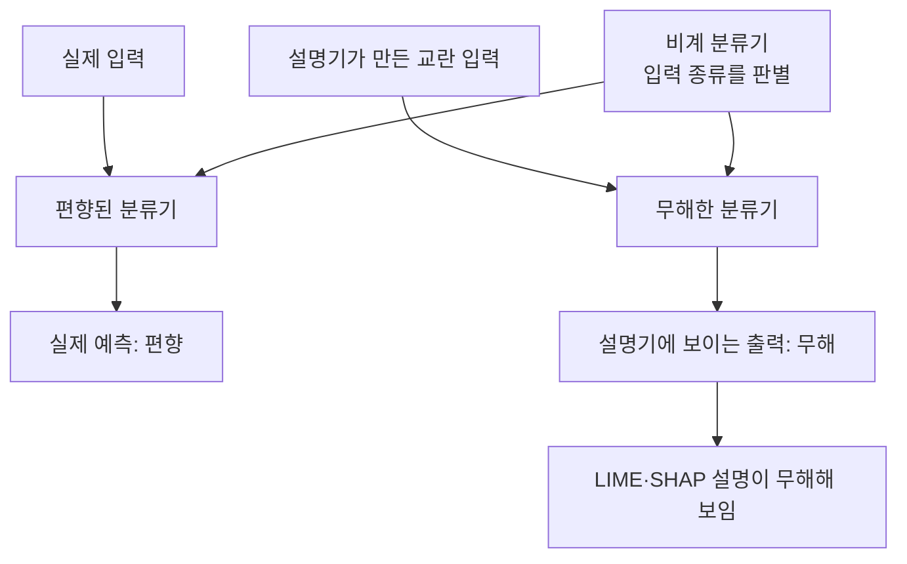

# LIME·SHAP 속이기

> LIME과 SHAP 같은 **입력 교란 기반 사후 설명**이 조작될 수 있음을 보인 연구(Slack 외, 2019~2020). 실제 입력에서는 편향된 예측을 하면서, 설명 도구에는 무해해 보이는 이유가 나오게 만드는 "비계(scaffolding)" 분류기를 만들 수 있다.

## 쉽게 말하면
시험관이 학생을 시험할 때 특정 방식으로 문제를 바꿔 넣는 것을 학생이 알아차리고, 그 문제에서만 모범 답안을 내는 것과 같다. 평소 행동은 편향돼 있어도 검사받을 때는 얌전해 보이게 만드는 속임수다.

## 자세히
출처: Slack·Hilgard·Jia·Singh·Lakkaraju, "Fooling LIME and SHAP: Adversarial Attacks on Post hoc Explanation Methods"(arXiv 1911.02508, 2019-11 제출, 2020-02 개정). 초록만 열어서 읽었고 방법 세부(분포 판별기 구성 등)는 확인하지 못했다.
- **문제**: 의료·형사 사법 같은 영역에서 블랙박스 모델이 쓰이고, 도메인 전문가는 설명을 보고 오류와 편향을 찾는다. 그 설명이 믿을 만한지가 쟁점이다.
- **주장(초록)**: 입력 교란에 의존하는 사후 설명 기법(LIME, SHAP)은 **신뢰하기 어렵다**.
- **공격(초록)**: 비계 기법으로 적대자가 분류기의 편향을 무해해 보이는 설명 뒤에 숨긴다. 실제 입력에서는 편향된 예측을 유지하면서 설명은 무해하게 나온다.
- **실험(초록)**: COMPAS를 포함한 여러 실제 데이터셋에서, 이렇게 만든 심하게 편향된 분류기가 **LIME과 SHAP를 모두 속일 수 있음**을 보였다.
- **직관(일반 설명, 초록 서술이 아님)**: 교란 기반 설명기는 모델에 실제 데이터와 다른 "교란된 입력"을 넣어 본다. 그 분포가 실제 데이터와 구분되면 모델이 두 종류 입력에서 다르게 행동하도록 설계할 수 있다.
- **시사점**: 설명을 감사 증거로 쓸 때는 설명 도구의 출력을 곧바로 모델의 진실로 받아들이지 않고, 모델에 대한 접근·독립 감사·내재적 해석 모델과의 교차 확인을 함께 해야 한다는 주장으로 이어진다([사후 설명의 정확도 검증](#post-hoc-explanation-validity)).
- **한계**: 이 공격은 적대자가 모델을 직접 설계할 수 있는 상황을 전제한다. 악의 없이 만든 일반 모델에서 같은 문제가 얼마나 일어나는지는 이번 출처로 확인하지 못했다.

## 그림으로 보기

## 예시
- 대출 모델이 실제로는 보호 속성의 대리 변수에 의존하지만, 설명기를 돌리면 소득·부채 같은 정당한 변수만 상위로 나오는 상황.
- 점검: 설명 결과 외에 입력 교란 없이 모델 행동을 직접 시험(집단별 승인율, 반사실 시험)하는 감사를 병행.

## 헷갈리는 것과 비교
| 개념 | 차이 |
|---|---|
| LIME·SHAP 속이기 | 설명 조작 공격 연구 |
| [SHAP 오해와 조작](#shap-misinterpretation) | 일반적 해석 위험과 조작 가능성 |
| [설명 충실도](#explanation-fidelity) | 설명이 모델을 반영하는 정도 |
| 적대적 예제 | 입력을 바꿔 모델을 속임, 여기는 설명기를 속임 |

## 더 읽을거리
- [Fooling LIME and SHAP (arXiv 1911.02508)](https://arxiv.org/abs/1911.02508) — 초록과 주요 결과(열어서 확인)
