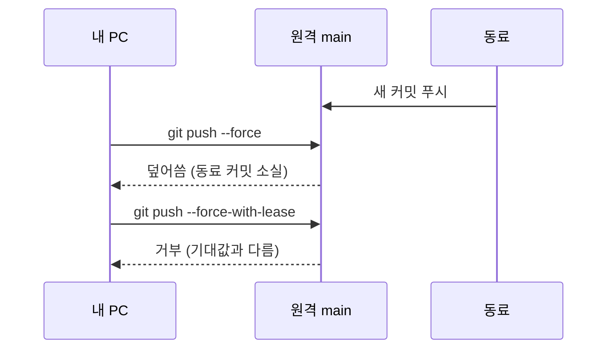

# force push 위험

> force push는 원격 브랜치를 내 기록으로 강제로 덮어쓰는 것이라, 다른 사람이 올린 커밋을 조용히 지울 수 있어 `--force-with-lease`로 안전장치를 거는 게 좋다.

## 쉽게 말하면
공유 문서를 "내 버전으로 전체 덮어쓰기" 하는 것과 같다. 그 사이 동료가 쓴 내용이 있어도 확인 없이 사라진다. `--force-with-lease`는 덮어쓰기 전에 "내가 마지막으로 본 상태 그대로일 때만" 허락하는 확인 단계다.

## 자세히
git-push 매뉴얼(2026-11 확인):
- `--force`(`-f`, `+refspec`): 빨리감기가 아니어도 덮어쓰고 다른 안전 검사와 lease 검사까지 끈다. 원격이 커밋을 잃을 수 있다. 여러 ref가 대상이면 현재 브랜치 외 ref도 덮을 수 있어 `git push origin +main`처럼 하나만 지정하는 편이 안전하다.
- `--force-with-lease`: 원격 ref가 기대값과 같을 때만 덮어씀. 형태 3가지(맨 형태, `=<ref>`, `=<ref>:<sha>`). 맨·ref 형태는 로컬 원격 추적 브랜치를 기준 삼으므로 백그라운드 `git fetch`가 그걸 갱신하면 보호가 무력해진다.
- `--force-if-includes`: lease와 함께 써서 원격 변경을 로컬에 통합했는지 reflog로 확인. `push.useForceIfIncludes = true`로 기본화 가능.
- 가장 강한 형태는 `--force-with-lease=<ref>:<sha>`(매뉴얼은 의미가 바뀔 수 있는 실험적 기능이라 표기).
- 기록 재작성 후(예: [git-filter-repo](#git-filter-repo)) 협업자는 merge가 아니라 재클론·rebase해야 옛 기록이 되살아나지 않는다(GitHub Docs).

## 그림으로 보기

## 예시
rebase 후 올릴 때: `git push --force-with-lease --force-if-includes origin feature`. AI 에이전트에게는 "force push 금지, 필요하면 --force-with-lease만"이라고 규칙을 박아 둔다.

## 헷갈리는 것과 비교
| 개념 | 차이 |
|---|---|
| `--force` | 무조건 덮어씀 |
| `--force-with-lease` | 기대 상태일 때만 덮어씀 |
| `--force-if-includes` | 원격 변경을 통합했는지 추가 확인 |
| [키 교체](#secret-rotation) | 노출 대응은 force push보다 먼저 |

## 더 읽을거리
- [git-push 문서](https://git-scm.com/docs/git-push) — 세 옵션의 정확한 동작.
